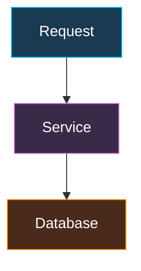
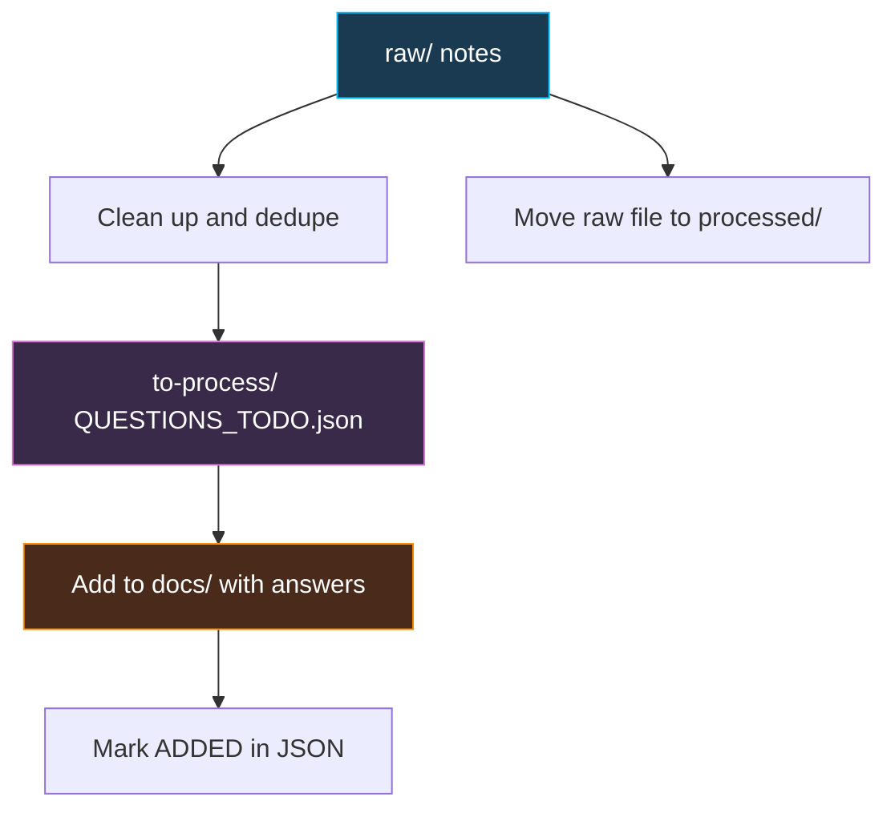

# CONTRIBUTING.md — Guidelines for All Contributors

**Read this before editing, adding content, or contributing to this repository.** This file contains the standards, patterns, rules, and workflow for working on the interview playbook.

---

## 🎯 Repository Overview

A structured interview-preparation knowledge base, published with MkDocs (Material theme) to GitHub Pages. Two kinds of content make up most of the work:

1. **Learning material**: topic pages under `docs/<section>/` (Java Core, Spring, Databases, and so on).
2. **Question bank**: interview questions with answers under `docs/interview-questions/`.

```
.
├── docs/                  # published site content (PUBLIC)
│   ├── index.md           # home page
│   ├── <section>/         # learning material, one folder per section
│   ├── interview-questions/
│   │   ├── coding/        # coding problems
│   │   └── verbal/        # verbal Q&A, one file per domain
│   ├── resources/         # long-form references (roadmap, code-review guidelines)
│   └── feedback.md        # public feedback page
├── todo/                  # content intake pipeline + TASKS.md (committed, NOT published)
├── mkdocs.yml             # site config and navigation
├── CONTRIBUTING.md        # this file
└── README.md              # project intro and local setup
```

---

## ⚠️ Publishing Model & Safety

### Content Visibility
- Everything under `docs/` is **published to a public site**.
- `todo/` is committed to git but **not published**. The GitHub repository may still be public, so the same safety rules apply to it.
- Editing notes, format instructions, and meta-guidance belong in this file, never on published pages.

### What NOT to Include
- **No employer/client-specific information**: no company, client, or internal product names, system/service names, endpoints, ticket IDs, hostnames, cluster names, account/client IDs, or internal URLs.
- Use generic descriptions instead (e.g., "an aggregation microservice", "a downstream transaction service", "our payment provider").
- **No personal or sensitive data** of any kind.
- **No internal editing notes** or "how to write this page" text on published pages.

### Change Control
- **Do not delete existing content without the owner's approval.**
- Complete the [mandatory checklist](#mandatory-checklist) before committing.

---

## 🧩 Keep the Site Working

**Every change must include the follow-on changes that keep the published site working.** A change isn't done until navigation, index pages, and links are consistent with it. This applies to every contributor, and especially to AI assistants: make these updates as part of the same change, without waiting to be asked.

| When you... | Also update |
| :-- | :-- |
| **Add a page** | Register it in `mkdocs.yml` `nav:` · add it to the section `index.md` · add "See also" links to and from related pages · update `docs/index.md` if it's a new section |
| **Rename or move a page** | Update its `mkdocs.yml` entry · fix **every inbound link** (search for the old filename in `docs/`, including absolute `/anandu-interview-playbook/...` links inside HTML) · update the section `index.md` |
| **Delete a page** | Remove its `mkdocs.yml` entry · remove or redirect **every inbound link** · remove it from the section `index.md` · get owner approval first |
| **Split a page** | Register the new pages in `mkdocs.yml` · add cross-links between the parts · repoint inbound links (including `#anchor` links) to the part that now holds the content |
| **Rename a heading** | Fix links to its `#anchor` (search for the old anchor in `docs/`) |
| **Add or change questions** | Keep "📚 Learn more" links valid; make sure the learning page links back to the questions |
| **Change a section's scope** | Update the section `index.md` description and its one-liner on `docs/index.md` |

### Verify Before Committing
- Find inbound links to a changed file: `grep -rn "old-file-name" docs`
- Find pages missing from navigation: every `docs/**/*.md` file should appear in `mkdocs.yml` (MkDocs reports pages that aren't in the nav when you build).
- Build the site with `mkdocs build --strict`. It fails on broken links and missing files; fix every warning before committing.
- Open the changed pages with `mkdocs serve` and click their links.

---

## 🔀 Git Workflow

| Who | Workflow |
| :-- | :-- |
| **Repository owner** | Commits directly to `main`. |
| **Other contributors** | Create a feature branch, open a PR, and wait for the owner's approval before merge. |
| **AI assistants** | Propose a high-level plan first, make the changes, summarize them, then **wait for explicit approval before committing**. Never push unless asked. |

### Git Safety
- **Stage only the files you intend to commit** by naming them (`git add path/to/file.md`). Never use `git add -A` or `git add .`.
- When asked to "commit staged changes", commit exactly what is already staged; do not stage anything else.
- Review `git status` and `git diff --staged` before every commit.
- Commit messages: short imperative summary of *what and why* (e.g., "Add switch statement types to Java basics").

### Publishing
- The site rebuilds automatically on push/merge to `main` (`.github/workflows/deploy.yml`) and goes live within minutes.
- After publishing, spot-check the changed pages for broken links or rendering issues.

---

## 🗂️ Organizing Content: Topics & Subtopics

### Where Does New Content Go?

Work through these questions in order:

1. **Does the content already exist?** Search `docs/` first (`grep -ri "keyword" docs`). If it exists, **update it** instead of creating a duplicate.
2. **Is it a concept within an existing page's topic?** → Add a new `##`/`###`/`####` heading in that page.
3. **Is it a distinct topic within an existing section?** → Create a new file in that section folder.
4. **Does the section's nav group exceed 8 pages?** → Add **sub-groups** inside the section in `mkdocs.yml` (e.g., Spring → Core / Data / Security / Reactive) instead of a new top-level section.
5. **Is it a new subject area that fits no section?** → Create a new section folder with an `index.md`, and register it in `mkdocs.yml` and `docs/index.md`.

### Size Limits

Limits exist for readability and ease of maintenance. They differ by page type:

| Page type | Limit | Split trigger & method |
| :-- | :-- | :-- |
| **Learning page** (`docs/<section>/*.md`) | 300–600 lines target, **800 max** | Over 800 lines or more than ~8 `##` sections → split by subtopic or into `-advanced` / `-deep-dive` files |
| **Question bank** (`verbal-*`, `coding-*`) | **25 questions per file** | Over 25 questions → split by subtopic (e.g., `verbal-spring-boot-core-questions.md`, `verbal-spring-boot-data-questions.md`) |
| **Long-form reference** (`docs/resources/`) | Exempt | Must use collapsibles and rely on the page table of contents |
| **Nav group** (a section in `mkdocs.yml`) | **8 pages max** | Over 8 → add sub-groups inside the section |

When splitting, add "See also" cross-references between the resulting files and update every inbound link.

### Naming Conventions
- **Files and folders**: lowercase kebab-case (`spring-boot-advanced.md`, `java-core/`).
- **Split suffixes**: `-fundamentals`, `-advanced`, `-deep-dive`, or a specific subtopic name.
- **Question files**: `verbal-{domain}-questions.md`, `coding-{topic}.md`.
- **Every section folder** has an `index.md` overview page.

---

## 🛠️ Workflows

### Adding or Updating Learning Material
1. Search `docs/` to confirm the content doesn't already exist.
2. Choose the location using [Where Does New Content Go?](#where-does-new-content-go).
3. Read 1–2 existing pages in the same section and match their style.
4. Write the content using the [Learning Page Formatting](#learning-page-formatting) rules.
5. Check the size limits; split if needed.
6. Make the follow-on updates in [Keep the Site Working](#keep-the-site-working) (nav, index pages, links).
7. Link related interview questions to the new content (and vice versa).
8. If the topic was listed in `todo/TASKS.md`, tick it off.
9. Run `mkdocs build --strict` and check the page renders correctly with `mkdocs serve`.

### Adding Interview Questions
1. **Deduplicate**: search the matching `verbal-*` / `coding-*` file (and related ones) for the same or a paraphrased question. If one exists, improve that answer instead.
2. Pick the domain file. If it already has 25 questions, split it first (see [Size Limits](#size-limits)).
3. **Append** new questions at the end with the next number. Don't renumber existing questions — other pages may link to them.
4. Use the matching [question template](#interview-question-templates).
5. Add a "📚 Learn more" link to the related learning page. If no learning page covers the concept, add the concept to that page (or log it in `todo/TASKS.md` → Content gaps).
6. If the question came from the `todo/` pipeline, mark it `ADDED` in `QUESTIONS_TODO.json`.

### Tracking Work: `TASKS.md` and `feedback.md`
- [`todo/TASKS.md`](todo/TASKS.md) is the single internal list of pending work: fixes, refactors, splits, **and topics still to be written**. Tick items off when done. Don't create "backlog" or "to add" pages under `docs/`.
- `docs/feedback.md` is the public feedback page; don't use it for internal notes.

---

## 📝 Formatting Guide

### General Principles
- **Structured over prose**: headings, bullets, tables, and code over long paragraphs.
- **Interview-useful**: include edge cases, gotchas, and likely follow-up questions.
- **Accurate**: verify facts; don't invent technical details. Label personal project experience separately from general knowledge.
- **Example-driven**: show real Java/Spring/YAML code whenever feasible.
- **Preserve existing content**: update rather than duplicate; keep the existing structure.

### Learning Page Formatting

**Heading levels**
- One `#` title per page.
- `##` for major sections, `###` for subsections, `####` for individual concepts inside a long page.
- Don't skip levels (no `##` followed directly by `####`).

**Recommended structure for a concept**
1. One-paragraph explanation of what it is and why it matters.
2. Code example(s).
3. Comparison table (when contrasting options or versions).
4. Gotchas / under-the-hood notes.
5. **Common interview questions** (short Q → A bullets).
6. Reference links (Baeldung, official docs, JEPs).

**Example**: See the "Switch Statements" section in `docs/java-core/basics.md`.

**Java versions**: when a feature is version-dependent, state the version (e.g., "Switch expression (Java 14)") and mark preview features as preview.

### Markdown Rules
- Code blocks always have a language tag: ` ```java `, ` ```yaml `, ` ```sql `, ` ```bash `.
- Code must be correct and compilable (or clearly marked as a fragment). Use `// ✅ Good` / `// ❌ Bad` pairs to contrast patterns.
- Tables: keep to ~5 columns or fewer so they stay readable on smaller screens.
- Admonitions for callouts: `!!! note "Title"`, `!!! warning`, `!!! tip`.
- **No emoji in numbering** (write `10. Topic`, not `🔟 Topic`). Emoji are fine as occasional section markers.

### Collapsibles (`<details>`)
Markdown is **not** reliably rendered inside raw HTML blocks. Inside `<details>`:
- Use HTML only: `<h3>`, `<h4>`, `<p>`, `<b>`, `<ul>/<li>`, `<table>`.
- Fenced code blocks (` ```java `) do render and may be used.
- Leave a blank line after `<summary>...</summary>` and before `</details>`.

### Links
| Where the link is | Format | Why |
| :-- | :-- | :-- |
| Markdown text (learning pages) | Relative path to the `.md` file: `[Streams](../java-collections-concurrency/streams.md)` | MkDocs validates and rewrites it |
| Raw HTML (inside `<details>`) | Absolute site path, no `.md`: `<a href="/anandu-interview-playbook/java-core/basics/">` | MkDocs does not rewrite HTML links |

Verify every link target exists.

### Mermaid Diagrams (Dark-Mode Safe)
The site defaults to dark mode, so default Mermaid colors are hard to read.
- Prefer vertical layouts (`graph TD`) over wide horizontal ones (`graph LR`).
- Keep diagrams small (about 12 nodes or fewer); split large flows.
- Use dark fills, bright strokes, and white text:



---

## 🎓 Content Patterns by Topic Type

### Annotations & API References
- **Summary table**: annotation/API with its purpose.
- **Code examples**: constructor, setter, and field patterns; highlight best practice (constructor injection first).
- **Configuration YAML**: realistic config with comments explaining each field.
- **Profile-specific examples**: dev vs. prod when relevant.

**Example**: `docs/spring-web/spring-boot.md` (common annotations section)

### Design Patterns & Architecture
- **Organize by category**: resilience, communication, data patterns, etc.
- **Pattern structure**: motivation → how it works → example → trade-offs.
- **Code examples**: real Spring/Java code; framework-native and custom implementations.
- **Comparison tables**: contrast similar patterns by throughput, latency, cost, rollback speed.
- **Diagrams**: Mermaid for flows (event choreography, state transitions, deployment cutover).

**Example**: `docs/microservices-distributed/principles.md`

### Performance & Tuning
- **Issue → Root Cause → Fix table** for quick lookup.
- **Real config**: JVM flags and YAML tuning with concrete values.
- **Tools section**: tools with use cases and one-liner commands.
- **Before/After**: poor pattern vs. optimized pattern (e.g., N+1 queries).

**Example**: `docs/java-patterns-advanced/advanced.md` (GC) and `docs/java-patterns-advanced/logging-performance.md`

### Section Index Pages
- **Brief intro** (1–2 sentences) on the topic area.
- **Topic list** with keyword-dash one-liners (e.g., "DI - Lifecycle - Profiles").
- **Optional**: Quick Interview Prep bullets.

**Example**: `docs/spring-web/index.md`

---

## ❓ Interview Question Templates

### Coding Problems (`docs/interview-questions/coding/`)

````markdown
## N. Question Title

<details>
<summary>View Solution</summary>

<h3>Problem</h3>
<p>Problem statement with example input/output.</p>

<h3>Approach 1: Method Name</h3>
```java
// complete, runnable code
```
<p>Explanation.</p>

<h3>Approach 2: Alternative Method</h3>
(2–3 approaches minimum)

<h4>Complexity Comparison</h4>
(HTML table: Approach | Time | Space | Pros | Cons)

<h4>Key Insight: Topic</h4>
<ul>
<li>Insight 1</li>
</ul>

<p>📚 <a href="/anandu-interview-playbook/path/to/topic/">Learn more: Topic</a></p>

</details>

---
````

**Requirements**: 2–3+ approaches, complexity comparison table, complete runnable code, key insights.

### Verbal Questions (`docs/interview-questions/verbal/`)

One file per domain: `verbal-{domain}-questions.md`
- `verbal-java-core-questions.md`
- `verbal-java-advanced-questions.md`
- `verbal-design-patterns-questions.md`
- `verbal-spring-boot-questions.md`
- `verbal-db-questions.md`
- `verbal-microservices-questions.md`
- `verbal-system-design-questions.md`
- `verbal-devops-questions.md`
- `verbal-ml-ai-questions.md`

```markdown
## N. Question Title

<details>
<summary>View Answer</summary>

<h3>Direct Answer</h3>
<p>Clear, concise answer.</p>

<h3>Why / Context</h3>
<p>Detailed reasoning.</p>

<h3>Comparison Table</h3>
(When applicable: Property | Option A | Option B)

<h3>Example / Real-World Use</h3>
<p>Practical scenario or code.</p>

<h3>When to Use</h3>
<ul>
<li>Use case 1</li>
</ul>

<p>📚 <a href="/anandu-interview-playbook/path/to/topic/">Learn more: Topic</a></p>

</details>

---
```

**Requirements**: Direct answer → Why → Table → Example → When to use.

### Rules for Both
- Summary text: **"View Solution"** for coding problems, **"View Answer"** for verbal questions.
- No "All Questions" list at the top of the page.
- Number sequentially (`## 1. Title`, `## 2. Title`); append new questions at the end.
- `---` separator between questions.
- HTML inside collapsibles (see [Collapsibles](#collapsibles-details)).
- Every answer ends with a "📚 Learn more" link to the related learning page.

---

## 📥 Content Intake Pipeline (`todo/`)

Raw interview notes and topic ideas pass through `todo/` before they reach `docs/`. The folder is committed but **not published**.

| Folder | Contents | Rules |
| :-- | :-- | :-- |
| `todo/raw/` | Unprocessed input: interview notes, question dumps, topic ideas. | Paste as-is, but **scrub employer/client names and personal data before committing**. Use a `.txt` or `.md` extension. |
| `todo/to-process/` | Cleaned-up, deduplicated items **ready to add** to `docs/`. | Questions go in `QUESTIONS_TODO.json`. Topic ideas go in `todo/TASKS.md` → Content gaps. |
| `todo/processed/` | Raw files that have been fully extracted. | Kept for reference only; don't edit. |
| `todo/TASKS.md` | All pending work: fixes, refactors, splits, and topics to write. | Work through it batch by batch; tick items off when done. |

### Flow



1. **Capture**: drop raw content into `todo/raw/`.
2. **Clean up**: rewrite each item as a clear, standalone question; split combined questions; drop pure behavioural or company-specific ones unless they're useful generically.
3. **Deduplicate**: check against `QUESTIONS_TODO.json` **and** the existing `docs/interview-questions/` files.
4. **Queue**: add the cleaned items to `todo/to-process/QUESTIONS_TODO.json` with a unique ID, source file, status, and short notes.
5. **Archive**: move the raw file to `todo/processed/` once everything is extracted.
6. **Publish in batches**: add questions to `docs/` using the [question templates](#interview-question-templates), then mark them `ADDED`.

### `QUESTIONS_TODO.json` Rules
- **IDs**: category prefix + number (`SB_001`, `KFK_004`). IDs are never reused or renumbered.
- **Status values**:

| Status | Meaning |
| :-- | :-- |
| `NEW` | Cleaned up, not in the repo yet; ready to add |
| `REVIEW` | Might already exist in the repo; check before adding |
| `DUPLICATE` | Already covered in the repo (note where); skip |
| `ADDED` | Added to `docs/` (note the file and question number) |

- **Counts are derived, never hand-typed**: if the file keeps `count`/`total` fields, recompute them from the actual entries whenever the file changes.
- Question text may be edited during clean-up; once a question is `ADDED`, update only `status` and `notes`.

---

<a id="mandatory-checklist"></a>
## ✅ Mandatory Checklist Before Committing

### 1. Placement & Size
- [ ] Searched `docs/` for existing coverage (no duplicates)
- [ ] Content placed per [Where Does New Content Go?](#where-does-new-content-go)
- [ ] File within [size limits](#size-limits); split if not, with cross-references

### 2. Navigation & Index Pages (see [Keep the Site Working](#keep-the-site-working))
- [ ] New, renamed, moved, or deleted files reflected in `mkdocs.yml` `nav:`
- [ ] Every `docs/**/*.md` page is in the nav (no orphan pages)
- [ ] Nav group has 8 pages or fewer (otherwise add sub-groups)
- [ ] Section `index.md` updated with a keyword-dash one-liner
- [ ] `docs/index.md` updated if a new section was added

### 3. Links
- [ ] "See also" links added; related pages link to the new content
- [ ] Questions link to learning pages and vice versa
- [ ] Relative links in Markdown, absolute site links inside HTML
- [ ] All link targets exist
- [ ] Inbound links fixed for any renamed, moved, split, or deleted page or heading

### 4. Formatting
- [ ] Matches the style of other files in the same section
- [ ] HTML (not Markdown) inside `<details>`
- [ ] Code blocks have language tags; code is correct
- [ ] Mermaid diagrams use dark-mode colors
- [ ] No emoji in numbering

### 5. Safety
- [ ] No employer/client names, internal identifiers, or personal data
- [ ] No internal editing notes on published pages

### 6. Verify & Commit
- [ ] `mkdocs build --strict` passes; changed pages render correctly in `mkdocs serve`
- [ ] `QUESTIONS_TODO.json` / `TASKS.md` updated if relevant
- [ ] Only intended files staged (`git status`, `git diff --staged`)
- [ ] Changes summarized; approval received (AI assistants and PR contributors)

---

## 💻 Local Development

```sh
python -m venv .venv
source .venv/bin/activate          # macOS/Linux
# .venv\Scripts\Activate.ps1       # Windows PowerShell

pip install mkdocs-material
mkdocs serve                       # http://127.0.0.1:8000
```

Click through every changed page and link before committing.

---

## 💡 Quick Reference for AI Assistants

1. **Read this file first**, then read 1–2 existing files in the target section.
2. **Plan first**: give the owner a high-level summary of intended changes before editing.
3. **Follow** the workflows, formatting guide, and templates above.
4. **Keep the site working**: make every follow-on change (nav, index pages, inbound links) as part of the same change, without being asked. See [Keep the Site Working](#keep-the-site-working).
5. **Complete** the [mandatory checklist](#mandatory-checklist).
6. **Summarize** changed files, open issues, and decisions needed.
7. **Wait** for explicit approval before committing. Stage only named files. Never push unless asked.
