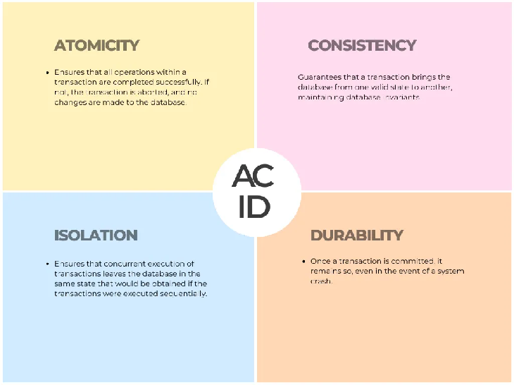

# Databases

## ACID

* A transaction is a group of operations executed as a single unit of work.
  An example of a transaction is when money is transferred between bank accounts. Money must be debited from one account and credited to another.

* If a database fulfills the following aspects of ACID compliance, it is known to be ACID-compliant.
  Atomicity compliance ensures that all transactions are completed successfully. If not, the transaction is aborted, and no changes are made to the database.

* Database transactions, also known as atoms, can be divided into smaller components to ensure their integrity.

* During a transaction, either all operations occur, or none do. If a debit is successfully deducted from one account, Atomicity guarantees that the corresponding credit is applied to the other account.

1. **Atomicity**
   Atomicity is all based around this idea of togetherness. When carrying out any kind of database transaction, it often consists of multiple operations. With atomicity, either every operation succeeds or none of them do. This is important because the operations can have an impact on each other, so one failing can lead to unexpected results.

   Think of a financial transaction, for example. You are paying a friend $250 for a holiday you are going on. The whole transaction would consist of the money leaving your account and arriving in the recipient’s account. If there was no atomicity, it is possible that money leaves your account but doesn’t arrive at the other end, resulting in you being debited the money but still owing the recipient.

2. **Consistency**
   Consistency is about ensuring that changes made as part of a transaction are consistent with any database constraints. If the data at any stage goes against these constraints, the whole transaction will fail.

   Unless you have an agreed overdraft, banks, for example, will expect your balance to be positive. So if you tried to withdraw more money than you have available, this would break a constraint and fail, rolling back all operations in that transaction.

3. **Isolation**
   Isolation is there to make sure that all transactions are run in an isolated environment without interfering with each other.

   Sticking with the financial example, imagine you have a bank balance of $200 and you try to withdraw $100 at an ATM. At the same time, a standing order you have set up comes out for $100. With isolation, these transactions can occur concurrently, ensuring that your ending balance is $0, not $100, because the transactions impacted each other.

4. **Durability**
   Durability is another important element of ACID because it ensures that no matter what happens, once a transaction is complete, the changes in that transaction are written to the database. This makes sure that data changes are persisted, even in the event of a power failure or system crash.

Normalization ?
Types of DB ?

	Data Definition Language(DDL)
		Create
		drop
 		alter
		truncate
	Data Manipulation Language(DML)
		insert
		update
		delete
	Data Control Language(DCL)
		grant
		revoke
	Transaction Control Language(TCL)
		commit
		rollback
		save point
	Data Query Language(DQL)
		select

	Constraints
		Not Null
		Unique
		primary key
		foreign key
		check
		default

	Joins
		join/ inner join
		right join
		left join
		outter join/ FULL OUTER JOIN
		CROSS JOIN
		NATURAL JOIN
	Set Operations
		union
		intersect
		except

	index
	Triggers
	Procedures

## Database Types

### Relational (SQL)
- MySQL, PostgreSQL, Oracle, SQL Server, MariaDB
- **Structure:** Tables with rows/columns, ACID transactions
- **Use:** Business apps, financial systems, anything needing transactions
- **Pros:** Strong consistency, complex queries (JOINs), ACID guarantees
- **Cons:** Less flexible schema, scaling horizontally is hard

### NoSQL

#### Document Databases
- MongoDB, CouchDB, Firebase
- **Structure:** JSON-like documents, flexible schema
- **Use:** Content management, user profiles, catalogs
- **Pros:** Flexible, fast reads/writes, scales horizontally
- **Cons:** No strong ACID, eventual consistency

#### Key-Value Stores
- Redis, Memcached, DynamoDB
- **Structure:** Simple key → value mapping
- **Use:** Caching, sessions, leaderboards, real-time
- **Pros:** Ultra-fast, simple, scales well
- **Cons:** Limited query capabilities

#### Column-Family Databases
- HBase, Cassandra, Google BigTable
- **Structure:** Data stored by column families (optimized for analytics)
- **Use:** Time-series data, analytics, massive scale (petabytes)
- **Pros:** Extreme scalability, columnar compression
- **Cons:** Complex, eventual consistency

#### Graph Databases
- Neo4j, ArangoDB
- **Structure:** Nodes and relationships
- **Use:** Social networks, recommendations, knowledge graphs
- **Pros:** Fast relationship queries, natural modeling
- **Cons:** Specialized use cases

#### Search Engines
- Elasticsearch, Solr
- **Structure:** Inverted indexes for full-text search
- **Use:** Search, logging, analytics
- **Pros:** Fast full-text search, powerful aggregations
- **Cons:** Not transactional

### When to Use Which

| Need | Type | Example |
|------|------|---------|
| **ACID transactions** | SQL | Banking, inventory |
| **Flexible schema** | Document (MongoDB) | Content management |
| **Ultra-fast reads/writes** | Key-Value (Redis) | Caching, sessions |
| **Time-series/analytics** | Column-Family (Cassandra) | Metrics, logs |
| **Relationships** | Graph (Neo4j) | Social network |
| **Full-text search** | Search (Elasticsearch) | Search results |

**[See more: SQL & Relational](sql.md) | [NoSQL & Scaling](scaling.md)**

Db improvements / efficiency - design principles

SQL injection - prevention

JPA
Hibernet
MyBatis

Concurrency model - optimistic / pessimistic ?

**JPA** - **Jakarta Persistence API**
	Java ORM standard for storing, accessing, and managing Java objects in a relational or NoSQL database.
	Annotations - [https://www.techferry.com/articles/hibernate-jpa-annotations.html#Version](https://www.techferry.com/articles/hibernate-jpa-annotations.html#Version)

	JDBC vs JPA
		https://www.baeldung.com/jpa-vs-jdbc

## Cheat Sheets

[https://www.interviewbit.com/sql-cheat-sheet](https://www.interviewbit.com/sql-cheat-sheet)
[https://learnsql.com/blog/sql-basics-cheat-sheet/](https://learnsql.com/blog/sql-basics-cheat-sheet/)
[https://www.sqltutorial.org/sql-cheat-sheet/](https://www.sqltutorial.org/sql-cheat-sheet/)

## BASE (NoSQL) & CAP
- **BASE** — Basically Available, Soft state, Eventual consistency (NoSQL trade-off vs ACID).
- **CAP theorem** — under a network partition you choose **Consistency** or **Availability**
  (Partition tolerance is mandatory in distributed systems).
- RDBMS lean ACID/strong consistency; many NoSQL stores lean AP + eventual consistency.
