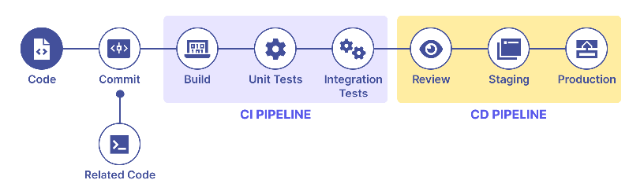
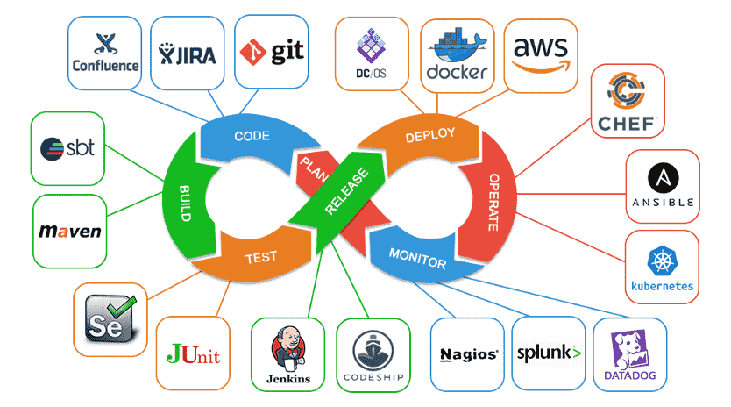
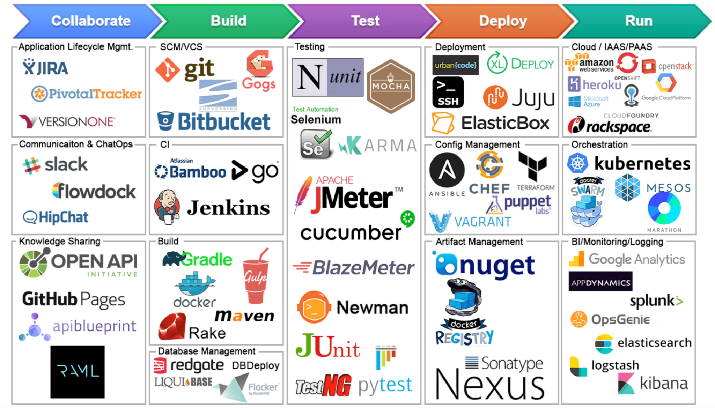

# CI/CD

## Definitions
- **CI (Continuous Integration)** — merge frequently; every push triggers **build + test** to catch issues early.
- **CD (Continuous Delivery)** — every change is *release-ready*; deploy is a manual approval.
- **Continuous Deployment** — every green change auto-deploys to production.

## Typical pipeline stages
`checkout → build → unit tests → static analysis (SonarQube) → package (jar/image) → integration tests → publish artifact → deploy → smoke tests`

## Tools
- **Jenkins** (pipelines as `Jenkinsfile`), **GitHub Actions**, GitLab CI, CircleCI, Argo CD (GitOps).
- Artifacts: Nexus/Artifactory; images: container registry.

## Deployment strategies

| Strategy | How | Downtime | Cost | Rollback | Best for |
|----------|-----|----------|------|----------|----------|
| **Blue-green** | Two identical environments; deploy to idle one, smoke-test, switch router/ALB | None | High (2x infra) | Instant (switch back) | Critical flows (payments) |
| **Canary** | Send a small % (e.g. 5%) to the new version, watch error rate/latency, ramp 10/25/50/100% | None | Low | Fast (drop canary) | High-traffic services, risky features |
| **Rolling** | Replace instances one by one behind readiness probes (Kubernetes default) | None | Low | Slow (roll back the same way) | Standard stateless services |
| **Recreate** | Stop all old instances, then start new ones | Yes | None | Slow | Internal tools, batch jobs |

- **Rolling and canary run two versions at once**, so database schema changes must be backward compatible (expand, migrate, contract).
- Canary promotion should be automated from metrics (Prometheus/Grafana alerts, Argo Rollouts/Flagger).
- Kubernetes manifests and shadow deployments: [Kubernetes Deployment Strategies](kubernetes-deployment-strategies.md).

## GitOps
Declarative desired state in git; a controller (**Argo CD**/Flux) syncs the cluster to match. Git is the source of truth.

## Good practices
- Fast, reliable pipelines; fail fast; quality gates (coverage, security scans).
- Immutable artifacts promoted across envs (dev → UAT → prod); no rebuild per env.
- Automated rollback; secrets from a vault, never in the pipeline config.

## Diagrams

**Practice questions:** [DevOps & Cloud](../interview-questions/verbal/verbal-devops-questions.md)
