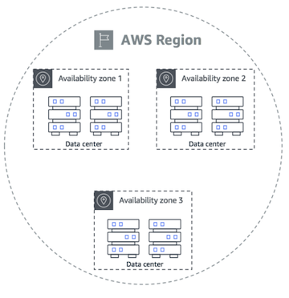
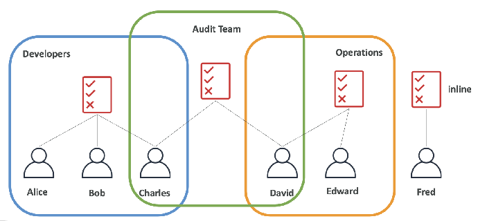
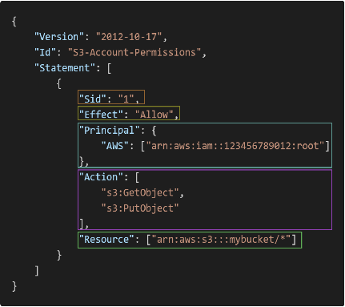
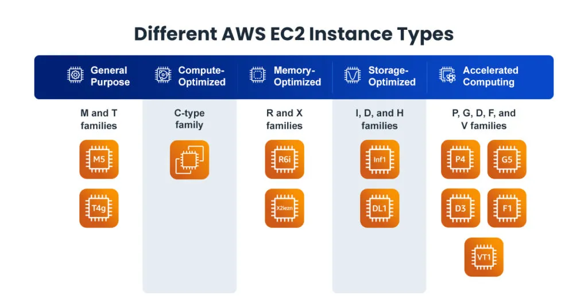
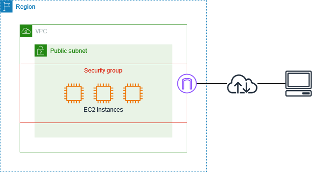

# AWS

## AWS Global Infrastructure

## AWS Regions

* AWS has Regions all around the world
* Names can be us-east-1, eu-west-3…
* A region is a cluster of data centers
* Most AWS services are region-scoped

Choose an AWS Region based on

* Compliance
* Proximity
* Available services
* Pricing

## AWS Availability Zones

* Each region has many availability zones (usually 3, min is 3, max is 6).
  Example:
  * Ap-southeast-2a
  * Ap-southeast-2b
  * ap-southeast-2c
* Each availability zone (AZ) is one or more discrete data centers with redundant power, networking, and connectivity
* They’re separate from each other, so that they’re isolated from disasters
* They’re connected with high bandwidth, ultra-low latency networking



## AWS Points of Presence (Edge Locations)

Content is delivered to end users with lower latency

## AWS Identity & Access Management (AWS IAM)

## Users

Root account created by default, shouldn’t be used or shared
Users are people within your organization, and can be grouped

## Groups

Groups only contain users, not other groups
Users don’t have to belong to a group, and user can belong to multiple groups


## Roles

Some AWS service will need to perform actions on your behalf
To do so, we will assign permissions to AWS services with IAM Roles
Common roles:

* EC2 Instance Roles
* Lambda Function Roles
* Roles for CloudFormation

## Policies


Consists of

* **Version**: policy language version, always include “2012-10-17”
* **Id**: an identifier for the policy (optional)
* **Statement**: one or more individual statements (required)

Statements consists of

* **Sid**: an identifier for the statement (optional)
* **Effect**: whether the statement allows or denies access (Allow, Deny)
* **Principal**: account/user/role to which this policy applied to
* **Action**: list of actions this policy allows or denies
* **Resource**: list of resources to which the actions applied to
* **Condition**: conditions for when this policy is in effect (optional)

## MFA

Users have access to your account and can possibly change configurations or delete resources in your AWS account
You want to protect your Root Accounts and IAM users
MFA = password you know + security device you own

## How can users access AWS

To access AWS, you have three options:

* AWS Management Console (protected by password + MFA)
* AWS Command Line Interface (CLI): protected by access keys
* AWS Software Developer Kit (SDK) - for code: protected by access keys

### Access Keys

Access key ID: AKIASK4E37PV4983d6C
Secret Access Key: AZPN3zojWozWCndIjhB0Unh8239a1bzbzO5fqqkZq
Remember: don’t share your access keys

### AWS CLI

It’s open-source [https://github.com/aws/aws-cli](https://github.com/aws/aws-cli)

## IAM Security Tools

### IAM Credentials Report (account-level)

A report that lists all your account's users and the status of their variouscredentials

### IAM Access Advisor (user-level)

Access advisor shows the service permissions granted to a user and when those services were last accessed.
You can use this information to revise your policies.

## IAM Guidelines & Best Practices

* Don’t use the root account except for AWS account setup
* One physical user = One AWS user
* Assign users to groups and assign permissions to groups
* Create a strong password policy
* Use and enforce the use of Multi Factor Authentication (MFA)
* Create and use Roles for giving permissions to AWS services
* Use Access Keys for Programmatic Access (CLI / SDK)
* Audit permissions of your account using IAM Credentials Report & IAM Access Advisor
* Never share IAM users & Access Keys

## Shared Responsibility Model for IAM

| AWS | You |
| :---- | :---- |
| Infrastructure (global network security) Configuration and vulnerability analysis Compliance validation   | Users, Groups, Roles, Policies management and monitoring Enable MFA on all accounts Rotate all your keys often Use IAM tools to apply appropriate permissions Analyze access patterns & review permissions |

## Summary

* **Users**: mapped to a physical user, has a password for AWS Console
* **Groups**: contains users only
* **Policies**: JSON document that outlines permissions for users or groups
* **Roles**: for EC2 instances or AWS services
* **Security**: MFA + Password Policy
* **AWS** **CLI**: manage your AWS services using the command-line
* **AWS** **SDK**: manage your AWS services using a programming language
* **Access** **Keys**: access AWS using the CLI or SDK
* **Audit**: IAM Credential Reports & IAM Access Advisor

## EC2

Amazon EC2 (Elastic Compute Cloud) is a core service within Amazon Web Services (AWS) that provides secure, resizable computing capacity in the cloud. It essentially allows you to rent virtual servers, called instances, on which you can run your applications.

**1. Virtual Servers (Instances)**

* EC2 instances are virtual servers hosted in the AWS cloud.
* They provide customizable configurations of CPU, memory, storage, and networking to suit different workloads.

**2. Amazon Machine Images (AMIs)**

* Instances are launched from AMIs, which contain the operating system, applications, and configurations.
* You can select from AWS-provided AMIs, community AMIs, or create your own.

**3. Instance Types**
AWS provides various instance types optimized for different purposes, including General Purpose, Compute Optimized, Memory Optimized, Storage Optimized, Accelerated Computing (using GPUs), and High-Performance Computing (HPC) Optimized.

**4. Pricing Models**
EC2 offers several pricing options: On-Demand (pay-as-you-go), Savings Plans and Reserved Instances (commit to usage for discounts), Spot Instances (bid on unused capacity), Dedicated Hosts (physical server for your use), and a Free Tier for new users.

**5. Benefits**
Key benefits of EC2 include scalability, flexibility in configurations, cost-effectiveness through various pricing models, high availability and reliability, and leveraging AWS security features.

**6. Use Cases**
EC2 is used for a variety of workloads such as web hosting, application development and testing, big data, machine learning, HPC, and disaster recovery.

**7. Key Security Practices**
Important security practices for EC2 involve securing your VPC, configuring security groups and NACLs, using IAM roles, protecting against malware, and enforcing the principle of least privilege.

## EC2 Instance types



Amazon EC2 offers a broad selection of instance types tailored to diverse workloads, providing flexibility in choosing the ideal combination of CPU, memory, storage, and networking capacity. These instance types are organized into different families, each designed for specific use cases.

### 1. General Purpose Instances:

* Description: Offer a balanced mix of compute, memory, and networking resources suitable for a wide range of workloads that use these resources in equal proportions.
* Examples: Web servers, application servers, small and medium databases, gaming servers, backend servers for companies, and development/testing environments.
* Instance Families: Mac, T (T2, T3, T3a, T4g), M (M4, M5, M5a, M5n, M5zn, M6a, M6g, M6i, M6in, M7a, M7g, M7i, M7i-flex, M8g), A (A1).
* Key Features (Examples):
  * T instances: Burstable performance for workloads with occasional activity spikes, using a CPU credit system.
  * M instances: Offer a balanced CPU-to-memory ratio, suitable for applications like mid-size databases and enterprise apps.
  * M8g: Powered by AWS Graviton4 processors, offering excellent price-performance for general purpose workloads.
  * Mac: Based on Apple Mac Mini computers, allowing you to run macOS workloads in the cloud.

### 2. Compute Optimized Instances:

* Description: Designed for applications demanding high-performance processors and significant computing power.
* Examples: High-performance web servers, scientific modeling, batch processing, gaming servers, ad server engines, machine learning inference.
* Instance Families: C, Hpc.
* Key Features (Examples):
  * C-series: High compute performance with less memory overhead, optimized for speed in CPU-intensive tasks.
  * C7g: Utilizes Arm-based AWS Graviton3 processors for superior price-performance.

### 3. Memory Optimized Instances:

* Description: Ideal for applications processing large data sets in memory and requiring fast performance.
* Examples: In-memory databases, real-time data analytics, data warehousing, machine learning, and big data processing frameworks like Apache Spark and Hadoop.
* Instance Families: R, X, Z.
* Key Features (Examples):
  * R-series: Higher memory-to-vCPU ratio for memory-heavy workloads like in-memory caching and real-time big data analytics.
  * X1/X1e: Highest memory-to-compute ratio for demanding memory-intensive applications like SAP HANA.
  * R7g: Powered by AWS Graviton processors, supporting Elastic Fabric Adapter (EFA) for enhanced networking.

### 4. Storage Optimized Instances:

* Description: Designed for workloads requiring high read and write access to large datasets on local storage.
* Examples: Big data analytics, data warehousing, databases, and OLTP systems.
* Instance Families: I, D, H.
* Key Features (Examples): Features include those optimized for price-performance with Graviton2 processors (Im4gn), high-density HDD storage (D2), and low-latency NVMe SSD storage for high IOPS (I3/I3en).

### 5. Accelerated Computing Instances:

* Description: Use hardware accelerators like GPUs or FPGAs to speed up compute-intensive tasks.
* Examples: Machine learning training and inference, HPC, graphics processing, and video rendering.
* Instance Families: P, G, F, Inf, Trn, DL, VT.
* Key Features (Examples): Features include NVIDIA GPUs for ML/HPC (P instances), AWS Inferentia chips for ML inference (Inf instances), AWS Trainium chips for deep learning training (Trn instances), and optimization for graphics-intensive applications (G instances).

### 6. High-Performance Computing (HPC) Optimized Instances:

* Description: Built for running HPC workloads efficiently at scale.
* Examples: Large-scale simulations, financial modeling, and deep learning.
* Instance Families: Hpc6a, Hpc6id, Hpc7a, Hpc7g.
* Key Features (Examples): Features include those with 4th Gen AMD EPYC processors for high performance (Hpc7a) and those designed for memory-bound and data-intensive HPC with Intel Xeon Scalable processors (Hpc6id).

### 7. Burstable Performance Instances:

* Description: Offer a baseline CPU performance that can increase when needed.
* Examples: Web servers, development/testing environments, and small/medium databases.
* Instance Families: T (T2, T3, T3a, T4g).
* Key Features (Examples): Features include better baseline performance and unlimited mode support (T3) and improved price-performance with AWS Graviton2 processors (T4g).

### Important Considerations When Choosing an Instance Type:

* Workload characteristics: Understand your application's resource needs.
* Performance requirements: Evaluate the necessary performance levels.
* Cost considerations: Balance performance with budget, considering different pricing models.
* Scalability needs: Determine if auto-scaling is required.

## Instances Purchasing Options

* [**On-Demand Instances**](https://docs.aws.amazon.com/AWSEC2/latest/UserGuide/ec2-on-demand-instances.html) – Pay, by the second, for the instances that you launch.
* [**Savings Plans**](https://docs.aws.amazon.com/savingsplans/latest/userguide/what-is-savings-plans.html) – Reduce your Amazon EC2 costs by making a commitment to a consistent amount of usage, in USD per hour, for a term of 1 or 3 years.
* [**Reserved Instances**](https://docs.aws.amazon.com/AWSEC2/latest/UserGuide/ec2-reserved-instances.html) – Reduce your Amazon EC2 costs by making a commitment to a consistent instance configuration, including instance type and Region, for a term of 1 or 3 years.
* [**Spot Instances**](https://docs.aws.amazon.com/AWSEC2/latest/UserGuide/using-spot-instances.html) – Request unused EC2 instances, which can reduce your Amazon EC2 costs significantly.
* [**Dedicated Hosts**](https://docs.aws.amazon.com/AWSEC2/latest/UserGuide/dedicated-hosts-overview.html) – Pay for a physical host that is fully dedicated to running your instances, and bring your existing per-socket, per-core, or per-VM software licenses to reduce costs.
* [**Dedicated Instances**](https://docs.aws.amazon.com/AWSEC2/latest/UserGuide/dedicated-instance.html) – Pay, by the hour, for instances that run on single-tenant hardware.
* [**Capacity Reservations**](https://docs.aws.amazon.com/AWSEC2/latest/UserGuide/capacity-reservation-overview.html) – Reserve capacity for your EC2 instances in a specific Availability Zone.

## EC2 User Data

EC2 User Data is a powerful feature in Amazon EC2 that allows you to provide scripts or directives to your instances when they launch. This data is executed automatically during the boot process of the instance.

How it works:

* You create a script: This script can be written in a scripting language like Bash (for Linux instances) or PowerShell (for Windows instances).
* You include the script in User Data: When you launch an EC2 instance, you provide the script in the User Data field. This can be done through the AWS Management Console, AWS CLI, or AWS SDKs/APIs.
* The instance executes the script: During the instance's first boot cycle, the User Data script runs with root privileges on Linux or administrator privileges on Windows.

Use Cases:

* **Software Installation**: You can use User Data to install software packages, dependencies, and libraries required by your applications automatically upon instance launch.
* **Configuration Management**: User Data scripts can be used to set up the instance's environment, adjust system settings, and perform other configuration tasks, ensuring consistency across your instances.
* **Application Deployment**: You can automatically launch applications or services, like web servers or databases, on EC2 instances using User Data.
* **Dynamic Configuration**: User Data allows for dynamic configurations that can change depending on the instance's role or purpose.
* **Retrieving Metadata**: User Data scripts can fetch instance metadata like instance ID, region, or tags, which can be useful for dynamic configurations and interaction with other AWS services.

Important Considerations:

* **Security**: Never include sensitive information like passwords directly in User Data scripts. Use AWS Secrets Manager or Parameter Store for securely storing and retrieving credentials.
* **Idempotency**: Design your scripts to be idempotent so they can be run multiple times without causing unintended side effects.
* **Error Handling**: Include error handling in your scripts and utilize the cloud-init logs (located in /var/log on Linux) to troubleshoot any issues.
* **User Data Limit**: User Data is limited to 16KB in raw form. For more complex configurations, consider using configuration management tools.

In summary, EC2 User Data is a valuable tool for automating the setup and customization of your instances during the initial launch, enabling faster and more consistent deployments.

## Security Groups

* Can be attached to multiple instances
* Locked down to a region / VPC combination
* Does live “outside” the EC2 – if traffic is blocked the EC2 instance won’t see it
* It’s good to maintain one separate security group for SSH access
* If your application is not accessible (time out), then it’s a security group issue
* If your application gives a “connection refused“ error, then it’s an application error or it’s not launched
* All inbound traffic is blocked by default
* All outbound traffic is authorised by default



AWS Security Groups act as a virtual firewall for your EC2 instances to control incoming and outgoing traffic. This means you can regulate which network traffic is allowed or denied access to your instances based on rules you define.

**How They Work:**

* Inbound and Outbound Rules: Security groups use two sets of rules to control traffic: inbound rules for incoming traffic and outbound rules for outgoing traffic.
* Stateful: Security groups are stateful. This means that if you allow an inbound request, the corresponding outbound response traffic is automatically allowed, regardless of your outbound rules.
* Instance-Level Control: They operate at the instance level, meaning you can assign one or more security groups to each individual EC2 instance.
* Default vs. Custom: Each VPC comes with a default security group. If you don't specify a different group when launching an instance, the default one is used. You can also create custom security groups with tailored rules.

**Key Components of Security Group Rules:**

* Protocol: The network protocol (e.g., TCP, UDP, ICMP) you want to allow.
* Port Range: A specific port or a range of ports to allow traffic on.
* Source/Destination:
  * Inbound Rules: The source IP address, IP range (CIDR block), or another security group that will be allowed to send traffic to your instance.
  * Outbound Rules: The destination IP address, IP range, or other security group that your instance is allowed to send traffic to.
* Description (Optional): A description to help identify the purpose of the rule.

**Best Practices:**

* Implement granular access control: Restrict access to specific IPs or CIDR blocks instead of allowing traffic from the entire internet (0.0.0.0/0) where not strictly necessary.
* Design rules based on roles: Create separate security groups for different instance types (e.g., web servers, database servers) with rules tailored to their specific needs.
* Avoid overly permissive rules: Don't open large port ranges. Only allow necessary traffic to minimize your attack surface.
* Regularly audit security group rules: Review and update your rules regularly to ensure they remain relevant and aligned with your security needs.
* Don't use the default security group for active resources: Create custom security groups with specific rules for your instances.
* Simplify management: Use descriptive names and tags for your security groups to make them easier to identify and manage.
* Minimize the number of security groups: Use each group to manage resources with similar functions to reduce complexity.
* Delete unused security groups: Remove groups that are no longer needed to minimize the risk of misconfigurations.
* Restrict outbound traffic: Limit outbound access to only the necessary destinations.
* Integrate with AWS flow logs: Use flow logs to monitor and troubleshoot network traffic and identify anomalies.
* Implement IAM policies to control group management: Control who can create, modify, or delete security groups and rules.

### Classic Ports

* Port 21: FTP (File Transfer Protocol): is used for transferring files between a client and a server.
* Port 22: SSH (Secure Shell): provides a secure, encrypted connection for remote access to a server or network device.
* Port 23: Telnet: is an older protocol for remote access, but it's unencrypted and generally not recommended for modern networks.
* Port 25: SMTP (Simple Mail Transfer Protocol): is used for sending emails from one email server to another.
* Port 53: DNS (Domain Name System): is used to translate domain names (like google.com) into IP addresses.
* Port 80: HTTP (Hypertext Transfer Protocol): is the foundation of the World Wide Web and is used for transmitting web pages and other resources.
* Port 443: HTTPS (Hypertext Transfer Protocol Secure): is the secure, encrypted version of HTTP used for secure web browsing.

## Connecting to Amazon EC2

Connecting to your Amazon EC2 instance can be done in several ways, each offering varying levels of security and convenience.

**1. Secure Shell (SSH)**
SSH is a widely used and secure protocol for connecting to and controlling remote servers. It requires using a private key file on your local machine to authenticate with the instance. You can connect via a terminal or SSH client using the instance's public IP or hostname and your private key. A potential drawback is the need to manage SSH keys securely, and it lacks built-in connection logging and auditing.

**2. EC2 Instance Connect**
This method simplifies SSH access by using temporary keys managed by AWS, eliminating the need for direct SSH key pair management. You can connect through the AWS Management Console for a browser-based terminal or use the AWS CLI to push your public key and then connect with your preferred SSH client. Its main advantage is enhanced security and simplified key management.

**3. AWS Systems Manager Session Manager**
Session Manager provides secure and auditable access without requiring open inbound ports or SSH key management. To use it, the SSM Agent must be running on the instance, and appropriate IAM policies need to be set up. You can initiate sessions from the Systems Manager console. Benefits include secure access without open ports, no key management, and improved auditing via CloudTrail. Limitations include no direct file transfer and lack of logging for sessions using port forwarding or SSH.

**4. EC2 Serial Console**
The serial console offers a low-level connection for troubleshooting boot and network issues. You can access it through the EC2 console. However, it only allows one active connection per instance, requires a 30-second wait between sessions, and has limited regional availability.

## Lambda

AWS Lambda is a serverless compute service that lets you run code without provisioning or managing servers.

### Key Features
- **Event-driven**: Triggered by events from S3, DynamoDB, API Gateway, Kinesis, SNS, SQS, etc.
- **Auto-scaling**: Automatically scales to handle any workload
- **Pricing**: Pay only for compute time (100ms granularity) + requests
- **Languages**: Python, Node.js, Java, C#, Go, Ruby, and custom runtimes
- **Timeout**: Default 3s, max 15 minutes

### Use Cases
- Microservices (REST APIs via API Gateway)
- Data processing (S3 uploads → transform → DynamoDB)
- Real-time file processing (CloudTrail logs)
- Scheduled tasks (CloudWatch Events + Cron)
- Webhook handlers
- Backend for mobile/web apps

### Best Practices
- Keep functions small and single-purpose
- Minimize cold start (keep dependencies lightweight, use layers)
- Store secrets in Secrets Manager, not environment variables
- Use VPC only when necessary (adds cold start latency)
- Monitor with CloudWatch Logs and X-Ray
- Set appropriate timeout and memory allocation

### Example: Lambda Handler
```python
import json

def lambda_handler(event, context):
    # event: Input from trigger (S3, API Gateway, etc.)
    # context: Runtime info (function name, request ID, etc.)
    
    body = json.loads(event.get('body', '{}'))
    result = process_data(body)
    
    return {
        'statusCode': 200,
        'body': json.dumps(result),
        'headers': {'Content-Type': 'application/json'}
    }

def process_data(data):
    # Business logic
    return {'success': True, 'processed': data}
```

### Lambda + API Gateway
Create REST endpoints:
```
POST /api/users → Lambda → DynamoDB (create user)
GET /api/users/{id} → Lambda → DynamoDB (fetch user)
```

---

## S3 (Simple Storage Service)

Object storage for files, backups, data lakes, static websites.

### Key Concepts
- **Buckets**: Root containers (globally unique names)
- **Objects**: Files stored in buckets (key = full path)
- **Regions**: Buckets are region-specific
- **Versioning**: Keep multiple versions of objects
- **Lifecycle Policies**: Automatically move/delete old objects

### Storage Classes (Cost vs Access Speed)
| Class | Cost | Access Speed | Use Case |
|-------|------|--------------|----------|
| **S3 Standard** | High | Instant | Frequently accessed data |
| **S3 Intelligent-Tiering** | Auto | Auto moves between tiers | Unknown access patterns |
| **S3 Standard-IA** | Low | Instant (retrieval fee) | Infrequently accessed |
| **S3 Glacier** | Very Low | Hours (restore time) | Archival, compliance, backups |
| **S3 Glacier Deep Archive** | Lowest | 12+ hours | Long-term archival |

### Access Control
- **Bucket Policies**: JSON policies for bucket-level access
- **ACLs**: Object-level access (mostly replaced by policies)
- **Pre-signed URLs**: Temporary access to private objects
- **IAM Roles**: Service roles with S3 permissions

### Security
- **Encryption**: At-rest (SSE-S3, SSE-KMS), in-transit (HTTPS)
- **Versioning**: Protect against accidental deletes
- **MFA Delete**: Require MFA to permanently delete objects
- **Block Public Access**: Default block all public access

### Common Operations
```python
import boto3

s3 = boto3.client('s3')

# Upload file
s3.upload_file('local.txt', 'my-bucket', 'path/to/remote.txt')

# Download file
s3.download_file('my-bucket', 'path/to/file.txt', 'local.txt')

# List objects
response = s3.list_objects_v2(Bucket='my-bucket', Prefix='logs/')
for obj in response['Contents']:
    print(obj['Key'])

# Delete object
s3.delete_object(Bucket='my-bucket', Key='path/to/file.txt')

# Generate pre-signed URL (expires in 1 hour)
url = s3.generate_presigned_url(
    'get_object',
    Params={'Bucket': 'my-bucket', 'Key': 'file.txt'},
    ExpiresIn=3600
)
```

---

## RDS (Relational Database Service)

Managed SQL databases (MySQL, PostgreSQL, MariaDB, Oracle, SQL Server).

### Advantages over EC2 database
- ✅ Automated backups, patching, scaling
- ✅ Multi-AZ failover for high availability
- ✅ Read replicas for scaling reads
- ✅ No infrastructure management
- ❌ Less control over database configuration

### Deployment Options
- **Single-AZ**: Single instance, no failover
- **Multi-AZ**: Primary + standby (automatic failover)
- **Read Replicas**: Async copies for read scaling (different region possible)

### Backup & Restore
- **Automated Backups**: Daily snapshots, 35-day retention
- **Manual Snapshots**: On-demand backups
- **Point-in-Time Restore**: Restore to any moment within backup window
- **Backup Window**: Specify when backups run (impacts performance)

### Performance
- **Instance Type**: db.t3.micro to db.x2iedn (large memory)
- **Storage**: Scalable storage, auto-scaling available
- **IOPS**: Provisioned or auto-scaled
- **Read Replicas**: Offload reads to async copies (within AWS or other regions)

### Security
- Encryption at-rest (AWS KMS), in-transit (SSL/TLS)
- Subnet groups for VPC deployment
- Security groups for network access
- IAM authentication (instead of passwords)

### Example: RDS + Lambda
```python
import boto3
import pymysql

rds_endpoint = 'my-db.xxx.rds.amazonaws.com'

def lambda_handler(event, context):
    conn = pymysql.connect(
        host=rds_endpoint,
        user='admin',
        password=get_secret('db-password'),  # From Secrets Manager
        database='mydb'
    )
    
    cursor = conn.cursor()
    cursor.execute('SELECT * FROM users WHERE id = %s', (event['userId'],))
    result = cursor.fetchone()
    cursor.close()
    conn.close()
    
    return {'statusCode': 200, 'body': result}
```

---

## DynamoDB

Fully managed NoSQL database (key-value + document).

### Core Concepts
- **Table**: Collection of items
- **Item**: Record with attributes (like JSON document)
- **Key**: Partition key (required) + sort key (optional)
- **Attributes**: Fields with values (dynamic schema)

### Throughput Capacity
- **Provisioned Mode**: Pay for reserved RCU/WCU (read/write capacity units)
- **On-Demand Mode**: Pay per-request (unpredictable workloads)
- **1 RCU**: 1 strongly consistent read/sec (4KB) or 2 eventually consistent reads/sec
- **1 WCU**: 1 write/sec (1KB)

### Data Types
- String, Number, Boolean
- List, Map (nested objects)
- String Set, Number Set, Binary Set
- Null, Binary

### Query vs Scan
- **Query**: Use partition key (+ sort key range) → fast, efficient
- **Scan**: Table-wide search → slow, expensive (avoid in production)
- **ProjectionExpression**: Fetch only needed attributes

### Global Tables
- Multi-region replication (eventually consistent)
- Read from nearest region
- Write to any region (synchronized)

### TTL (Time To Live)
Automatically delete items after expiration:
```json
{
  "userId": "12345",
  "data": "...",
  "expiresAt": 1699564800  // Unix timestamp
}
```

### Example: DynamoDB + Lambda
```python
import boto3

dynamodb = boto3.resource('dynamodb')
table = dynamodb.Table('users')

def lambda_handler(event, context):
    # Put item
    table.put_item(Item={
        'userId': '12345',
        'name': 'John Doe',
        'email': 'john@example.com',
        'expiresAt': int(time.time()) + 86400  # Expire in 1 day
    })
    
    # Get item
    response = table.get_item(Key={'userId': '12345'})
    user = response.get('Item')
    
    # Query with partition key
    response = table.query(
        KeyConditionExpression='userId = :uid',
        ExpressionAttributeValues={':uid': '12345'}
    )
    
    # Scan with filter (avoid!)
    response = table.scan(
        FilterExpression='#status = :status',
        ExpressionAttributeNames={'#status': 'status'},
        ExpressionAttributeValues={':status': 'active'}
    )
    
    return {'statusCode': 200, 'items': response.get('Items', [])}
```

---

## VPC & Networking

### VPC (Virtual Private Cloud)
- Isolated network within AWS
- Subnets divide VPC into smaller segments
- CIDR blocks define IP ranges (e.g., 10.0.0.0/16)

### Subnets
- **Public Subnet**: Has route to Internet Gateway → instances get public IPs
- **Private Subnet**: No direct internet → use NAT Gateway for outbound traffic
- **Multi-AZ**: Deploy across availability zones for HA

### Internet Gateway
- Enables communication between VPC and internet
- Attach to VPC + add route in route table

### NAT Gateway
- Allows private instances to access internet (one-way)
- Sits in public subnet
- Assign Elastic IP

### Security Groups vs NACLs
| Feature | Security Group | NACL |
|---------|---|---|
| Level | Instance | Subnet |
| Stateful | Yes | No |
| Rules | Allow only | Allow + Deny |
| Performance | Higher | Lower |

### Route Table
Determines where traffic is sent:
```
Destination       Target
10.0.0.0/16       Local (within VPC)
0.0.0.0/0         Internet Gateway (to internet)
10.1.0.0/16       VPN Connection (to on-prem)
```

### VPC Peering
Connect two VPCs privately (no internet exposure):
```
VPC A (10.0.0.0/16) ←→ VPC B (10.1.0.0/16)
```

---

## Other Critical Services

### CloudFront (CDN)
- Cache content at 600+ edge locations
- Low latency for global users
- Integrate with S3, ALB, Lambda@Edge
- DDoS protection (Shield Standard included)

### ElastiCache
- In-memory caching (Redis, Memcached)
- Reduce database load
- Session storage
- Leaderboards, real-time analytics

### SNS (Simple Notification Service)
- Publish-Subscribe messaging
- Send emails, SMS, push notifications
- Fan-out pattern (one message → many subscribers)

### SQS (Simple Queue Service)
- Decoupled message processing
- FIFO vs Standard queues
- Visibility timeout, dead-letter queues
- Lambda → SQS → Workers

### Kinesis
- Real-time streaming data
- Analytics, dashboards
- High throughput, low latency

---

## Monitoring & Logging

### CloudWatch
- Metrics (CPU, disk, network)
- Logs (application, system events)
- Alarms (trigger on thresholds)
- Dashboards

### CloudTrail
- API audit logs
- Who did what, when
- Compliance, forensics

### X-Ray
- Distributed tracing
- Visualize service calls
- Performance bottlenecks

---

## Cost Optimization

1. **Right-sizing**: Choose appropriate instance types
2. **Spot Instances**: 70% discount but can be interrupted
3. **Reserved Instances / Savings Plans**: 1-3 year commitment discount
4. **Scheduled Scaling**: Scale down non-production at night
5. **Storage Optimization**: Use Glacier for old data
6. **Terminate unused resources**: Turn off dev/test environments

---

## Best Practices

✅ **Do's**
- Use least-privilege IAM policies
- Enable MFA on root account
- Use Secrets Manager for credentials
- Enable encryption everywhere (S3, RDS, EBS)
- Monitor with CloudWatch/CloudTrail
- Design for multi-AZ failover
- Use VPC for isolation

❌ **Don'ts**
- Don't use root AWS account
- Don't hardcode credentials
- Don't make S3 buckets public (unless necessary)
- Don't use default security groups
- Don't ignore AWS billing alerts
- Don't store backups in same region (no DR)

---

## EC2 – Instance Storage
