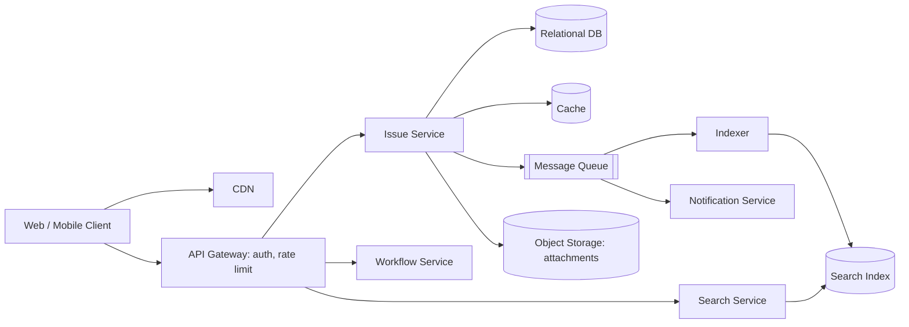

# System Design Case Studies Interview Questions

Worked design cases: a Jira-like issue tracker and a real-time financial data processing module, with requirements, consistency, recovery, and trade-offs.

---

## 1. Define the functional and non-functional requirements of a Jira-like system

<details>
<summary>View Answer</summary>

<h3>Direct Answer</h3>
<p>Start every design by clarifying scope. For an issue tracker, the core is projects, issues, workflows, and collaboration; the non-functional requirements decide the architecture.</p>

<h3>Functional Requirements</h3>
<ul>
<li><strong>Projects and issues:</strong> create/edit issues (type, summary, description, assignee, priority, labels, attachments), link and sub-task relations.</li>
<li><strong>Workflow:</strong> configurable states and transitions per project (for example To Do, In Progress, Done), with permission and validation rules on transitions.</li>
<li><strong>Boards and backlogs:</strong> Kanban/sprint boards, ranking and drag-and-drop ordering.</li>
<li><strong>Search and filters:</strong> text search and structured queries (a JQL-like language), saved filters.</li>
<li><strong>Collaboration:</strong> comments, mentions, watchers, notifications (email/in-app), activity history.</li>
<li><strong>Access control:</strong> users, roles, per-project permissions, SSO.</li>
<li><strong>Integrations:</strong> REST API and webhooks; reporting (burndown, velocity).</li>
</ul>

<h3>Non-Functional Requirements</h3>
<table>
<tr><th>Attribute</th><th>Target (state assumptions out loud)</th></tr>
<tr><td>Scale</td><td>Number of tenants/users, issues per project, requests per second; read-heavy (about 10:1 reads to writes is a typical assumption)</td></tr>
<tr><td>Latency</td><td>Page loads and board views in a few hundred ms; search results within about a second</td></tr>
<tr><td>Availability</td><td>High (for example 99.9 percent); degrade gracefully (search down, issues still editable)</td></tr>
<tr><td>Consistency</td><td>Strong for issue state and transitions; eventual for search index, notifications, reports</td></tr>
<tr><td>Durability</td><td>No data loss; backups, audit trail of changes</td></tr>
<tr><td>Security</td><td>Multi-tenant isolation, authN/authZ, encryption, audit</td></tr>
<tr><td>Extensibility</td><td>Custom fields and workflows without schema changes per tenant</td></tr>
<tr><td>Concurrency</td><td>Optimistic locking so two editors do not silently overwrite each other</td></tr>
</table>

<h3>Tips</h3>
<ul>
<li>Ask clarifying questions first (single vs multi-tenant, cloud vs self-hosted, attachments size, expected scale) and agree on what is out of scope.</li>
<li>Then do back-of-envelope sizing (issues per day, storage, QPS) to justify later choices.</li>
</ul>

<p>📚 <a href="/anandu-interview-playbook/system-design/fundamentals/">Learn more: System Design Fundamentals</a></p>

</details>

---

## 2. Design a system to build an application like Jira (system design case study)

<details>
<summary>View Answer</summary>

<h3>Direct Answer</h3>
<p>A read-heavy, multi-tenant web application: stateless API services behind a load balancer, a relational database as the source of truth for issues and workflows, a search index for queries, a queue for async work (notifications, indexing), and object storage for attachments.</p>

<h3>High-Level Architecture</h3>



<h3>Key Design Decisions</h3>
<ul>
<li><strong>Data model:</strong> tables for projects, issues, comments, links, workflows/transitions, users and roles; custom fields via a typed key-value (EAV) table or a JSON column, with a trade-off between flexibility and query speed.</li>
<li><strong>Source of truth:</strong> relational DB (ACID) for issue state and transitions; transitions validated against the workflow in one transaction; optimistic locking via a version column.</li>
<li><strong>Search:</strong> issues are indexed asynchronously (events to indexer to a search engine such as Elasticsearch/OpenSearch); a structured query language is parsed into index queries. Eventual consistency lag is acceptable.</li>
<li><strong>Notifications:</strong> event-driven; the write path publishes an event and returns; consumers fan out email/in-app/webhooks with retries and a dead-letter queue.</li>
<li><strong>Attachments:</strong> object storage with pre-signed URLs, served via CDN; metadata in the DB.</li>
<li><strong>Multi-tenancy:</strong> tenant ID on every row and query (shared schema) for small tenants; separate schema/DB for large or regulated ones.</li>
<li><strong>Scaling:</strong> stateless services scale horizontally; read replicas and caching (board/issue views); shard by tenant or project when a single DB is not enough; paginate and cap large boards.</li>
<li><strong>Audit/history:</strong> append-only change log per issue, which also powers activity feeds.</li>
<li><strong>Real-time updates:</strong> WebSocket or SSE for board updates, backed by a pub/sub channel.</li>
</ul>

<h3>Trade-offs to Call Out</h3>
<ul>
<li>Monolith first vs microservices: start modular monolith, split search/notifications first as they scale differently.</li>
<li>Flexible custom fields vs query performance; strong consistency for writes vs eventual consistency for search.</li>
</ul>

<p>📚 <a href="/anandu-interview-playbook/system-design/worked-examples/">Learn more: System Design Worked Examples</a></p>

</details>

---

## 3. How would you design a module to handle real-time derivatives data processing?

<details>
<summary>View Answer</summary>

<h3>Direct Answer</h3>
<p>An event-driven streaming pipeline: ingest market and trade events into a partitioned, durable log, process them in stateless-or-partition-local consumers with deterministic logic, persist results, and publish downstream. Design for ordering, idempotency, back-pressure, and replay.</p>

<h3>Components</h3>
<ol>
<li><strong>Ingestion:</strong> gateways/adapters normalize incoming feeds into a canonical event format (validated, versioned schema).</li>
<li><strong>Durable log:</strong> Kafka or similar, partitioned by a key (instrument or account) so events for one key are ordered.</li>
<li><strong>Processing:</strong> consumer group per concern (validation, enrichment, pricing/valuation, risk aggregation). State (positions, running totals) is partition-local, kept in memory with a changelog or a fast store.</li>
<li><strong>Storage:</strong> a write-optimized store for the event history (audit, replay), a serving store or cache for latest state, and an analytical store for reporting.</li>
<li><strong>Output:</strong> publish results (events/APIs) to downstream consumers; real-time dashboards via WebSocket/SSE.</li>
<li><strong>Operations:</strong> metrics (lag, latency percentiles), tracing, alerting, dead-letter topic for poison messages.</li>
</ol>

<h3>Design Concerns</h3>
<ul>
<li><strong>Ordering:</strong> guaranteed only within a partition, so the partition key must match the unit of ordering.</li>
<li><strong>Exactly-once effect:</strong> at-least-once delivery plus idempotent processing (dedupe by event ID, or transactional offset and output commit).</li>
<li><strong>Back-pressure and scaling:</strong> scale consumers up to the partition count; bounded queues; shed or buffer under bursts.</li>
<li><strong>Low latency in Java:</strong> avoid object churn and long GC pauses (pre-sized collections, primitive collections, tuned GC such as ZGC), bounded thread pools, minimal locking; measure with JFR/JMH.</li>
<li><strong>Money and precision:</strong> <code>BigDecimal</code> or scaled integers; never floating point for monetary values.</li>
<li><strong>Determinism and audit:</strong> versioned rules so a past result can be reproduced from the event log.</li>
</ul>

```java
// Idempotent consumer sketch
@KafkaListener(topics = "trades", groupId = "valuation")
@Transactional
public void on(TradeEvent e) {
    if (processed.exists(e.id())) return;           // dedupe on at-least-once delivery
    valuation.apply(e);
    processed.mark(e.id());
}
```

<p>📚 <a href="/anandu-interview-playbook/system-design/building-blocks/">Learn more: System Design Building Blocks</a></p>

</details>

---

## 4. How would you handle data consistency and recovery in case of failure in real-time systems?

<details>
<summary>View Answer</summary>

<h3>Direct Answer</h3>
<p>Combine <strong>durable, replayable inputs</strong>, <strong>idempotent processing</strong>, <strong>replicated state</strong>, and <strong>tested recovery procedures</strong> with explicit recovery objectives (RPO: how much data you can lose; RTO: how long you can be down).</p>

<h3>Consistency</h3>
<ul>
<li>The event log is the source of truth; every state change is derived from it, so state can be rebuilt.</li>
<li>Idempotent handlers plus transactional offset commit with output writes, so replays do not double-apply.</li>
<li>Use the outbox pattern when a DB write and an event publish must both happen (avoids dual-write inconsistency).</li>
<li>Sequence numbers/versions to detect gaps and out-of-order events; reconciliation jobs compare against the upstream source.</li>
</ul>

<h3>Recovery Strategies</h3>
<table>
<tr><th>Failure</th><th>Mitigation</th></tr>
<tr><td>Consumer crash</td><td>Consumer group rebalances; resume from the last committed offset; at-least-once plus idempotency</td></tr>
<tr><td>Node/state loss</td><td>Rebuild state from snapshots plus replay of the log from the snapshot offset</td></tr>
<tr><td>Broker/DB failure</td><td>Replication (for example replication factor 3, min in-sync replicas 2), automatic failover, synchronous replication for zero-loss tiers</td></tr>
<tr><td>Poison message</td><td>Bounded retries, then dead-letter topic and alert; do not block the partition</td></tr>
<tr><td>Site/region outage</td><td>Cross-zone deployment, cross-region replication, warm standby with defined failover runbook</td></tr>
<tr><td>Corrupt data / bad deploy</td><td>Point-in-time recovery from backups, replay with a fixed version, reconciliation</td></tr>
</table>

<h3>Backup and Disaster Recovery</h3>
<ul>
<li>Regular backups plus continuous log archival for point-in-time recovery; encrypted and stored off-site.</li>
<li>Pick DR tier by RPO/RTO: backup/restore (cheapest, slowest), warm standby, active-active (fastest, most complex).</li>
<li><strong>Test it:</strong> run failover drills and restore tests; an untested backup is not a backup.</li>
</ul>

<h3>Gotchas</h3>
<ul>
<li>Exactly-once across systems is not free; document where at-least-once with dedupe is used.</li>
<li>Replay can trigger side effects (emails, payments); isolate side-effecting steps behind idempotency keys.</li>
</ul>

<p>📚 <a href="/anandu-interview-playbook/system-design/scalability-resilience/">Learn more: Scalability and Resilience</a></p>

</details>

---

## 5. What trade-offs would you consider in your system design for derivatives processing?

<details>
<summary>View Answer</summary>

<h3>Direct Answer</h3>
<p>State the trade-offs explicitly and tie each to a requirement. For financial processing the dominant tension is <strong>correctness and auditability first</strong>, then latency and throughput.</p>

<table>
<tr><th>Trade-off</th><th>Considerations</th></tr>
<tr><td>Consistency vs availability / latency</td><td>Core ledger and positions need strong consistency; reporting, search, and dashboards can be eventually consistent (CAP/PACELC thinking)</td></tr>
<tr><td>Latency vs throughput</td><td>Batching and larger buffers raise throughput but add latency; per-event processing lowers latency but costs more per message</td></tr>
<tr><td>Ordering vs parallelism</td><td>Strict global ordering limits scale; order per key (partition) and parallelize across keys</td></tr>
<tr><td>Exactly-once vs simplicity</td><td>At-least-once plus idempotent consumers is usually simpler and cheaper than distributed transactions</td></tr>
<tr><td>Durability vs speed</td><td>Synchronous replication and fsync cost latency; weigh against acceptable data loss (RPO)</td></tr>
<tr><td>Real-time vs batch</td><td>Streaming gives immediacy; end-of-day batch is simpler and easier to reconcile. Many systems use both</td></tr>
<tr><td>Build vs buy / complexity</td><td>Event sourcing and CQRS add power and audit but operational and learning cost</td></tr>
<tr><td>Cost vs resilience</td><td>Active-active multi-region versus warm standby</td></tr>
<tr><td>Precision vs performance</td><td><code>BigDecimal</code> is slower than primitives; scaled <code>long</code> values are a middle ground</td></tr>
</table>

<h3>How to Answer</h3>
<ul>
<li>Pick a position per decision (for example "ledger: strong consistency, accept higher write latency"), justify with the requirement, and say what you would revisit if the numbers change.</li>
<li>Mention how you would validate the choice: load tests, latency percentiles (p99, not averages), and failure-injection tests.</li>
<li>Regulatory needs (audit trail, retention, reproducibility) usually override pure performance preferences.</li>
</ul>

<p>📚 <a href="/anandu-interview-playbook/system-design/fundamentals/">Learn more: System Design Fundamentals</a></p>

</details>

---
