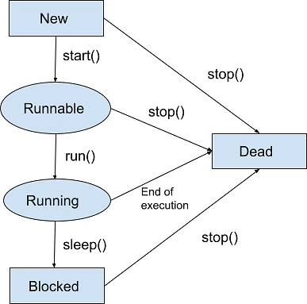
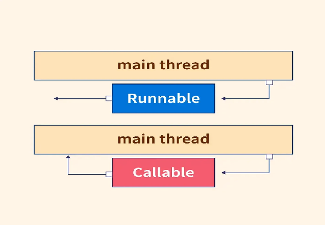
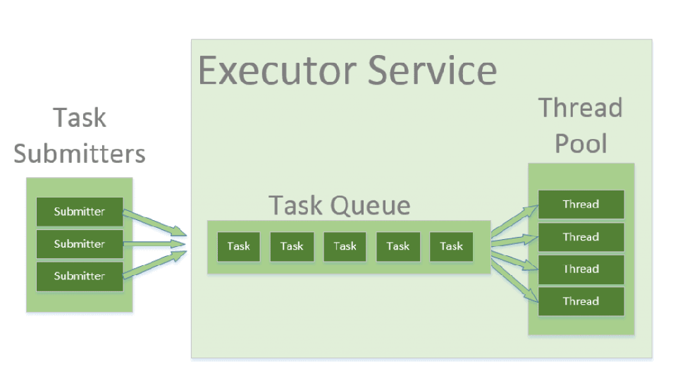

# Concurrency & Threads

**See also:** [Threading Deep-Dive & Virtual Threads](threading.md) for synchronization primitives, thread pools, virtual threads and concurrency patterns, and [Spring Threading & Async](../spring-web/spring-threading.md) for `@Async`.


[https://www.simplilearn.com/tutorials/java-tutorial/thread-in-java](https://www.simplilearn.com/tutorials/java-tutorial/thread-in-java)
[https://medium.com/@AlexanderObregon/beginners-guide-to-java-threads-80ee370b3cb5](https://medium.com/@AlexanderObregon/beginners-guide-to-java-threads-80ee370b3cb5)
[https://www.geeksforgeeks.org/java-threads/](https://www.geeksforgeeks.org/java-threads/)

|  | Process | Thread |
| :---- | :---- | :---- |
| **Definition** | A process is the execution of a program. | A thread is a semi-process. |
| **Creation** | We need to use more than one system call to create more than one process. | We can create more than one thread with one system call. |
| **Termination** | Termination of the process take more compared to thread. | Termination of thread takes less compared to thread. |
| **Communication** | It requires extra mechanisms such as IPC. | It does not require any extra mechanism. |
| **Context switching** | Context switching of processes slower than threads. | Context switching between threads is much faster than processes. |
| **Resource** | Processes may consume more resources since they have separate memory spaces. | Threads may consume fewer resources. |
| **Memory** | Processes are mostly isolated. | Threads share memory. |
| **Sharing** | It requires extra mechanisms such as IPC to share data. | Threads share data with each other. |

## Threads

1. **Improved Application Responsiveness**: By dividing tasks into separate threads, an application can remain responsive to user input even while performing intensive operations. For instance, a user interface can stay active and responsive while another thread performs a long-running calculation or reads data from a file.
2. **Better Resource Utilization**: Threads help in making full use of the processing power available on multi-core processors. By distributing tasks across multiple threads, a program can run more efficiently, completing tasks faster by doing them in parallel.
3. **Simplified Program Structure**: In some scenarios, using threads can simplify the design of a program. For instance, server applications that handle multiple client connections simultaneously can allocate a thread to each connection, making the program easier to understand and manage.
4. **Concurrency Control:** Threads are crucial in applications that require concurrent operations, such as real-time data processing, simulations, and games. They allow developers to create fluid and dynamic interactions by executing multiple operations simultaneously.

**User Thread vs Daemon Thread**

| User Thread | Daemon Thread |
| :---- | :---- |
| [JVM](https://www.geeksforgeeks.org/jvm-works-jvm-architecture/) wait until user threads to finish their work. It never exit until all user threads finish their work. | The JVM will’t wait for daemon threads to finish their work. The JVM will exit as soon as all user threads finish their work. |
| JVM will not force to user threads for terminating, so JVM will wait for user threads to terminate themselves. | If all user threads have finished their work JVM will force the daemon threads to terminate |
| User threads are created by the application. | Mostly Daemon threads created by the JVM. |
| Mainly user threads are designed to do some specific task. | Daemon threads are design as to support the user threads. |
| User threads are foreground threads. | Daemon threads are background threads. |
| User threads are high priority threads. | Daemon threads are low priority threads. |
| Its life independent. | Its life depends on user threads. |

## Life Cycles

1. New
2. Runnable
3. Running
4. Blocked (Non-runnable state)
5. Dead



## Thread Creation

There are two basic ways to create a thread: extend `Thread` and override `run()`, or implement `Runnable` and pass it to a `Thread` (preferred, because the class can still extend another class and the task can be reused with thread pools). In practice, submit tasks to an `ExecutorService` instead of creating threads by hand.

Code and a full comparison table are in [Threading Deep-Dive: Thread vs Runnable](threading.md#thread-vs-runnable).

## Starting and Managing Threads

**start()**
Starting a thread is accomplished by calling its start method, which requests the JVM to execute the thread's run method in a new call stack. This allows the thread to run concurrently with other threads, including the main thread.
**run()**
It's important to note that calling the run method directly won't start a new thread; instead, it will run the run method in the current thread, just like any other method call.

## Concurrency Problems

1. **Race Condition:** Occurs when multiple threads access shared data simultaneously, leading to inconsistent results. It happens when the code is not thread-safe.
2. **Deadlock**: Happens when two or more threads are blocked forever, each waiting for the other to release a lock.
3. **Livelock**: Threads are active but unable to make progress because they keep responding to each other in an endless loop.
4. **Thread Starvation**: A thread is perpetually denied access to resources because other threads are given priority.
5. **Priority Inversion**: Occurs when a low-priority thread holds a lock needed by a high-priority thread, blocking its progress.

## Why Synchronization is Necessary

Imagine a scenario where two threads are attempting to update the same bank account balance based on transactions from different sources. If these updates happen simultaneously without any form of control, one thread might overwrite the changes made by the other, resulting in an incorrect account balance. This scenario, known as a race condition, is a common issue in multi-threaded environments where the outcome depends on the sequence or timing of threads’ execution.

### Implementing Synchronization in Java

Java provides several mechanisms for synchronization, including synchronized methods, synchronized blocks, and special concurrent classes from the java.util.concurrent package.

### Synchronized Methods and Blocks

The `synchronized` keyword (on a method or on a block around the critical section), plus `volatile`, atomic variables and `Lock`s, are covered with code in [Threading Deep-Dive: Thread Synchronization](threading.md#thread-synchronization).

## Best Practices for Synchronizing Threads

1. **Minimize Synchronization Overheads**: Synchronize only the critical section of code that accesses shared resources. Unnecessary synchronization can lead to performance degradation.
2. **Avoid Deadlocks**: Ensure that all threads acquire locks in a consistent order and release them promptly to prevent deadlocks, where two or more threads wait indefinitely for each other to release locks.
3. **Prefer java.util.concurrent Utilities**: Whenever possible, use the high-level synchronization utilities provided in the java.util.concurrent package. These utilities are designed for efficiency and ease of use, reducing the risk of common synchronization issues.
4. **Understand the Scope of Synchronization**: Be aware of what object’s monitor you’re synchronizing on. Synchronizing on different objects can lead to unexpected concurrency issues.

## Advanced Threading

[https://dev.to/danielrendox/thread-runnable-callable-executorservice-and-future-all-the-ways-to-create-threads-in-java-2o86](https://dev.to/danielrendox/thread-runnable-callable-executorservice-and-future-all-the-ways-to-create-threads-in-java-2o86)
[https://www.geeksforgeeks.org/future-and-futuretask-in-java/](https://www.geeksforgeeks.org/future-and-futuretask-in-java/)

### Callable Interface

The Java Callable interface, java.util.concurrent.Callable, represents an asynchronous task which can be executed by a separate thread. For instance, it is possible to submit a Callable object to a Java ExecutorService which will then execute it asynchronously.

public interface Callable<V> {
   V call() throws Exception;
}
**Benefits**

1. **Return Value**: The call method returns a value of type V. This allows tasks to return results, which can be useful for complex computations.
2. **Checked Exceptions**: The call method can throw checked exceptions, providing better error-handling capabilities.
3. **Generic Type**: The interface is generic, allowing you to specify the type of the result returned by the call method.

**Example**
public class CallableExample implements Callable<String> {
   @Override
   public String call() throws Exception {
       return "Callable result";
   }
   public static void main(String[] args) {
       ExecutorService executor = Executors.newSingleThreadExecutor();
       Future<String> future = executor.submit(new CallableExample());
       try {
           String result = future.get();
           System.out.println(result);
       } catch (InterruptedException | ExecutionException e) {
           e.printStackTrace();
       }
       executor.shutdown();
   }
}

### Future and FutureTask

**Future**
A Future interface provides methods to check if the computation is complete, to wait for its completion and to retrieve the results of the computation. The result is retrieved using Future’s get() method when the computation has completed, and it blocks until it is completed.

Future<Integer> future = executor.submit(() -> new Random().nextInt());
.
.
// wait for 1 sec and then throw TimeoutException, if it still hasn't finished
future.get(1, TimeUnit.SECONDS);
future.cancel(true);
future.isCancelled();
future.isDone();
.
.
public static void main(String[] args) {
   ExecutorService executor = Executors.newSingleThreadExecutor();
   Future<Integer> future = executor.submit(() -> {
       try {
           Thread.sleep(1000);
       } catch (InterruptedException e) {
           throw new RuntimeException(e);
       }
       return new Random().nextInt();
   });

   try {
       System.out.println("Result: " + future.get(1, TimeUnit.SECONDS));
   } catch (InterruptedException | ExecutionException e) {
       e.printStackTrace();
   } catch (TimeoutException e) {
       System.out.println("Couldn't complete the task before timeout");
   }

   executor.shutdown();
}

**FutureTask**

1. FutureTask is a concrete implementation of the Future, Runnable, and RunnableFuture interfaces and therefore can be submitted to an ExecutorService instance for execution.
2. When calling ExecutorService.submit() on a Callable or Runnable instance, the ExecutorService returns a Future representing the task. and one can create it manually also.
3. FutureTask acts similar to a CountDownLatch when calling get() in that it waits for the task to complete or error out.
4. Behaviour of the parameterless get() method depends on the state of the task. If tasks are not completed, get() method blocks until the task is completed. Once the task complete, it returns the result or throws an ExecutionException.
5. An overloaded variant of get() allows passing a timeout parameter to limit the amount of time the thread waits for a result.

class MyRunnable implements Runnable {
   private final long waitTime;
   public MyRunnable(int timeInMillis)
   {
       this.waitTime = timeInMillis;
   }
   @Override
   public void run()
   {
       try {
           // sleep for user given millisecond
           // before checking again
           Thread.sleep(waitTime);
           // return current thread name
           System.out.println(Thread
                                  .currentThread()
                                  .getName());
       }
       catch (InterruptedException ex) {
           Logger
               .getLogger(MyRunnable.class.getName())
               .log(Level.SEVERE, null, ex);
       }
   }
}
// Class FutureTaskExample execute two future task
class FutureTaskExample {
   public static void main(String[] args)
   {
       // create two object of MyRunnable class
       // for FutureTask and sleep 1000, 2000
       // millisecond before checking again
       MyRunnable myrunnableobject1 = new MyRunnable(1000);
       MyRunnable myrunnableobject2 = new MyRunnable(2000);
       FutureTask<String>
           futureTask1 = new FutureTask<>(myrunnableobject1,
                                          "FutureTask1 is complete");
       FutureTask<String>
           futureTask2 = new FutureTask<>(myrunnableobject2,
                                          "FutureTask2 is complete");
       // create thread pool of 2 size for ExecutorService
       ExecutorService executor = Executors.newFixedThreadPool(2);
       // submit futureTask1 to ExecutorService
       executor.submit(futureTask1);
       // submit futureTask2 to ExecutorService
       executor.submit(futureTask2);
       while (true) {
           try {
               // if both future task complete
               if (futureTask1.isDone() && futureTask2.isDone()) {
                   System.out.println("Both FutureTask Complete");
                   // shut down executor service
                   executor.shutdown();
                   return;
               }
               if (!futureTask1.isDone()) {
                   // wait indefinitely for future
                   // task to complete
                   System.out.println("FutureTask1 output = "
                                      + futureTask1.get());
               }
               System.out.println("Waiting for FutureTask2 to complete");
               // Wait if necessary for the computation to complete,
               // and then retrieves its result
               String s = futureTask2.get(250, TimeUnit.MILLISECONDS);
               if (s != null) {
                   System.out.println("FutureTask2 output=" + s);
               }
           }
           catch (Exception e) {
               System.out.println("Exception: " + e);
           }
       }
   }
}

### Future Exception Handling

If a task throws (checked or unchecked), the pool thread survives and the exception is stored in the `Future`. It surfaces only at `future.get()`, wrapped in an `ExecutionException`; call `getCause()` for the real error.

```java
Future<String> future = executor.submit(() -> {
    throw new IOException("Database connection timed out");
});

try {
    future.get();
} catch (InterruptedException e) {
    Thread.currentThread().interrupt();          // the waiting thread was interrupted
} catch (ExecutionException e) {
    Throwable cause = e.getCause();              // the IOException
    System.out.println(cause.getClass().getName() + ": " + cause.getMessage());
}
```

Submitting a `Runnable` also returns a `Future`, but `get()` returns `null`. An exception thrown inside a task passed to `submit()` is never printed unless you call `get()`.

### Runnable vs Callable



| Feature | Runnable | Callable |
| :---- | :---- | :---- |
| **Method** | run() | call() |
| **Return Value** | void (nothing) | Returns a value of type V |
| **Exceptions** | Cannot throw checked exceptions | Can throw checked exceptions |
| **Usage** | Simple tasks, no return needed | Tasks requiring a return value or exception handling |
| **Execution** | Can be run by Thread or ExecutorService | Needs an ExecutorService (or wrap it in a `FutureTask` to run on a `Thread`) |

Choose `Runnable` for side effects (logging, cleanup, metrics) and `Callable` for computations, remote calls or code that throws checked exceptions. `Runnable` was added in Java 1.0, `Callable` in Java 5. Both are `@FunctionalInterface`s, so they can be lambdas. See [Future exception handling](#future-exception-handling) for what `submit()` does with failures.

---

## CompletableFuture (Java 8+)

**CompletableFuture** improves on Future with chainable async operations, callbacks, and combinations.

### Basic Usage

```java
// Create completed future
CompletableFuture<String> completed = CompletableFuture.completedFuture("Hello");

// Create incomplete future
CompletableFuture<String> incomplete = new CompletableFuture<>();
incomplete.complete("Done");  // Complete manually

// Async execution
CompletableFuture<String> async = CompletableFuture.supplyAsync(() -> {
    return "Async result";
});

String result = async.get();  // Block for result
```

### Chaining Operations

```java
// thenApply: Transform result
CompletableFuture<Integer> future = CompletableFuture
    .supplyAsync(() -> "Hello")
    .thenApply(String::length)     // String → int
    .thenApply(len -> len * 2);    // int → int

System.out.println(future.get());  // 10

// thenAccept: Consume result (no return)
CompletableFuture<Void> task = CompletableFuture
    .supplyAsync(() -> "Hello")
    .thenAccept(System.out::println);  // Print, return nothing

task.get();  // Wait for completion

// thenRun: Run after completion (ignore result)
CompletableFuture<Void> task2 = CompletableFuture
    .supplyAsync(() -> "Hello")
    .thenRun(() -> System.out.println("Finished"));  // No result param
```

### Error Handling

```java
// exceptionally: Handle errors
CompletableFuture<Integer> future = CompletableFuture
    .supplyAsync(() -> {
        throw new RuntimeException("Error!");
    })
    .exceptionally(ex -> {
        System.err.println("Caught: " + ex.getMessage());
        return -1;  // Default value on error
    });

System.out.println(future.get());  // -1

// whenComplete: Run after success or error
CompletableFuture.supplyAsync(() -> "Result")
    .whenComplete((result, ex) -> {
        if (ex == null) {
            System.out.println("Success: " + result);
        } else {
            System.err.println("Error: " + ex);
        }
    });

// handle: Transform result or error
CompletableFuture<String> handled = CompletableFuture
    .supplyAsync(() -> {
        throw new RuntimeException("Oops");
    })
    .handle((result, ex) -> {
        if (ex != null) {
            return "Error: " + ex.getMessage();
        }
        return result;
    });

System.out.println(handled.get());  // "Error: Oops"
```

### Combining Multiple Futures

```java
// thenCombine: Combine two futures' results
CompletableFuture<String> future1 = CompletableFuture.supplyAsync(() -> "Hello");
CompletableFuture<String> future2 = CompletableFuture.supplyAsync(() -> "World");

CompletableFuture<String> combined = future1
    .thenCombine(future2, (a, b) -> a + " " + b);

System.out.println(combined.get());  // "Hello World"

// allOf: Wait for all futures
CompletableFuture<Integer> f1 = CompletableFuture.supplyAsync(() -> 1);
CompletableFuture<Integer> f2 = CompletableFuture.supplyAsync(() -> 2);
CompletableFuture<Integer> f3 = CompletableFuture.supplyAsync(() -> 3);

CompletableFuture<Void> allDone = CompletableFuture.allOf(f1, f2, f3);
allDone.get();  // Wait for all

// Collect results
List<Integer> results = List.of(f1.get(), f2.get(), f3.get());
System.out.println(results);  // [1, 2, 3]

// anyOf: Return first to complete
CompletableFuture<String> f4 = CompletableFuture.supplyAsync(() -> "First", 
    Executors.newFixedThreadPool(1));
CompletableFuture<String> f5 = CompletableFuture.supplyAsync(() -> "Second",
    Executors.newFixedThreadPool(1));

CompletableFuture<Object> first = CompletableFuture.anyOf(f4, f5);
System.out.println(first.get());  // Whichever completes first
```

### Dependent Calls, Timeouts and Custom Executors

| Method | Use |
|--------|-----|
| `thenApply(fn)` | Synchronous transform (like `map`) |
| `thenCompose(fn)` | `fn` returns another `CompletableFuture`; flattens it (like `flatMap`). Use for a call that depends on a previous result |
| `thenCombine(other, fn)` | Combine two independent futures |
| `allOf(...)` | Barrier: completes when all complete; returns `Void`, so read each result with `join()` |
| `orTimeout(t, unit)` (Java 9+) | Fails with `TimeoutException` if not done in time |
| `completeOnTimeout(v, t, unit)` (Java 9+) | Completes with a fallback value on timeout |

```java
ExecutorService io = Executors.newFixedThreadPool(10);   // dedicated pool for blocking I/O

CompletableFuture<UserProfile> profile =
    CompletableFuture.supplyAsync(() -> fetchProfile(userId), io);

CompletableFuture<List<Order>> orders =
    CompletableFuture.supplyAsync(() -> fetchOrders(userId), io)
        .exceptionally(ex -> List.of());                  // fallback if the order service fails

// Depends on the profile result: thenCompose avoids CompletableFuture<CompletableFuture<...>>
CompletableFuture<List<Recommendation>> recs =
    profile.thenCompose(p -> CompletableFuture.supplyAsync(() -> fetchRecs(p), io));

Dashboard dashboard = CompletableFuture.allOf(profile, orders, recs)
    .thenApply(v -> new Dashboard(profile.join(), orders.join(), recs.join()))
    .orTimeout(3, TimeUnit.SECONDS)
    .join();                                              // blocks; throws CompletionException on failure
```

- Profile and orders run in parallel; total time is about the slowest chain, not the sum.
- Without an executor argument, tasks run on `ForkJoinPool.commonPool()`. Blocking network calls there can starve other work, so pass a dedicated executor for I/O.
- `join()` throws an unchecked `CompletionException`; `get()` throws a checked `ExecutionException`. Both wrap the original error in `getCause()`.
- Shut the executor down when finished.

### Real-World: API Call Pipeline

```java
@Service
public class UserService {
    
    private RestTemplate restTemplate;
    private ExecutorService executor;
    
    // Fetch user asynchronously
    public CompletableFuture<User> getUser(Long userId) {
        return CompletableFuture.supplyAsync(() -> {
            return restTemplate.getForObject("/users/" + userId, User.class);
        }, executor);
    }
    
    // Fetch orders asynchronously
    public CompletableFuture<List<Order>> getOrders(Long userId) {
        return CompletableFuture.supplyAsync(() -> {
            List<Order> orders = restTemplate.getForObject(
                "/orders?userId=" + userId, 
                new ParameterizedTypeReference<List<Order>>() {});
            return orders;
        }, executor);
    }
    
    // Combine user + orders (runs in parallel, then combines)
    public CompletableFuture<UserProfile> getUserProfile(Long userId) {
        return getUser(userId)
            .thenCombine(getOrders(userId), (user, orders) -> {
                UserProfile profile = new UserProfile();
                profile.setUser(user);
                profile.setOrders(orders);
                return profile;
            })
            .exceptionally(ex -> {
                log.error("Error fetching profile", ex);
                return new UserProfile();  // Empty profile on error
            });
    }
}

// Usage
UserProfile profile = userService.getUserProfile(123).get();
```

### Parallel Service Calls with CompletableFuture

Fan out independent calls on a **dedicated executor**, then join. Latency becomes roughly the slowest call, not the sum. Java 9+ for `orTimeout`/`completeOnTimeout`; Java 21+ for the virtual-thread executor.

```java
import java.util.List;
import java.util.concurrent.*;

public class ProfileAggregator {
    // I/O-bound: own pool (Java 21+: Executors.newVirtualThreadPerTaskExecutor())
    private final ExecutorService io = Executors.newFixedThreadPool(20);

    record Profile(String user, List<String> orders, String recs) {}

    Profile load(String id) {
        CompletableFuture<String> user = CompletableFuture
            .supplyAsync(() -> userClient.get(id), io)
            .orTimeout(2, TimeUnit.SECONDS);

        CompletableFuture<List<String>> orders = CompletableFuture
            .supplyAsync(() -> orderClient.list(id), io)
            .orTimeout(2, TimeUnit.SECONDS)
            .exceptionally(ex -> List.of());            // optional data: degrade gracefully

        CompletableFuture<String> recs = CompletableFuture
            .supplyAsync(() -> recClient.get(id), io)
            .completeOnTimeout("none", 500, TimeUnit.MILLISECONDS);

        return CompletableFuture.allOf(user, orders, recs)
            .thenApply(v -> new Profile(user.join(), orders.join(), recs.join()))
            .join();                                    // failures arrive as CompletionException
    }
}

// N calls of the same kind
static <T> List<T> fetchAll(List<Callable<T>> calls, Executor ex) {
    List<CompletableFuture<T>> futures = calls.stream()
        .map(c -> CompletableFuture.supplyAsync(() -> {
            try { return c.call(); } catch (Exception e) { throw new CompletionException(e); }
        }, ex))
        .toList();                                      // start ALL before joining any
    return futures.stream().map(CompletableFuture::join).toList();
}
```

(`userClient`, `orderClient`, `recClient` are placeholder service clients.)

**Rules of thumb**

- Always pass an executor for blocking work; the default is the shared common pool.
- Collect futures into a list first, then join. Calling `join()` inside the same lazy `map` serialises the calls.
- Put a timeout on every call; decide per call whether failure is fatal or optional (`exceptionally`/`handle`).
- `allOf` completes exceptionally if any future fails (after all finish); inspect each future for partial results.
- Size pools from downstream capacity; cap concurrency with a bulkhead or `Semaphore`.
- Request context (MDC, security, transaction) is **not** propagated to pool threads; decorate the executor (Spring: `TaskDecorator`, see [Spring threading](../spring-web/spring-threading.md)).
- Java 21+ alternative: virtual threads with plain blocking code.

**Common interview questions**

- *Parallel stream vs CompletableFuture for 5 REST calls?* CompletableFuture with a custom executor: control over pool, timeouts and errors; parallel streams use the shared pool.
- *`allOf` returns `Void`, how do you get results?* Keep the individual futures and `join()` them after `allOf` completes.

### CompletableFuture vs Future

| Aspect | Future | CompletableFuture |
|--------|--------|-------------------|
| **Chaining** | Not supported | Chainable with `thenApply`, etc. |
| **Composition** | Manual | `allOf`, `anyOf` combinator methods |
| **Error Handling** | Try-catch | `exceptionally`, `handle` |
| **Callbacks** | Block or poll | `thenAccept`, `whenComplete` |
| **Cancellation** | `cancel()` | `cancel()` + `join()` |
| **Flexibility** | Limited | Highly flexible, composable |

### Thread Pool

Prefer a thread pool over creating many `Thread` objects: a fixed number of reusable threads takes tasks from a queue, which avoids the cost of constantly creating and destroying threads.

Pool types, a worked example, `shutdown()` handling and the risks (pool deadlock, thread leakage, resource thrashing) are in [Threading Deep-Dive: Thread Pools & ExecutorService](threading.md#thread-pools-executorservice).

[https://jenkov.com/tutorials/java-util-concurrent/executorservice.html](https://jenkov.com/tutorials/java-util-concurrent/executorservice.html)
[https://www.geeksforgeeks.org/thread-pools-java/](https://www.geeksforgeeks.org/thread-pools-java/)



## IPC - Inter-Process Communication

[https://www.baeldung.com/java-ipc](https://www.baeldung.com/java-ipc)
[https://www.geeksforgeeks.org/inter-process-communication-ipc/](https://www.geeksforgeeks.org/inter-process-communication-ipc/)

## Types of Process

Let us first talk about types of types of processes.

1. **Independent process:** An independent process is not affected by the execution of other processes. Independent processes are processes that do not share any data or resources with other processes. No inter-process communication required here.
2.
3. **Co-operating process:** Interact with each other and share data or resources. A co-operating process can be affected by other executing processes. Inter-process communication (IPC) is a mechanism that allows processes to communicate with each other and synchronize their actions. The communication between these processes can be seen as a method of cooperation between them.

## Inter Process Communication

Inter process communication (IPC) allows different programs or processes running on a computer to share information with each other. IPC allows processes to communicate by using different techniques like sharing memory, sending messages, or using files. It ensures that processes can work together without interfering with each other. Cooperating processes require an Inter Process Communication (IPC) mechanism that will allow them to exchange data and information.

The two fundamental models of Inter Process Communication are:

1. **Shared Memory**
2. **Message Passing**

**Practice questions:** [Java Concurrency](../interview-questions/verbal/verbal-java-concurrency-questions.md), [Java Advanced](../interview-questions/verbal/verbal-java-advanced-questions.md)
