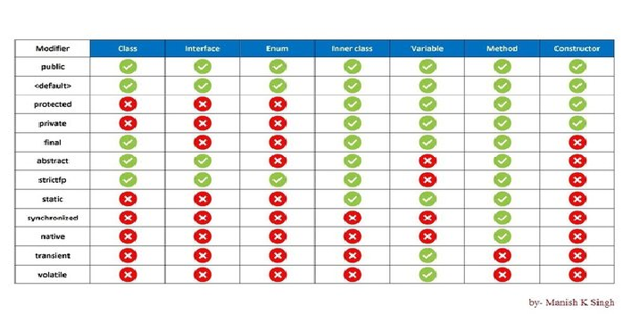
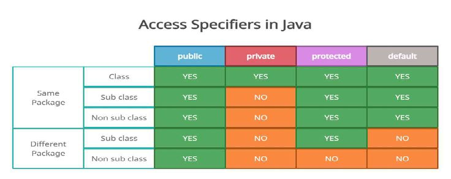
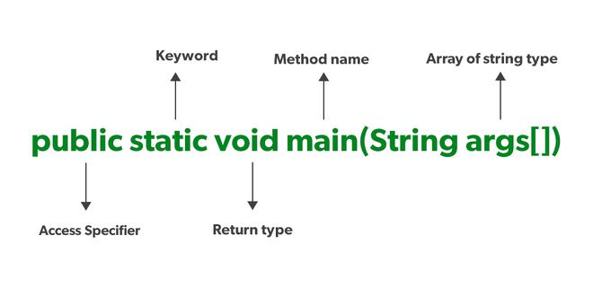

# Java Basics

## Java Editions

Java has several editions, each catering to different platforms and use cases

* **Java Standard Edition**
  * Java SE is the core Java platform designed for developing and running desktop applications, web applications, and server-side applications.
  * It includes the Java Development Kit (JDK), which provides tools for compiling, debugging, and running Java programs.
  * Java SE also includes the Java Runtime Environment (JRE), which is required to run Java applications on end-user devices.
  * Java SE is widely used for developing a variety of applications, including enterprise software, mobile apps, and games.

* **Java Enterprise Edition**
  * Java EE is a set of specifications and APIs for developing enterprise-scale applications, particularly web-based and distributed systems.
  * It provides a runtime environment and libraries for building server-side components such as servlets, JavaServer Pages (JSP), Enterprise JavaBeans (EJB), and Java Persistence API (JPA).
  * Java EE also includes support for web services, messaging, security, and transactions.
  * Java EE application servers, such as Apache Tomcat, WildFly, and IBM WebSphere, provide implementations of the Java EE specifications.

* **Java Micro Edition - Embedded devices**
  * Java ME is a platform for developing applications for resource-constrained embedded devices, such as mobile phones, smart cards, and IoT devices.
  * It provides a subset of the Java SE platform optimized for devices with limited memory, processing power, and display capabilities.
  * Java ME includes profiles and configurations tailored to specific types of devices, allowing developers to target a wide range of embedded platforms.

* **Javafx**
  * JavaFX is a platform for creating rich internet applications (RIAs) and modern user interfaces (UIs) for desktop, mobile, and embedded platforms.
  * It provides a set of APIs for developing graphical user interfaces, multimedia applications, and 2D/3D graphics.
  * JavaFX is designed to work seamlessly with Java SE, allowing developers to create cross-platform applications using familiar Java programming techniques.

**For Java versions and feature timeline**, see [Versions & Features](versions-features.md).

**For the JDK/JRE/JVM, class loaders, garbage collection and memory areas**, see [JVM Internals](jvm-internals.md).

## Java Core

### Access modifiers



1. **public**
2. **private**
3. **protected**
4. **default**

   

5. **final**

[https://www.geeksforgeeks.org/final-keyword-in-java/](https://www.geeksforgeeks.org/final-keyword-in-java/)
[https://www.baeldung.com/java-static-final-order](https://www.baeldung.com/java-static-final-order)

* *variable* - Once assigned can’t change the value
  * an empty final variable can be assigned via constructor
* *method* -  cannot override it
* *class* - cannot extend it.

***const - reserved keyword, can’t be used as a variable name or as a modifier.***

6. **synchronized**
* logic marked with synchronized  - allowing only one thread to execute at any given time.
* synchronized keyword on different levels: Instance methods, Static methods & Code blocks

7. **abstract**
* can have both concrete and abstract methods
* see [Abstract](#abstract) below

8. **native**
* A non-access modifier that is used to access methods implemented in a language other than Java like C/C++
* A method marked as native cannot have a body and should end with a semicolon

9. **strictfp**

10. **transient**
* Variable is not serialized
* can be static and final - but no impact

11. **volatile**
* To ensure that updates to variables propagate predictably to other threads(multi threading, synchronization)

### Static

In Java, the static keyword is a non-access modifier used for memory management. It associates a variable, method, block, or nested class with the class itself rather than with specific instances (objects) of the class. This means that only one copy of a static member exists, regardless of how many objects of the class are created.

1. **Static Variables**
   Static variables are class-level variables shared among all instances of the class. They are declared using the static keyword before the variable type.

2. **Static Methods**
   Static methods belong to the class and can be called without creating an object of the class. They are declared using the static keyword before the return type. Static methods can only access static variables and other static methods. Static methods can be inherited, but can’t be overridden (a subclass method with the same signature *hides* it).

3. **Static Blocks**
   Static blocks are used to initialize static variables or perform other static initialization tasks. They are executed only once when the class is loaded into memory.

4. **Static Nested Classes**
   Nested classes can be declared as static, in which case they do not have access to the instance members of the outer class. They are accessed using the outer class name.

#### Java Variable (Instance Variable) vs Static Variable (Class Variable)

The primary difference between a Java variable and a static variable lies in their scope, lifetime, and how they are accessed.

| Feature | Java Variable (Instance Variable) | Static Variable (Class Variable) |
| :---- | :---- | :---- |
| **Scope** | Belongs to a specific instance (object) of a class. Each object has its own copy of the variable. | Belongs to the class itself. All instances of the class share the same copy of the variable. |
| **Lifetime** | Created when an object is created using the new keyword and destroyed when the object is garbage collected. | Created when the program starts and destroyed when the program terminates. |
| **Access** | Accessed through an object reference (e.g., objectName.variableName). | Accessed directly using the class name (e.g., ClassName.variableName) or through an object reference. |
| **Memory Allocation** | Memory is allocated for each instance variable when an object is created. | Memory is allocated only once for a static variable, regardless of the number of objects created. |
| **Use Cases** | Represents attributes or states specific to an object. | Represents data or behavior shared among all objects of a class, like constants or counters. |

#### Method (Instance Method) vs Static Method

The core difference between a Java method and a static method lies in their association and accessibility. A regular method, also known as an instance method, is tied to a specific object (instance) of a class. To call an instance method, one must first create an object of that class. On the other hand, a static method belongs to the class itself, not to any specific instance. It can be called directly using the class name, without needing to create an object

| Feature | Method (Instance Method) | Static Method |
| :---- | :---- | :---- |
| **Association** | Associated with an object of the class | Associated with the class itself |
| **Access** | Accessed through an object of the class | Accessed directly using the class name |
| **"this" keyword** | Can access instance variables and methods using the "this" keyword | Cannot use the "this" keyword |
| **Access to Instance Members** | Can directly access both static and non-static members (variables and methods) | Can only directly access static members |
| **Memory** | Multiple copies exist, one for each instance | Only one copy exists, shared by all instances |
| **Use Cases** | Operations that depend on the state of a specific object | Utility functions, operations that don't depend on object state |

### Java main() Method

[https://www.geeksforgeeks.org/java-main-method-public-static-void-main-string-args/](https://www.geeksforgeeks.org/java-main-method-public-static-void-main-string-args/)

**public static void main(String[] args)**

Java’s main() method is the starting point from where the JVM starts the execution of a Java program. JVM will not execute the code, if the program is missing the main method. Hence, it is one of the most important methods of Java, and having a proper understanding of it is very important.

The Java compiler or JVM looks for the main method when it starts executing a Java program. The signature of the main method needs to be in a specific way for the JVM to recognize that method as its entry point. If we change the signature of the method, the program compiles but does not execute.

The execution of the Java program, the java.exe is called. The Java.exe in turn makes Java Native Interface or JNI calls, and they load the JVM. The java.exe parses the command line, generates a new String array, and invokes the main() method. By default, the main thread is always a non-daemon thread.



#### public

It is an Access modifier, which specifies from where and who can access the method. Making the main() method public makes it globally available. It is made public so that JVM can invoke it from outside the class as it is not present in the current class.

#### static

It is a keyword that is associated with a method, making it a class-related method. The main() method is static so that JVM can invoke it without instantiating the class. This also saves the unnecessary wastage of memory which would have been used by the object declared only for calling the main() method by the JVM.

#### void

It is a keyword and is used to specify that a method doesn’t return anything. As the main() method doesn’t return anything, its return type is void. As soon as the main() method terminates, the Java program terminates too. Hence, it doesn’t make any sense to return from the main() method as JVM can’t do anything with its return value.

#### main

It is the name of the Java main method. It is the identifier that the JVM looks for as the starting point of the Java program. It’s not a keyword.

### var

* ***var is a reserved type name, not a keyword***. We can still use it as a class name and also as the name of our variables.
* Packaged as part of the 2018 version 10 release, the Java var reserved word introduced type inference to the strongly typed Java programming language.
* Type inference in Java happens when the JDK’s compiler, rather than the developer, assigns a data-type to a variable.

```java
var x = 5.5;                        // double is inferred
var y = System.currentTimeMillis(); // long is inferred
var z = new ArrayList<Double>();    // ArrayList is inferred
```

Limits and restrictions to the use of var in Java include the following:

1. var cannot be used in a method signature.
2. var cannot be used to declare instance variables.
3. var cannot be used to declare static variables.
4. var cannot be used if a variable is initially set to null.

Where `var` is allowed and key gotchas:

| Rule | Detail |
| :-- | :-- |
| Compile-time only | The variable is still statically typed; no dynamic typing. The compiler writes the inferred type into the bytecode. |
| Where | Local variables, `for`/enhanced-`for` variables, try-with-resources; lambda parameters (Java 11) |
| Needs an initializer | `var s;`, `var x = null;`, `var f = () -> 1;` and `var a = {1, 2};` do not compile (no type to infer) |
| Diamond trap | `var list = new ArrayList<>();` infers `ArrayList<Object>`; write `new ArrayList<String>()` |

```java
var userMapping = new HashMap<String, List<User>>();  // instead of Map<String, List<User>> x = new HashMap<...>()
```

| Pros | Cons |
| :---- | :---- |
| A simplified syntax for method block logic. Useful to simplify complex expressions; | It makes the readability worse, specially outside the IDE, for example in GitHub; |
| A familiar syntax for JavaScript, Go, Rust and Pascal programmers. | Debugging: While the compiler can infer the type, it may not always be immediately obvious to the developer, which could make debugging more challenging in some cases. |
| Easier onboarding experience for developers new to Java. Speed when typing; | Loss of Explicitness: Explicitly declaring variable types can make the code more self-documenting and can help in understanding the code at a glance. |
| Enhanced ease of development for methods and local blocks of code. | Readability: Overuse of 'var' can potentially reduce code readability, especially for newcomers to the codebase who might not be familiar with the context of the variable. |
| It encourages developers to write more descriptive variable names; |  |

[https://www.geeksforgeeks.org/var-keyword-in-java/](https://www.geeksforgeeks.org/var-keyword-in-java/)

### Switch Statements

Java's `switch` has grown from a C-style jump table into a full pattern-matching construct. There are five forms to know:

| # | Type | Since | Returns value? | Fall-through? | Key syntax |
| :-- | :---- | :---- | :---- | :---- | :---- |
| 1 | Classic switch statement | Java 1.0 | No | Yes (needs `break`) | `case X:` |
| 2 | Arrow switch statement | Java 14 | No | No | `case X ->` |
| 3 | Switch expression | Java 14 | Yes | No (arrow) | `var r = switch (x) { ... };` + `yield` |
| 4 | Pattern matching switch | Java 21 | Either | No | `case Type t when cond ->` |
| 5 | Record pattern switch | Java 21 | Either | No | `case Point(int x, int y) ->` |

#### 1. Classic switch statement (colon form)

* Execution jumps to the matching `case` and **falls through** to the next cases until a `break`.
* Supported selector types: `byte`, `short`, `char`, `int`, their wrappers, `enum` (Java 5), `String` (Java 7).
* Not supported: `long`, `float`, `double`, `boolean`.

```java
switch (day) {
    case "SAT":
    case "SUN":                       // grouping via intentional fall-through
        System.out.println("Weekend");
        break;
    case "MON":
        System.out.println("Start of week");
        break;                        // forgetting this is a classic bug
    default:
        System.out.println("Weekday");
}
```

#### 2. Arrow switch statement (Java 14)

* `case X ->` runs only the code on the right; **no fall-through, no `break` needed**.
* Multiple labels separated by commas.

```java
switch (day) {
    case "SAT", "SUN" -> System.out.println("Weekend");
    case "MON"        -> System.out.println("Start of week");
    default           -> System.out.println("Weekday");
}
```

#### 3. Switch expression (Java 14)

* `switch` produces a value, so it can be assigned, returned or passed as an argument.
* Must be **exhaustive**: every possible input needs a case (or a `default`). For an `enum`, covering all constants is enough.
* Use `yield` to return a value from a multi-statement block.

```java
int letters = switch (day) {
    case MONDAY, FRIDAY, SUNDAY -> 6;
    case TUESDAY                -> 7;
    case THURSDAY, SATURDAY     -> 8;
    case WEDNESDAY -> {
        log.info("Midweek");
        yield 9;                      // yield, not return
    }
};                                    // enum fully covered, so no default needed
```

`yield` also works with the old colon form, which still falls through:

```java
String type = switch (code) {
    case 1:  yield "ONE";
    case 2:  yield "TWO";
    default: yield "OTHER";
};
```

#### 4. Pattern matching switch (Java 21)

* The selector can be **any reference type**; cases match on type and bind a variable (no manual cast).
* **Guards** (`when`) add conditions to a case.
* `case null` handles null explicitly (otherwise a null selector throws `NullPointerException`).
* Order matters: a broader pattern placed before a narrower one is a compile error ("dominated" label).

```java
String describe(Object obj) {
    return switch (obj) {
        case null                   -> "null";
        case Integer i when i > 0   -> "positive int " + i;
        case Integer i              -> "non-positive int " + i;
        case String s               -> "string of length " + s.length();
        case List<?> list           -> "list of size " + list.size();
        default                     -> "unknown: " + obj.getClass().getSimpleName();
    };
}
```

With a **sealed** hierarchy the compiler knows every subtype, so no `default` is needed. Adding a new subtype later breaks compilation until it is handled, which is the main benefit.

```java
sealed interface Shape permits Circle, Square, Rectangle {}
record Circle(double radius) implements Shape {}
record Square(double side) implements Shape {}
record Rectangle(double width, double height) implements Shape {}

double area(Shape shape) {
    return switch (shape) {
        case Circle c    -> Math.PI * c.radius() * c.radius();
        case Square s    -> s.side() * s.side();
        case Rectangle r -> r.width() * r.height();
    };
}
```

#### 5. Record pattern switch (Java 21)

* Destructures a record's components straight in the `case` label, and patterns can be nested.

```java
record Point(int x, int y) {}

String locate(Object obj) {
    return switch (obj) {
        case Point(int x, int y) when x == 0 && y == 0 -> "origin";
        case Point(int x, int y) when y == 0          -> "on x-axis at " + x;
        case Point(int x, int y)                      -> "point (" + x + ", " + y + ")";
        default                                       -> "not a point";
    };
}
```

#### Classic vs modern switch

| Aspect | Classic (`:`) | Modern (`->` / expression / patterns) |
| :---- | :---- | :---- |
| Fall-through | Default behaviour, needs `break` | None |
| Returns a value | No | Yes (expression form) |
| Exhaustiveness check | No | Yes (expressions and pattern switches) |
| Null selector | Throws `NullPointerException` | Can be handled with `case null` |
| Selector types | Primitives (int-compatible), wrappers, enum, String | Any reference type |
| Variable scope | Shared across the whole switch block | Scoped to each case |

#### Under the hood

* Dense `int` cases compile to a `tableswitch` bytecode (O(1) jump table); sparse cases compile to `lookupswitch` (binary search).
* A `String` switch switches on `hashCode()` first, then checks `equals()` to rule out collisions.
* An `enum` switch uses the constant's `ordinal()`.
* Pattern switches are compiled using `invokedynamic` (`SwitchBootstraps.typeSwitch`).

#### Common interview questions

* *Can you switch on a `long`?* No. Only int-compatible primitives, their wrappers, enum, String, and any reference type with pattern matching.
* *Difference between `return` and `yield`?* `yield` exits the switch with a value; `return` exits the whole method and isn't allowed inside a switch expression.
* *What happens when you switch on null?* Before Java 21: always `NullPointerException`. Java 21+: NPE unless there is a `case null`.
* *Why prefer sealed types with pattern switch over `default`?* The compiler enforces exhaustiveness, so a newly added subtype can't be silently ignored.
* *Can a switch statement replace polymorphism?* For closed hierarchies (sealed + records, data-oriented design) yes. For open hierarchies, overriding methods is still the better fit.

[https://www.baeldung.com/java-switch](https://www.baeldung.com/java-switch)
[https://www.baeldung.com/java-yield-switch](https://www.baeldung.com/java-yield-switch)
[https://openjdk.org/jeps/441](https://openjdk.org/jeps/441)

### Interface

* methods are by default abstract and public
* attributes are by default public, static and final
* abstract methods have no implementation
* Can have default concrete implementations (e.g., default methods in Java 8+), static methods (Java 8) and private methods (Java 9)

### Abstract

An **abstract class** is declared with the `abstract` keyword and cannot be instantiated. It is meant to be extended and can mix abstract methods (no body, subclasses must implement) with concrete methods.

* Can have constructors (called via `super(...)` from subclasses), instance fields, and any access modifier on members
* A class with at least one abstract method must be declared abstract
* A subclass must implement all abstract methods or be abstract itself
* A class can extend only one abstract class

```java
abstract class Shape {
    abstract double area();                 // subclasses must implement

    void describe() {                       // shared concrete behaviour
        System.out.println("Area: " + area());
    }
}

class Circle extends Shape {
    private final double r;
    Circle(double r) { this.r = r; }
    @Override double area() { return Math.PI * r * r; }
}
```

| Aspect | Abstract class | Interface |
| :---- | :---- | :---- |
| Instantiable | No | No |
| State (instance fields) | Yes | No (only `public static final` constants) |
| Constructors | Yes | No |
| Method bodies | Abstract and concrete | Abstract, plus `default`, `static`, `private` (Java 8/9+) |
| Inheritance | Single (`extends`) | Multiple (`implements`) |
| Use when | Related classes share state and code | Defining a capability or contract across unrelated classes |

### Serialization

* conversion of the state of an object into a byte stream; deserialization does the opposite, to store the object in file, transfer over a network
* When a class implements the *java.io.Serializable* interface, all its sub-classes are serializable as well
* **The JVM associates a version (*long*) number (`serialVersionUID`) with each serializable class.** We use it to verify that the saved and loaded objects have the same attributes, and thus are compatible with serialization.
* Custom serialization can be particularly useful when trying to serialize an object that has some unserializable attributes(Transient)

### Optional

* container object which may or may not contain a non-null value
* *isPresent()* and *isEmpty()*
* Optional.empty()
* Optional.of
* Optional.ofNullable
* *ifPresent()*
* *orElse()*
* *get()*

### Generics

* Code reuse - handle multiple param type
* Type Safety - compile time check of the type (e.g., List<String> only accepts String)
* Generic Class - **items or functions** in that class can be generalized
* Generic Method - diamond operator enclosing the type
* T – Type
* E – Element
* K – Key
* N – Number
* V – Value

### Records

* fast way to create POJO or DTO

```java
public record Employee(int id, String firstName, String lastName) {}
```

### hashCode()

* An `int` digest of an object. Hash-based collections (`HashSet`, `HashMap`) use it to choose a bucket.
* Equal objects must return equal hash codes, so override `hashCode()` together with `equals()`. Different objects may share a hash code (a collision), so it is not a unique ID.

### Java Constructor Patterns

* Default constructor (no parameters)
* Parametrized constructor (with parameters)
* Copy constructor (initialize from another object)
* Builder pattern (fluent construction)

### Annotations

Annotations attach metadata to classes, methods, fields, and parameters. They don't change program logic by themselves; a compiler, framework, or reflection code reads them.

* **Built-in:** `@Override`, `@Deprecated`, `@SuppressWarnings`, `@FunctionalInterface`, `@SafeVarargs`
* **Meta-annotations** (used to define annotations): `@Retention` (SOURCE, CLASS, RUNTIME), `@Target` (where it can be applied), `@Documented`, `@Inherited`, `@Repeatable`

**Custom annotation**

```java
import java.lang.annotation.*;

@Retention(RetentionPolicy.RUNTIME)   // keep it available at runtime
@Target(ElementType.METHOD)           // only usable on methods
public @interface Audit {
    String value() default "";
}

class OrderService {
    @Audit("place-order")
    void placeOrder() { /* ... */ }
}
```

**Reading it with reflection**

```java
for (Method m : OrderService.class.getDeclaredMethods()) {
    if (m.isAnnotationPresent(Audit.class)) {
        System.out.println(m.getName() + " -> " + m.getAnnotation(Audit.class).value());
    }
}
```

Frameworks such as Spring build on this idea (`@Component`, `@Transactional`). Only `RUNTIME` retention is visible to reflection.

### Immutable class implementation

An immutable object's state can't change after construction. This makes it inherently thread-safe and safe to share or use as a map key. `String`, the wrapper classes, and `LocalDate` are immutable.

**Recipe**

1. Declare the class `final` so it can't be subclassed.
2. Make all fields `private final`.
3. Set fields only in the constructor; provide no setters.
4. Defensively copy mutable inputs in the constructor and mutable outputs in getters.

```java
public final class Order {
    private final String id;
    private final List<String> items;

    public Order(String id, List<String> items) {
        this.id = id;
        this.items = List.copyOf(items);   // defensive copy, unmodifiable
    }

    public String getId() { return id; }
    public List<String> getItems() { return items; }   // already unmodifiable
}
```

A `record` gives you an immutable data carrier with less code, but its fields are only shallowly immutable: a mutable component (such as an `ArrayList`) can still change unless you copy it.

### Marker interface

An interface with no methods, used to tag a class so other code can check for it (`instanceof`) and change behaviour. Examples: `Serializable`, `Cloneable`, `RandomAccess`. Annotations are the modern alternative because they can carry values and apply to methods and fields.

[https://www.geeksforgeeks.org/marker-interface-java/](https://www.geeksforgeeks.org/marker-interface-java/)
[https://www.baeldung.com/java-marker-interfaces](https://www.baeldung.com/java-marker-interfaces)

### Autoboxing and wrapper classes

[https://www.baeldung.com/java-wrapper-classes](https://www.baeldung.com/java-wrapper-classes)

Each primitive has a wrapper class (`int` → `Integer`, `long` → `Long`, `double` → `Double`, `boolean` → `Boolean`, `char` → `Character`, and so on). Wrappers are objects, so they can be used in generics and collections and can be `null`.

* **Autoboxing:** automatic primitive → wrapper conversion (`Integer a = 5;`)
* **Unboxing:** automatic wrapper → primitive conversion (`int b = a;`)

**Gotchas**

* Unboxing a `null` wrapper throws `NullPointerException`.
* `Integer` values from -128 to 127 are cached, so `==` can be `true` for small values and `false` for larger ones. Compare wrappers with `.equals()`.
* Boxing inside hot loops creates many short-lived objects and extra GC work; prefer primitives there. `Integer sum = 0; for (...) sum += i;` unboxes, adds, and boxes a **new** `Integer` on every iteration once values leave the cached range.
* Under the hood the compiler emits `Integer.valueOf(42)` for boxing and `wrapper.intValue()` for unboxing; `valueOf` is what returns cached instances.

```java
Integer a = 127, b = 127;
System.out.println(a == b);        // true  (cached)
Integer c = 1000, d = 1000;
System.out.println(c == d);        // false (different objects)
System.out.println(c.equals(d));   // true
```

### Primitive vs Reference Types

| Feature | Primitive | Reference (object) |
|---------|-----------|--------------------|
| Examples | `int`, `char`, `boolean`, `double` | `String`, `Integer`, `List`, arrays, your classes |
| Holds | The raw value | A reference (address) to an object on the heap |
| Location | Local variables live on the stack; as fields they live inside their object | Reference lives on the stack (or in a field); the object lives on the heap |
| `null` | Never; has a default (`0`, `false`) | Allowed; unhandled use gives `NullPointerException` |
| Cost | No header, no indirection | Object header (about 8 to 16 bytes) plus pointer dereference |
| Generics | Not allowed (`List<int>` is invalid) | Allowed (`List<Integer>`) |

```java
int x = 10;
int y = x;  y = 20;           // independent copies: x stays 10

int[] a = {1, 2, 3};
int[] b = a;  b[0] = 99;      // same object: a[0] is now 99
```

### Pass by Value (Java Is Always Pass-by-Value)

Java copies the argument into the parameter. For primitives it copies the value; for objects it copies the **reference**, so caller and callee point to the same object.

* Mutating the object through the parameter **is visible** to the caller.
* Reassigning the parameter (`param = new Foo()`) **is not** visible to the caller.

```java
static void change(StringBuilder sb, int n) {
    sb.append("!");          // visible: same object
    sb = new StringBuilder("new"); // invisible: only the local copy changes
    n = 99;                  // invisible
}
```

Pass-by-reference (C++ `&`, C# `ref`) would let the callee rebind the caller's variable; Java cannot. Interview tip: "objects are passed by reference" is the classic wrong answer.

### Java Casting

* **Widening (implicit):** a smaller primitive type to a larger one, with no data loss (`int` → `long` → `double`).
* **Narrowing (explicit cast):** a larger type to a smaller one; data can be lost (`double` → `int` drops the fraction, `int` → `byte` can overflow).
* **Upcasting:** subclass reference to a superclass or interface type; implicit and always safe.
* **Downcasting:** superclass reference to a subclass type; needs an explicit cast and throws `ClassCastException` if the object isn't actually that type.

```java
int i = 10;
long l = i;                    // widening, implicit
double d = 9.99;
int n = (int) d;               // narrowing, n == 9

Object o = "hello";
// Integer bad = (Integer) o;  // ClassCastException at runtime
if (o instanceof String s) {   // pattern matching instanceof (Java 16)
    System.out.println(s.length());
}
```

### Passing Class Name as Input Parameter

Useful for reflection and dynamic object creation:

```java
public <T> T createInstance(Class<T> clazz) {
    return clazz.getDeclaredConstructor().newInstance();
}
```

### == vs .equals()

* `==` is an operator that compares addresses (references) for objects.
* `.equals()` is a method that compares content, but it must be overridden. The default implementation from `Object` behaves like `==`.

| Feature | `==` | `.equals()` |
| :---- | :---- | :---- |
| Comparison type | Reference equality (memory address) for objects, value equality for primitives | Content equality (can be overridden) |
| Usage | Objects and primitives | Objects only |
| Overridable | No | Yes |
| Example | `obj1 == obj2`, `int1 == int2` | `obj1.equals(obj2)`, `"hello".equals(str)` |

### Comparable vs Comparator

| Feature | Comparable | Comparator |
| :---- | :---- | :---- |
| Sorting sequences | Single, natural ordering | Multiple custom orderings |
| Defined | Inside the class | Outside the class |
| Effect on original class | Modifies the class (it must implement the interface) | Doesn't affect the original class |
| Method | `compareTo()` | `compare()` |
| Usage | `Collections.sort(List)` | `Collections.sort(List, Comparator)` |

[https://www.geeksforgeeks.org/comparable-vs-comparator-in-java/](https://www.geeksforgeeks.org/comparable-vs-comparator-in-java/)
[https://www.baeldung.com/java-comparator-comparable](https://www.baeldung.com/java-comparator-comparable)

### final vs finally vs finalize

In Java, final, finally, and finalize serve distinct purposes:

**final**:
It is a keyword used to apply restrictions on variables, methods, and classes.

* A final variable's value cannot be changed once assigned.
* A final method cannot be overridden in subclasses.
* A final class cannot be extended.

**finally**:
It is a block used in exception handling, typically following a try or catch block. The code within the finally block always executes, regardless of whether an exception occurred or was caught. It's commonly used for cleanup operations like closing resources.

**finalize**:
It is a method of the Object class in Java. It's called by the garbage collector before an object is reclaimed. The finalize() method allows an object to perform any necessary cleanup before it is garbage collected. However, its use is discouraged in modern Java development due to its unpredictable timing and potential performance issues. Alternatives like try-with-resources are preferred.

### Hashing vs Encryption

Hashing and encryption are both techniques used to secure data in Java, but they serve different purposes and have distinct characteristics.

**Hashing**: It is a one-way function that transforms data into a fixed-size string of characters (a hash value or digest). This process is irreversible, meaning it's computationally infeasible to retrieve the original data from its hash. Hashing is primarily used for verifying data integrity and securely storing passwords.

**Encryption**: It is a two-way process that transforms data into an unreadable format (ciphertext). This process uses a key, and it can be reversed to retrieve the original data (plaintext) using the corresponding key. Encryption is used to protect data confidentiality, both in transit and at rest.

| Feature | Hashing | Encryption |
| :---- | :---- | :---- |
| **Purpose** | Data integrity, password storage | Data confidentiality |
| **Process** | One-way, irreversible | Two-way, reversible |
| **Key** | Not used | Required for encryption and decryption |
| **Output Size** | Fixed-size | Variable-size, depends on the input and algorithm |
| **Security Goal** | Prevents data modification | Prevents unauthorized access |
| **Common Use Cases** | File integrity checks, password storage | Secure communication, data storage |

In essence, hashing ensures that data hasn't been tampered with, while encryption ensures that only authorized parties can access the data.

## Java Beans, POJO, EJB

### Java Beans

JavaBeans are classes that encapsulate many objects into a single object (the bean)

1. Must implement Serializable.
2. It should have a public no-arg constructor.
3. All properties in java bean must be private with public getters and setter methods.

Advantage

1. Code reusability
2. Encapsulation of logic
3. Easy interaction with other components

Eg:

```java
import java.io.Serializable;

public class StudentBean implements Serializable {
   private String name;
   private int age;

   public StudentBean() {
   }

   public String getName() {
       return name;
   }

   public void setName(String name) {
       this.name = name;
   }

   public int getAge() {
       return age;
   }

   public void setAge(int age) {
       this.age = age;
   }
}
```

### POJO - Plain Old Java Objects

A POJO is a simple Java object that doesn’t extend or implement some specialized classes or interfaces in the Java framework. POJOs offer the advantage of simplicity and flexibility, but they lack some of the features provided by Java Beans, such as event handling and persistence.

Eg:

```java
public class StudentPOJO {
   private String name;
   private int age;

   // Constructor, getters, and setters omitted for brevity
}
```

### EJB - Enterprise JavaBeans

EJBs are a part of the Java EE (Enterprise Edition) framework and provide a robust architecture for building large-scale, distributed applications. EJBs offer advanced features such as **transaction** **management** and **security**, but they are more **complex** and **heavier** than Java Beans and POJOs.

Eg:

```java
import javax.ejb.Stateless;

@Stateless
public class StudentEJB {
   public String getStudentDetails() {
       return "John Doe, 22";
   }
}
```

**Practice questions:** [Java Core](../interview-questions/verbal/verbal-java-core-questions.md), [Java Modern Features and Generics](../interview-questions/verbal/verbal-java-modern-questions.md), [Java Advanced](../interview-questions/verbal/verbal-java-advanced-questions.md), [Coding Problems & Solutions](../interview-questions/coding/coding-problems.md)
