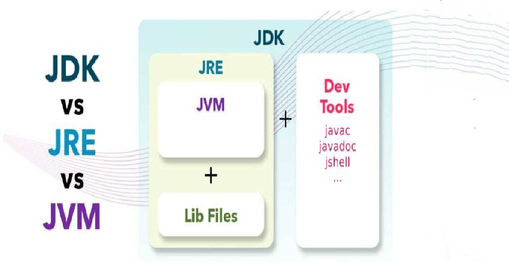
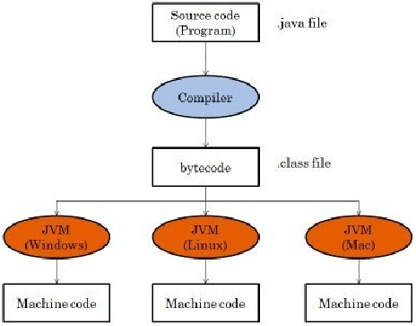
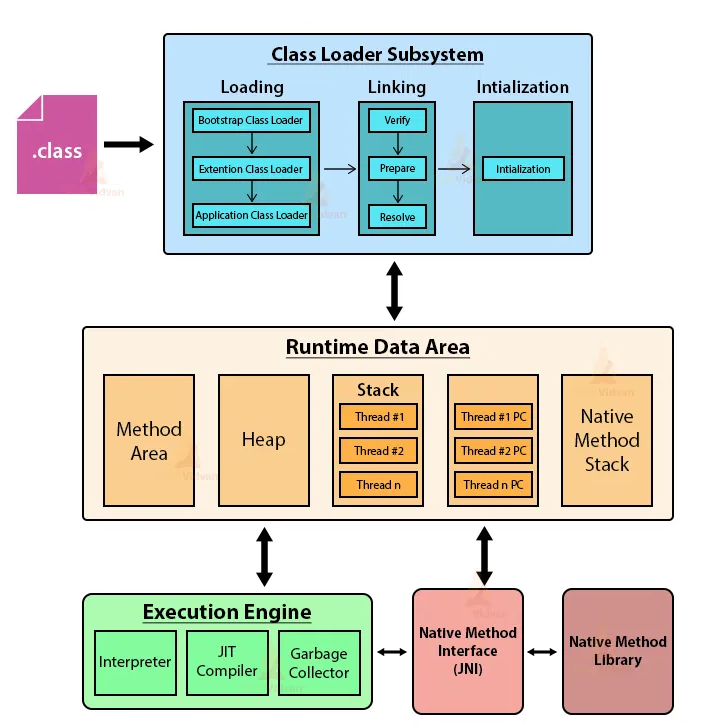
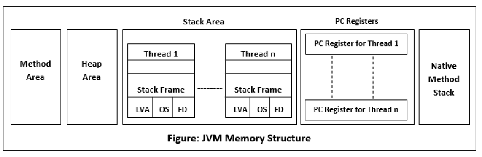

# JVM Internals

How Java code runs: the JDK/JRE/JVM split, bytecode and JIT compilation, class loaders, garbage collection, memory areas, and `OutOfMemoryError`.

**See also:** [Java Basics](basics.md) for language fundamentals, [Versions & Features](versions-features.md) for the Java version timeline.

## JDK, JRE, JVM



| JVM - Java Virtual Machine | JRE - Java Runtime Environment | JDK - Java Development Kit |
| :---- | :---- | :---- |
| A virtual machine that enables a computer to run Java programs as well as programs written in other languages that are also compiled to Java bytecode Its implementation is known as JRE JVM is Machine/OS-specific  | A software layer that runs on top of a computer’s operating system software and provides the class libraries and other resources that a specific Java program needs to run. Java Class Libraries: These are pre-written classes that provide a wide range of functionalities for developers. They cover areas like I/O operations, networking, data structures, user interface components, and more. These libraries simplify development by offering pre-built solutions for common tasks.  | A cross-platform software development environment that offers a collection of tools and libraries necessary for developing Java-based software applications and applets. It is a core package used in Java, along with the JVM (Java Virtual Machine) and the JRE (Java Runtime Environment).  JDK contains Java Runtime Environment (JRE), An interpreter/loader (Java), A compiler (javac), An archiver (jar) and many more. |

### Components and Tools

1. **ByteCode**
   The Java bytecode is the intermediate representation of Java source code after it has been compiled by the Java compiler (javac). Instead of compiling directly to machine code, Java source code is compiled into bytecode, which is a platform-independent binary format.

   Java bytecode is executed by the Java Virtual Machine (JVM), which is part of the Java Runtime Environment (JRE). The JVM is responsible for interpreting or just-in-time (JIT) compiling bytecode into machine code that can be executed by the underlying hardware.

2. **ClassLoader**
   The Java ClassLoader dynamically loads all classes necessary to run a Java program. Since Java classes are only loaded into memory when they're required, the JRE uses ClassLoaders to automate this process on demand.

3. **Bytecode verifier**
   The bytecode verifier ensures the format and accuracy of Java code before it passes to the interpreter. In the event that the code violates system integrity or access rights, the class will be considered corrupted and won't be loaded.

4. **Interpreter**
   After the bytecode successfully loads, the Java interpreter creates an instance of the JVM that allows the Java program to be executed natively on the underlying machine.

5. **javac**
   The Java Compiler (javac) is a command-line tool that compiles Java source code files (.java) into bytecode files (.class) that can be executed by the Java Virtual Machine (JVM).

6. **JShell**
   Introduced in Java 9, JShell is an interactive Read-Eval-Print Loop (REPL) tool that allows developers to experiment with Java code snippets and immediately see the results. It's particularly useful for testing small code fragments, exploring APIs, and learning Java syntax.

7. **Javadoc**
   The Javadoc tool (javadoc) generates HTML documentation from Java source code files. It extracts specially formatted comments (JavaDoc comments) from the source code and formats them into HTML pages, providing an easy-to-read reference for APIs.

8. **Java Debugger (jdb)**: The Java Debugger (jdb) is a command-line debugging tool that allows developers to debug Java programs interactively. It provides features such as setting breakpoints, stepping through code, inspecting variables, and evaluating expressions.

9. **Java Archive Tool (jar)**
   The Java Archive tool (jar) is used to package Java classes and resources into a single compressed file called a JAR (Java Archive). JAR files are commonly used to distribute libraries, applications, or Java applets.

10. **Javap**
    Javap is a command-line tool in the Java Development Kit (JDK) used to disassemble compiled Java class files. It displays information about the class's bytecode instructions, constant pool, fields, and methods in a human-readable format. Developers use javap for debugging, analyzing bytecode, and understanding the structure of compiled Java classes.

11. **JIT**
    [https://www.baeldung.com/graal-java-jit-compiler](https://www.baeldung.com/graal-java-jit-compiler)

    JIT (Just-In-Time) compilation in Java dynamically translates Java bytecode into native machine code during runtime, optimizing performance by executing compiled code directly. By identifying hot spots in the code and compiling frequently executed portions, JIT compilation enhances the execution speed of Java applications. This adaptive optimization process allows the JVM to balance between compilation overhead and runtime performance, achieving efficient execution on diverse hardware architectures.

    The JDK implementation by Oracle is based on the open-source OpenJDK project. This includes the HotSpot virtual machine, available since Java version 1.3. It contains two conventional JIT-compilers: the client compiler, also called C1 and the server compiler, called opto or C2.

    C1 is designed to run faster and produce less optimized code, while C2, on the other hand, takes a little more time to run but produces a better-optimized code. The client compiler is a better fit for desktop applications since we don’t want to have long pauses for the JIT-compilation. The server compiler is better for long-running server applications that can spend more time on the compilation.



### Class Loaders



[https://www.baeldung.com/java-classloaders](https://www.baeldung.com/java-classloaders)

In Java, class loaders are a fundamental part of the runtime environment. They are responsible for dynamically loading Java classes into the Java Virtual Machine (JVM) on demand.

#### What they do

* Class loaders handle loading `.class` files (containing bytecode) from various sources like the file system, network, or even custom locations depending on the implementation.
* They ensure that only required classes are loaded when needed, optimizing memory usage by avoiding upfront loading of all classes.
* They maintain class visibility and uniqueness within the JVM.

#### Key principles

* **Delegation Model**: Class loaders follow a parent-child hierarchy. When a class needs to be loaded, the request is delegated to the parent class loader first. The parent attempts to load the class, and if unsuccessful, the child class loader takes over. This ensures a standard search path and avoids conflicts.
* **Visibility**: A child class loader can see all classes loaded by its parent and ancestors. This allows for classes in different parts of the application to access commonly used classes loaded by the parent class loader. However, the reverse is not true – a parent class loader cannot see classes loaded by its child.
* **Uniqueness**: Class loaders guarantee that a class is loaded only once within the JVM, even if requested multiple times or from different sources. This prevents conflicts arising from duplicate class definitions.

#### Types of Class Loaders in Java

* **Bootstrap Class Loader (Primitive Bootstrap Loader):** This is the root of the hierarchy and is responsible for loading core JDK classes like `java.lang.Object`. It's written in native code and not accessible from Java code.
* **Extension Class Loader:** Loads classes from the `$JAVA_HOME/lib/ext` directory, typically containing extension libraries. (Java 8 and earlier; since Java 9 it is replaced by the **Platform Class Loader**.)
* **System Class Loader:** Loads classes from the system classpath, which is usually defined by the `CLASSPATH` environment variable. This is the class loader used for most user-written classes.
* **Application Class Loaders (Custom):** Developers can create custom class loaders to load classes from specific locations or implement custom loading logic.

#### Benefits of Class Loaders

* **Security**: By controlling class loading, the JVM can enforce security restrictions on where classes can be loaded from.
* **Flexibility**: Class loaders allow for modularity and customization of how classes are loaded.
* **Memory Efficiency**: Loading classes on demand helps optimize memory usage by avoiding unnecessary loading of unused classes.

## Java Memory Management

### Garbage Collector

Java garbage collection (GC) is an automatic process that manages memory allocation and reclaims memory occupied by unused objects in the Java heap.

A core feature of the Java Runtime Environment (JRE) that eliminates the need for manual memory management (unlike languages like C++).
It automatically identifies and removes objects that are no longer referenced by the program, freeing up memory for new object creation.

Methods like **System.gc() or Runtime.getRuntime().gc()** only request the JVM to run GC. The JVM might decide not to perform collection due to various factors, like ongoing program activity or insufficient memory overhead.

#### Working

* **Memory Allocation**: When a Java object is created, memory is allocated for it in the heap, a dedicated memory region managed by the garbage collector.
* **Object Reachability**: The garbage collector determines if an object is still reachable or "live." An object is considered live if it's referenced by a variable or another object that's still in use by the program.
* **Garbage Collection Cycle**: The GC runs periodically or when memory usage reaches a certain threshold. It uses algorithms to identify unreachable objects (garbage) and removes them from the heap.

#### Common GC Algorithms

* **Mark-Sweep**: This is a basic algorithm that identifies reachable objects by marking them and then sweeping the heap to reclaim unmarked objects (garbage).
* **Mark-Compact**: Similar to mark-sweep, but after marking live objects, it compacts them into a contiguous memory space, reducing memory fragmentation and potentially improving performance.
* **Generational Garbage Collection**: This is a more complex approach that divides the heap into generations based on object lifetimes. Younger generations (where objects are more likely to become garbage) are collected more frequently than older generations (where objects tend to have longer lifespans).

#### Impact on Application Performance

* While GC automates memory management, it can sometimes cause pauses in program execution during collection cycles, especially for large heaps or complex object structures.
* Understanding GC behavior and tuning GC parameters can help optimize application performance and minimize GC pauses.

#### Key Points to Remember

* You don't explicitly call GC in most cases. The JVM manages the GC process automatically.
* However, you can use the System.gc() method as a suggestion to the JVM to run garbage collection, but there's no guarantee it will happen immediately.
* Proper object management practices like avoiding memory leaks (holding references to unused objects) can improve GC efficiency.

### Java Memory Structure

[https://dip-mazumder.medium.com/java-memory-model-a-comprehensive-guide-ba9643b839e](https://dip-mazumder.medium.com/java-memory-model-a-comprehensive-guide-ba9643b839e)



* **Heap Memory**
  * The heap is the primary memory area where objects are allocated. It's a shared resource among all threads in a Java application.
  * The heap is divided into two main generations: the Young Generation and the Old Generation.
  * The Young Generation further consists of Eden space and Survivor spaces (S0 and S1).
  * Objects are initially allocated in the Eden space. Surviving objects are promoted to Survivor spaces during garbage collection.

* **Stack Memory**
  * Each thread in a Java application has its own stack memory.
  * The stack memory stores method invocations and local variables for each thread.
  * It operates in a Last-In-First-Out (LIFO) manner, with method calls and local variables pushed onto the stack as methods are invoked and popped off when methods return.

| Feature | Heap | Stack |
| :---- | :---- | :---- |
| **Functionality** | Stores all objects created during program execution. Objects reside in the heap until the garbage collector identifies them as unused and reclaims the memory. | Manages method calls, local variables, and frames (activation records) for each thread. The stack follows a Last-In-First-Out (LIFO) approach, where the most recently called method is at the top. |
| **Memory Allocation** | Uses dynamic memory allocation. The size of the heap can be adjusted while the program runs. | Uses static memory allocation. The stack size is typically predefined and limited, and it grows or shrinks as methods are called and return. |
| **Lifetime** | Objects in the heap can persist throughout the program's execution as long as they are referenced. The garbage collector determines when to remove them. | Data on the stack is temporary and specific to the current method execution. Once the method call finishes, the associated frame and variables are removed from the stack. |
| **Thread Visibility** | Objects in the heap are generally accessible by all threads in the program, although proper synchronization mechanisms are needed to avoid data races | Each thread has its own separate stack, and data on the stack is not directly accessible by other threads |
| **Management** | Managed by the garbage collector (GC). The GC automatically identifies and removes unused objects from the heap | Managed automatically by the JVM. When a stack overflow occurs (running out of stack space), a StackOverflowError exception is thrown. |

* **Method Area (PermGen/Metaspace)**
  * The method area stores class metadata, static fields, and method bytecode.
  * In older versions of Java (up to Java 7), the method area was known as PermGen (Permanent Generation). It stored metadata related to classes and methods.
  * In Java 8 and later versions, PermGen was replaced by Metaspace, which stores class metadata and other related information.

* **Native Memory**
  * Native memory is memory outside the JVM managed by the operating system.
  * It includes memory used by the JVM itself, as well as native libraries and resources accessed by Java applications.

* **Code Cache**
  * The code cache stores compiled native code generated by the Just-In-Time (JIT) compiler.
  * It helps improve the performance of Java applications by storing frequently executed bytecode as compiled native code.

* **Program Counter (PC)**
  * Tracks the currently executing instruction within a method.

### OutOfMemoryError

`OutOfMemoryError` is thrown when the JVM cannot allocate memory and the garbage collector cannot free enough. The message after the colon tells you which memory area ran out.

| Error message | Cause | Typical fix |
| :---- | :---- | :---- |
| `Java heap space` | Too many live objects for the heap, or a memory leak (for example an unbounded cache or collection) | Fix the leak; raise `-Xmx` only if the working set is genuinely larger |
| `GC overhead limit exceeded` | The JVM spends almost all its time in GC and recovers very little memory | Same as heap space: find what is retaining objects |
| `Metaspace` | Too many loaded classes, often from class-loader leaks (redeploys, dynamic proxies) | Fix the class-loader leak; set `-XX:MaxMetaspaceSize` to bound it |
| `unable to create native thread` | The OS refused another thread (too many threads or no native memory left) | Use thread pools; lower `-Xss`; check OS limits |

`StackOverflowError` is a different problem: a thread's stack is full, usually from unbounded recursion. It is an `Error`, but not an `OutOfMemoryError`.

**Diagnosing a heap problem**

```bash
# Dump the heap automatically when the error occurs
java -Xmx512m -XX:+HeapDumpOnOutOfMemoryError -XX:HeapDumpPath=./dumps MyApp

# Take a dump from a running process
jmap -dump:live,format=b,file=heap.hprof <pid>
```

Open the `.hprof` file in a heap analyzer such as Eclipse MAT or VisualVM and look for the objects with the largest retained size.
