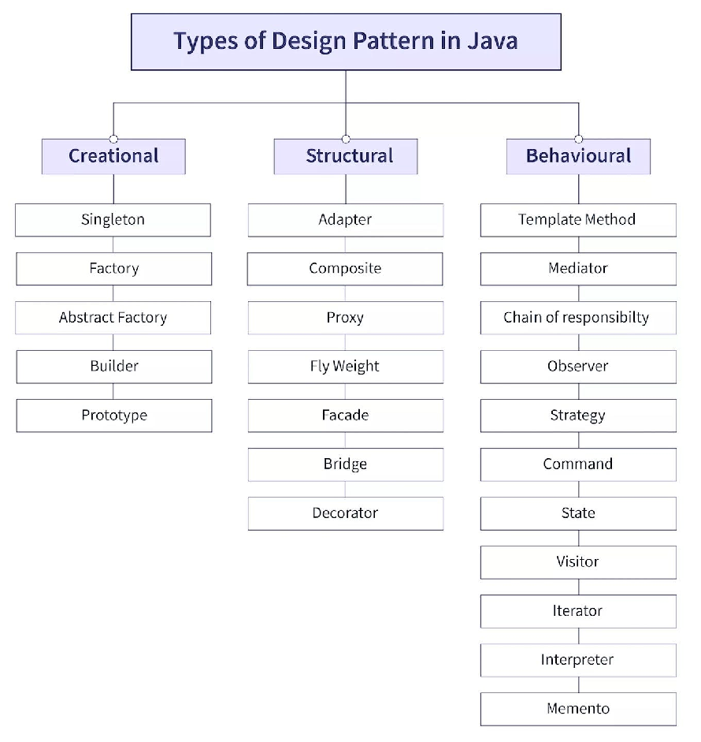

# Design Patterns

Design patterns are named, reusable solutions to recurring object-oriented design problems. The 23 Gang of Four (GoF) patterns fall into three categories: **creational** (how objects are created), **structural** (how objects are composed) and **behavioral** (how objects communicate). In interviews you are expected to name the pattern, state its intent, show a short example, and explain trade-offs and where Java or Spring already uses it.

**Further reading**

- [Refactoring Guru: Design Patterns in Java](https://refactoring.guru/design-patterns/java)
- [The 10 most popular types of design patterns in Java](https://vmsoftwarehouse.com/the-10-most-popular-types-of-design-patterns-in-java)
- [DigitalOcean: Java Design Patterns Example Tutorial](https://www.digitalocean.com/community/tutorials/java-design-patterns-example-tutorial)



---

## Pattern catalog

| Pattern | Category | Intent (one line) | Typical Java / Spring example |
| :-- | :-- | :-- | :-- |
| [Singleton](#singleton) | Creational | One instance with a global access point | Spring singleton beans, `Runtime.getRuntime()` |
| [Factory Method](#factory-method) | Creational | Subclasses decide which class to instantiate | `Calendar.getInstance()`, `List.of(...)` |
| [Abstract Factory](#abstract-factory) | Creational | Create families of related objects | `DocumentBuilderFactory`, JDBC `DriverManager` |
| [Builder](#builder) | Creational | Build complex objects step by step | `StringBuilder`, `Stream.Builder`, Lombok `@Builder` |
| [Prototype](#prototype) | Creational | Create new objects by copying existing ones | `Object.clone()`, Spring `prototype` scope |
| [Adapter](design-patterns-structural.md) | Structural | Make incompatible interfaces work together | `Arrays.asList`, `InputStreamReader` |
| [Bridge](design-patterns-structural.md) | Structural | Decouple abstraction from implementation | JDBC API and drivers |
| [Composite](design-patterns-structural.md) | Structural | Treat single objects and trees uniformly | Swing `Container`, JSON node trees |
| [Decorator](design-patterns-structural.md) | Structural | Add behavior by wrapping an object | `BufferedInputStream`, `Collections.unmodifiableList` |
| [Facade](design-patterns-structural.md) | Structural | Simple interface over a complex subsystem | Spring `JdbcTemplate`, SLF4J |
| [Flyweight](design-patterns-structural.md) | Structural | Share fine-grained objects to save memory | `Integer.valueOf` cache, String pool |
| [Proxy](design-patterns-structural.md) | Structural | Stand-in that controls access to an object | Spring AOP, `@Transactional`, `java.lang.reflect.Proxy` |
| [Chain of Responsibility](design-patterns-behavioral.md) | Behavioral | Pass a request along a chain of handlers | Servlet `Filter` chain, Spring Security filter chain |
| [Command](design-patterns-behavioral.md) | Behavioral | Encapsulate a request as an object | `Runnable`, `Callable` |
| [Interpreter](design-patterns-behavioral.md) | Behavioral | Define a grammar and interpret sentences | `java.util.regex.Pattern`, Spring SpEL |
| [Iterator](design-patterns-behavioral.md) | Behavioral | Traverse a collection without exposing internals | `java.util.Iterator`, `Iterable` |
| [Mediator](design-patterns-behavioral.md) | Behavioral | Centralize communication between objects | `ExecutorService`, `Timer` |
| [Memento](design-patterns-behavioral.md) | Behavioral | Capture and restore object state | Serialization, undo stacks |
| [Observer](design-patterns-behavioral.md) | Behavioral | Notify dependents when state changes | Spring `ApplicationEvent`, `PropertyChangeListener` |
| [State](design-patterns-behavioral.md) | Behavioral | Change behavior when internal state changes | Order or workflow state machines, Spring Statemachine |
| [Strategy](design-patterns-behavioral.md) | Behavioral | Swap interchangeable algorithms at runtime | `Comparator`, Spring `PasswordEncoder` |
| [Template Method](design-patterns-behavioral.md) | Behavioral | Fixed algorithm skeleton, steps overridden | `JdbcTemplate`, `AbstractList`, `HttpServlet.service` |
| [Visitor](design-patterns-behavioral.md) | Behavioral | Add operations without changing element classes | `FileVisitor`, `ElementVisitor` in annotation processing |

Structural patterns are covered in [Structural Design Patterns](design-patterns-structural.md) and behavioral patterns in [Behavioral Design Patterns](design-patterns-behavioral.md).

---

## Creational Patterns

Creational patterns abstract the instantiation process so the system does not depend on how its objects are created, composed or represented.

### Singleton

**Intent:** Ensure a class has exactly one instance and provide a global point of access to it.

**When to use**

- Exactly one object must coordinate actions (configuration, registry, connection pool, cache).
- The instance is expensive to create and safe to share.

**Example: enum singleton (preferred)**

The JVM guarantees an enum constant is created once, in a thread-safe way, and it is safe against reflection and serialization attacks.

```java
public enum AppConfig {
    INSTANCE;

    private final String environment = System.getProperty("app.env", "dev");

    public String environment() {
        return environment;
    }
}

// Usage
String env = AppConfig.INSTANCE.environment();
```

**Example: initialization-on-demand holder (lazy, thread-safe)**

```java
public final class Registry {
    private Registry() {}

    private static class Holder {
        private static final Registry INSTANCE = new Registry();
    }

    public static Registry getInstance() {
        return Holder.INSTANCE; // Holder is loaded (and initialized) on first call only
    }
}
```

**Example: double-checked locking (DCL)**

DCL is only correct if the field is `volatile`; without it, another thread can see a partially constructed object because of instruction reordering.

```java
public final class LazyService {
    private static volatile LazyService instance;

    private LazyService() {}

    public static LazyService getInstance() {
        LazyService result = instance;          // single volatile read
        if (result == null) {
            synchronized (LazyService.class) {
                result = instance;
                if (result == null) {
                    instance = result = new LazyService();
                }
            }
        }
        return result;
    }
}
```

**Pitfall: naive lazy singleton (not thread-safe)**

```java
// ❌ Bad: two threads can both see null and create two instances
public class NaiveSingleton {
    private static NaiveSingleton instance;

    private NaiveSingleton() {}

    public static NaiveSingleton getInstance() {
        if (instance == null) {
            instance = new NaiveSingleton();
        }
        return instance;
    }
}
```

**Trade-offs**

| Pros | Cons |
| :-- | :-- |
| Controlled access, one shared resource | Global state: hidden dependencies, hard to test and mock |
| Lazy creation possible | Easy to get thread safety wrong |
| Enum version is serialization and reflection safe | Tight coupling; one instance per classloader, not per JVM |

!!! tip "Interview tip"
    Mention that in Spring you almost never hand-write a singleton: a bean is a singleton **per container** by default, and dependency injection keeps it testable. Also mention the singleton-bean caveat: it must be stateless or thread-safe.

---

### Factory Method

**Intent:** Define an interface for creating an object, but let subclasses decide which class to instantiate.

**When to use**

- A class cannot anticipate the type of objects it must create.
- You want subclasses to choose the concrete product, keeping client code against an interface.
- You want to centralize construction logic (validation, pooling, caching).

**Example**

```java
public interface Shape {
    void draw();
}

public class Circle implements Shape {
    @Override
    public void draw() {
        System.out.println("Drawing Circle");
    }
}

public class Rectangle implements Shape {
    @Override
    public void draw() {
        System.out.println("Drawing Rectangle");
    }
}

// Creator declares the factory method
public interface ShapeFactory {
    Shape createShape();
}

public class CircleFactory implements ShapeFactory {
    @Override
    public Shape createShape() {
        return new Circle();
    }
}

public class RectangleFactory implements ShapeFactory {
    @Override
    public Shape createShape() {
        return new Rectangle();
    }
}

public class Demo {
    public static void main(String[] args) {
        ShapeFactory factory = new CircleFactory();
        factory.createShape().draw(); // Drawing Circle
    }
}
```

**Simple static factory (not a GoF pattern, but common)**

```java
public final class ShapeFactories {
    private ShapeFactories() {}

    public static Shape of(String type) {
        return switch (type) {
            case "circle" -> new Circle();
            case "rectangle" -> new Rectangle();
            default -> throw new IllegalArgumentException("Unknown shape: " + type);
        };
    }
}
```

**Trade-offs**

| Pros | Cons |
| :-- | :-- |
| Client depends on an interface, not concrete classes | One extra creator class per product |
| Open/Closed: add products without changing clients | Can be over-engineering for two or three types |
| Single place for creation logic | Static factory variant needs edits for each new type |

!!! tip "Interview tip"
    Distinguish **Factory Method** (inheritance: a subclass overrides one creation method) from **Abstract Factory** (composition: an object that creates a family) and from a **static factory method** such as `List.of()` or `Integer.valueOf()`.

---

### Abstract Factory

**Intent:** Provide an interface for creating families of related or dependent objects without specifying their concrete classes.

**When to use**

- The system must work with several product families (for example, UI widgets per operating system).
- Products from one family must be used together and never mixed.

**Example**

```java
public interface Button {
    void paint();
}

public interface Checkbox {
    void paint();
}

public interface GUIFactory {
    Button createButton();
    Checkbox createCheckbox();
}

// Windows family
public class WinButton implements Button {
    @Override
    public void paint() {
        System.out.println("Windows button");
    }
}

public class WinCheckbox implements Checkbox {
    @Override
    public void paint() {
        System.out.println("Windows checkbox");
    }
}

public class WinFactory implements GUIFactory {
    @Override
    public Button createButton() {
        return new WinButton();
    }

    @Override
    public Checkbox createCheckbox() {
        return new WinCheckbox();
    }
}

// Mac family
public class MacButton implements Button {
    @Override
    public void paint() {
        System.out.println("Mac button");
    }
}

public class MacCheckbox implements Checkbox {
    @Override
    public void paint() {
        System.out.println("Mac checkbox");
    }
}

public class MacFactory implements GUIFactory {
    @Override
    public Button createButton() {
        return new MacButton();
    }

    @Override
    public Checkbox createCheckbox() {
        return new MacCheckbox();
    }
}

public class Application {
    private final Button button;
    private final Checkbox checkbox;

    public Application(GUIFactory factory) {
        this.button = factory.createButton();
        this.checkbox = factory.createCheckbox();
    }

    public void render() {
        button.paint();
        checkbox.paint();
    }

    public static void main(String[] args) {
        boolean mac = System.getProperty("os.name").toLowerCase().contains("mac");
        new Application(mac ? new MacFactory() : new WinFactory()).render();
    }
}
```

**Trade-offs**

| Pros | Cons |
| :-- | :-- |
| Guarantees products in a family are compatible | Many interfaces and classes |
| Swap the whole family by changing one factory | Adding a new product type changes every factory |
| Client is isolated from concrete classes | Overkill when there is only one family |

!!! tip "Interview tip"
    A good analogy: Factory Method creates **one** product, Abstract Factory creates a **family** of products. In Spring, profiles or `@ConditionalOnProperty` choosing a whole set of beans is the same idea.

---

### Prototype

**Intent:** Create new objects by copying (cloning) an existing instance instead of constructing from scratch.

**When to use**

- Construction is costly (database load, heavy computation) and copies differ only slightly.
- You want to avoid a parallel hierarchy of factories.
- You need copies of objects whose concrete class is only known at runtime.

**Example: explicit prototype interface with copy constructor (recommended)**

```java
interface Prototype<T> {
    T copy();
}

class ConcretePrototype implements Prototype<ConcretePrototype> {
    private int value;
    private final List<String> tags;

    public ConcretePrototype(int value, List<String> tags) {
        this.value = value;
        this.tags = new ArrayList<>(tags);   // defensive copy
    }

    // Copy constructor: performs a deep copy of mutable state
    public ConcretePrototype(ConcretePrototype other) {
        this(other.value, other.tags);
    }

    public void setValue(int value) {
        this.value = value;
    }

    @Override
    public ConcretePrototype copy() {
        return new ConcretePrototype(this);
    }

    @Override
    public String toString() {
        return "ConcretePrototype [value=" + value + ", tags=" + tags + "]";
    }
}

public class Client {
    public static void main(String[] args) {
        ConcretePrototype prototype = new ConcretePrototype(10, List.of("a", "b"));
        ConcretePrototype clone = prototype.copy();
        clone.setValue(20);

        System.out.println(prototype); // value=10 (unchanged)
        System.out.println(clone);     // value=20
    }
}
```

**Java's built-in `Cloneable` and its pitfalls**

```java
class Document implements Cloneable {
    String title;
    List<String> pages = new ArrayList<>();

    @Override
    public Document clone() {
        try {
            Document copy = (Document) super.clone();   // shallow copy
            copy.pages = new ArrayList<>(pages);        // must deep-copy mutable fields yourself
            return copy;
        } catch (CloneNotSupportedException e) {
            throw new AssertionError(e);                // cannot happen: we implement Cloneable
        }
    }
}
```

- `Cloneable` is a marker interface with no `clone()` method; `Object.clone()` is `protected` and throws a checked exception.
- `super.clone()` is a **shallow** copy: mutable fields (collections, arrays, nested objects) are shared unless you copy them.
- It bypasses constructors, so `final` fields cannot be re-assigned and invariants may be skipped.
- Subclasses must also call `super.clone()` correctly or the chain breaks.
- Effective Java recommends a **copy constructor** or **static copy factory** instead.

**Trade-offs**

| Pros | Cons |
| :-- | :-- |
| Cheaper than rebuilding complex objects | Deep copy of cyclic or nested structures is tricky |
| Hides concrete classes from the client | `Cloneable` is broken by design; prefer copy constructors |
| Runtime configuration of prototypes | Shallow-copy bugs cause shared mutable state |

!!! note "Spring"
    `@Scope("prototype")` makes the container return a **new bean instance per request**. The name is related but it creates fresh instances via the constructor, not by cloning.

!!! tip "Interview tip"
    Be ready for "shallow vs deep copy" and "why is `Cloneable` considered broken". Answer: marker interface, protected `clone()`, no constructor call, shallow by default; prefer copy constructors.

---

### Builder

**Intent:** Separate the construction of a complex object from its representation, so the same process can produce different results and objects with many optional parameters stay readable and immutable.

**When to use**

- A constructor would need many parameters, especially optional ones (the "telescoping constructor" problem).
- You want immutable objects with validation at build time.
- Object creation is a multi-step process.

**Example: classic GoF builder with director**

```java
class Pizza {
    private String dough;
    private String sauce;
    private String topping;

    public void setDough(String dough) { this.dough = dough; }
    public void setSauce(String sauce) { this.sauce = sauce; }
    public void setTopping(String topping) { this.topping = topping; }

    @Override
    public String toString() {
        return "Pizza [dough=" + dough + ", sauce=" + sauce + ", topping=" + topping + "]";
    }
}

interface PizzaBuilder {
    void buildDough();
    void buildSauce();
    void buildTopping();
    Pizza getPizza();
}

class HawaiianPizzaBuilder implements PizzaBuilder {
    private final Pizza pizza = new Pizza();

    @Override
    public void buildDough() { pizza.setDough("Pan crust"); }

    @Override
    public void buildSauce() { pizza.setSauce("Tomato sauce"); }

    @Override
    public void buildTopping() { pizza.setTopping("Ham and pineapple"); }

    @Override
    public Pizza getPizza() { return pizza; }
}

// Director (optional): fixes the order of construction steps
class PizzaDirector {
    private final PizzaBuilder builder;

    public PizzaDirector(PizzaBuilder builder) {
        this.builder = builder;
    }

    public void makePizza() {
        builder.buildDough();
        builder.buildSauce();
        builder.buildTopping();
    }
}

public class PizzaDemo {
    public static void main(String[] args) {
        PizzaBuilder builder = new HawaiianPizzaBuilder();
        new PizzaDirector(builder).makePizza();
        System.out.println(builder.getPizza());
    }
}
```

**Example: fluent builder for an immutable class (most common in Java)**

```java
public final class User {
    private final String name;      // required
    private final String email;     // required
    private final int age;          // optional
    private final String phone;     // optional

    private User(Builder b) {
        this.name = b.name;
        this.email = b.email;
        this.age = b.age;
        this.phone = b.phone;
    }

    public static Builder builder(String name, String email) {
        return new Builder(name, email);
    }

    public static final class Builder {
        private final String name;
        private final String email;
        private int age;
        private String phone;

        private Builder(String name, String email) {
            this.name = name;
            this.email = email;
        }

        public Builder age(int age) { this.age = age; return this; }
        public Builder phone(String phone) { this.phone = phone; return this; }

        public User build() {
            if (age < 0) throw new IllegalStateException("age must be >= 0");
            return new User(this);
        }
    }

    @Override
    public String toString() {
        return "User[name=" + name + ", email=" + email + ", age=" + age + ", phone=" + phone + "]";
    }
}

// Usage
User user = User.builder("Asha", "asha@example.com").age(30).build();
```

**Lombok `@Builder`**

```java
import lombok.Builder;
import lombok.Value;

@Value
@Builder
public class Order {
    String id;
    String customer;
    @Builder.Default int quantity = 1;
}

// Usage
Order order = Order.builder().id("o-1").customer("Asha").quantity(3).build();
```

- `@Builder` generates the builder class and `build()`; pair with `@Value` for immutability.
- Use `@Builder.Default` for default values, and `toBuilder = true` to copy-and-modify.
- Lombok generates code at compile time; there is no runtime cost, but the generated API is hidden from the source.

**Records (Java 16+) and builders**

Records give concise immutable data carriers. For few components, use the canonical constructor directly; for many optional fields, add a small builder or a Lombok `@Builder` on the record.

```java
public record Address(String street, String city, String zip) {
    public Address {                                   // compact constructor: validation
        Objects.requireNonNull(street);
        Objects.requireNonNull(city);
    }

    public static Builder builder() { return new Builder(); }

    public static final class Builder {
        private String street, city, zip;
        public Builder street(String s) { this.street = s; return this; }
        public Builder city(String c) { this.city = c; return this; }
        public Builder zip(String z) { this.zip = z; return this; }
        public Address build() { return new Address(street, city, zip); }
    }
}

Address a = Address.builder().street("1 Main St").city("Pune").zip("411001").build();
```

**Trade-offs**

| Pros | Cons |
| :-- | :-- |
| Readable construction with named steps | More code (unless generated by Lombok) |
| Immutable objects and validation in `build()` | Required fields not enforced at compile time in a simple fluent builder |
| Avoids telescoping constructors and setters | Builder object allocation per instance |

!!! tip "Interview tip"
    Show a real-world use: `StringBuilder`, `Stream.builder()`, `HttpRequest.newBuilder()`, Spring `UriComponentsBuilder`, `ResponseEntity.ok().header(...).body(...)`. Contrast with the JavaBean setter style, which leaves objects partially built and mutable.

---

## Spring/Java examples

| Pattern | Where you see it |
| :-- | :-- |
| Singleton | Default Spring bean scope; `Runtime.getRuntime()` |
| Factory Method | `FactoryBean`, `@Bean` methods, `List.of()`, `Optional.of()` |
| Abstract Factory | `BeanFactory` / `ApplicationContext`, `DocumentBuilderFactory` |
| Prototype | `@Scope("prototype")`, `ArrayList` copy constructor |
| Builder | `UriComponentsBuilder`, `HttpRequest.newBuilder()`, `StringBuilder` |

---

## Common interview questions

- **Which singleton implementation do you prefer and why?** Enum (thread-safe, serialization and reflection safe) or the holder idiom for lazy loading; DCL only with `volatile`.
- **How can a singleton be broken?** Reflection (call the private constructor), serialization (fix with `readResolve`), cloning, multiple classloaders. Enum singletons defeat the first three.
- **Factory Method vs Abstract Factory?** One product via subclassing vs a family of related products via composition.
- **Shallow vs deep copy in Prototype?** Shallow shares referenced objects; deep copies them. Prefer copy constructors over `Cloneable`.
- **When would you use Builder over a constructor?** Many optional parameters, immutability, validation at build time.
- **Is a Spring singleton bean the same as the Singleton pattern?** No: it is one instance per container, not per classloader, and is managed by DI rather than a static accessor.

More questions with full answers:

- [Design Patterns questions](../interview-questions/verbal/verbal-design-patterns-questions.md)
- [Design Principles and Applied Patterns questions](../interview-questions/verbal/verbal-design-patterns-principles-questions.md)

---

## More references

- [Java Singleton Best Practices (DigitalOcean)](https://www.digitalocean.com/community/tutorials/java-singleton-design-pattern-best-practices-examples)
- [Essential Java design patterns (Medium)](https://medium.com/@minadev/solving-everyday-problems-essential-java-design-patterns-you-need-to-know-01dba2939b45)
- [Dependency Injection design pattern (GeeksforGeeks)](https://www.geeksforgeeks.org/dependency-injection-di-design-pattern/)
- [Dependency Injection in Java (Groupon Engineering)](https://medium.com/groupon-eng/dependency-injection-in-java-9e9438aa55ae)

**Practice questions:** [Design Patterns](../interview-questions/verbal/verbal-design-patterns-questions.md), [Design Principles and Applied Patterns](../interview-questions/verbal/verbal-design-patterns-principles-questions.md), [Java Advanced](../interview-questions/verbal/verbal-java-advanced-questions.md), [Application Architecture and Maintainability](../interview-questions/verbal/verbal-architecture-layered-clean-questions.md)
