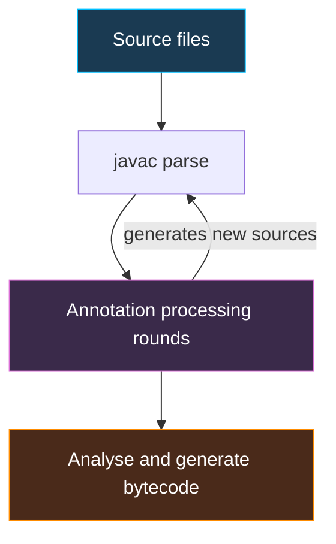

# Lombok, Annotation Processing and Reflection

Lombok removes boilerplate (getters, constructors, builders, loggers) at **compile time**. It works through annotation processing, which is also how MapStruct, Dagger and Immutables work. Reflection is the **runtime** counterpart used by Spring, Hibernate and Jackson. Both are interview favourites for "how does it work" and "what can go wrong". Basics: [Annotations](advanced.md#annotations), [Reflection](advanced.md#reflection).

## Lombok Annotations

| Annotation | Generates | Watch out |
| :-- | :-- | :-- |
| `@Getter` / `@Setter` | Accessors (class or field level) | Setters make objects mutable |
| `@ToString` | `toString()` | Exclude lazy/cyclic fields: `@ToString.Exclude` |
| `@EqualsAndHashCode` | `equals`/`hashCode` from all non-static, non-transient fields | JPA entities: see pitfalls |
| `@NoArgsConstructor` / `@AllArgsConstructor` / `@RequiredArgsConstructor` | Constructors; Required = `final` and `@NonNull` fields | Great for Spring constructor injection |
| `@Data` | `@Getter @Setter @ToString @EqualsAndHashCode @RequiredArgsConstructor` | Too broad for entities and inheritance |
| `@Value` | Immutable class: all fields `private final`, class `final`, getters, all-args constructor | Prefer a Java record (16+) for plain data |
| `@Builder` | Builder class and `builder()` | Loses defaults unless `@Builder.Default`; needs `@NoArgsConstructor`/`@AllArgsConstructor` for frameworks |
| `@With` | Copy with one field changed | Immutable updates |
| `@Slf4j` / `@Log4j2` | `private static final Logger log` | Needs the logging dependency |
| `@NonNull` | Null check in generated code | Throws `NullPointerException` |
| `@SneakyThrows` | Throws checked exceptions without declaring | Hides control flow; use sparingly |
| `@Cleanup` | Auto close | Prefer try-with-resources |
| `val` / `var` | Local type inference | Use Java `var` (10+) instead |

```java
import lombok.*;
import lombok.extern.slf4j.Slf4j;

@Slf4j
@Value
@Builder(toBuilder = true)
public class Customer {
    @NonNull String id;
    String email;
    @Builder.Default List<String> roles = List.of("USER");

    public void greet() { log.info("Hello {}", id); }
}

Customer c = Customer.builder().id("c1").email("a@x.io").build();
Customer admin = c.toBuilder().roles(List.of("ADMIN")).build();
```

```java
@Service
@RequiredArgsConstructor           // constructor injection without writing the constructor
public class BillingService {
    private final InvoiceRepository repo;
    private final Clock clock;
}
```

## Pitfalls

- **`@Data` on JPA entities**: generated `equals`/`hashCode` over all fields touches lazy associations (extra queries, `LazyInitializationException`) and changes with generated ids. Use `@Getter @Setter`, and write `equals`/`hashCode` on the id (or business key) by hand. Exclude collections from `@ToString`.
- **Cyclic relations** (`parent <-> child`) make `toString`/`hashCode` recurse until `StackOverflowError`.
- **Inheritance**: `@EqualsAndHashCode` ignores superclass fields unless `callSuper = true`; `@Data` on a subclass warns about it.
- **`@Builder` and defaults**: a field initialiser is ignored by the builder; use `@Builder.Default`. On a class it also removes the no-args constructor, which Jackson/JPA may need.
- **`@Builder` on collections**: add `@Singular` for ergonomic add-one methods.
- **`@Setter` on `@Value`** is not allowed; `@Value` plus Jackson needs a constructor annotation (`@Jacksonized @Builder` helps).
- **`@AllArgsConstructor` ordering** follows field order, so reordering fields silently changes call meaning for same-typed fields.
- **Tooling and debugging**: needs IDE plugin and annotation processing enabled; stack traces point to generated code lines; Javadoc and `javap` show generated members.
- **Java upgrades**: Lombok must support the JDK version. Pin a current Lombok release; internals use compiler APIs, so mismatches fail the build.
- **Builds**: with Maven put Lombok in `provided`/`annotationProcessorPaths`; in Gradle use `compileOnly` plus `annotationProcessor`. When combined with MapStruct, Lombok must run **first** (`lombok-mapstruct-binding`).
- **Alternatives**: records (16+) for immutable data, IDE generation for the rest.

## Annotation Processing (APT)

An **annotation processor** is a compiler plug-in (`javax.annotation.processing.AbstractProcessor`) discovered through `META-INF/services/javax.annotation.processing.Processor` (or `@AutoService`). During `javac` it receives the program model and can **generate new source files** and report diagnostics. Standard processors cannot modify existing classes.



```java
@SupportedAnnotationTypes("com.example.GenerateHello")
@SupportedSourceVersion(SourceVersion.RELEASE_17)
public class HelloProcessor extends AbstractProcessor {
    @Override
    public boolean process(Set<? extends TypeElement> annotations, RoundEnvironment round) {
        for (Element e : round.getElementsAnnotatedWith(GenerateHello.class)) {
            String name = e.getSimpleName() + "Hello";
            try (Writer w = processingEnv.getFiler()
                    .createSourceFile(name, e).openWriter()) {
                w.write("public class " + name + " { public String hi() { return \"hi\"; } }");
            } catch (IOException ex) {
                processingEnv.getMessager().printMessage(
                    javax.tools.Diagnostic.Kind.ERROR, ex.toString(), e);
            }
        }
        return true;
    }
}
```

**How Lombok differs:** Lombok uses the processor hook to get at javac's internal AST (`com.sun.tools.javac.tree`) and **modifies the existing class in place** (adds methods and fields). That is why it is javac/ECJ-specific, needs IDE support, and depends on compiler internals. MapStruct, Dagger and Immutables use the supported route and only generate new classes.

| | Annotation processing (compile time) | Reflection (runtime) |
| :-- | :-- | :-- |
| When | During `javac` | While running |
| Cost | Build time only | Per-call overhead, startup scanning |
| Safety | Errors at compile time | `NoSuchMethodException` etc. at runtime |
| Native image friendly | Yes (generated plain code) | Needs hints/configuration |
| Examples | Lombok, MapStruct, Dagger | Spring DI, Hibernate, Jackson |

This is why Micronaut, Quarkus and Dagger moved work to build time: faster startup and [GraalVM native images](../spring-web/spring-native-graalvm.md).

## Reflection Pitfalls

```java
Class<?> c = Class.forName("com.example.Secret");
Constructor<?> ctor = c.getDeclaredConstructor();
ctor.setAccessible(true);                      // may throw InaccessibleObjectException (Java 16+/17)
Object o = ctor.newInstance();
Method m = c.getDeclaredMethod("hash", String.class);
m.setAccessible(true);
Object r = m.invoke(o, "x");                   // InvocationTargetException wraps the real cause
```

| Pitfall | Detail |
| :-- | :-- |
| **Strong encapsulation (Java 16/17+)** | `setAccessible(true)` on JDK internals fails; `--illegal-access` was removed in 17. Workaround: `--add-opens java.base/java.lang=ALL-UNNAMED`, or use public APIs |
| **Performance** | Slower than direct calls and blocks inlining; cache `Method`/`Field` lookups. Since Java 18 core reflection uses method handles internally, narrowing the gap; `MethodHandle`/`VarHandle` are faster still |
| **Breaks encapsulation** | Can alter `private` and even `final` instance fields; breaks singleton and immutability guarantees |
| **No compile-time checks** | Refactors and renames silently break string-based lookups |
| **`InvocationTargetException`** | Unwrap with `getCause()` |
| **Security** | Deserialisation and reflective instantiation of attacker-chosen classes is a known attack path; never `Class.forName` user input |
| **Native image / obfuscation** | Reflective access needs registration (`reflect-config`, `@RegisterReflectionForBinding`); shrinkers can remove "unused" members |
| **Generics** | Erased at runtime; use `TypeToken`-style or `ParameterizedType` to recover |
| **Memory leaks** | Cached `Class` objects can keep classloaders alive in app servers |

## Common Interview Questions

- *How does Lombok work?* An annotation processor hooks into `javac`, edits the AST of annotated classes, so the generated members exist in the `.class` file but not in source.
- *Why avoid `@Data` on entities?* All-field `equals`/`hashCode`/`toString` trigger lazy loading, cycles and unstable hashes.
- *Annotation processing vs reflection?* Compile-time code generation (fast, checked, native-friendly) vs runtime inspection (flexible, slower, unchecked).
- *Can an annotation processor change an existing class?* Not through the public API; it can only generate new files. Lombok uses internal compiler APIs.
- *What does `setAccessible(true)` do and when does it fail?* Disables access checks; fails on non-open modules (Java 17+).
- *Retention policies?* SOURCE (discarded, used by Lombok and processors), CLASS (in bytecode only), RUNTIME (readable via reflection).

**See also:** [Advanced Java](advanced.md), [Java basics: annotations](../java-core/basics.md#annotations)

**Practice questions:** [Java Advanced](../interview-questions/verbal/verbal-java-advanced-questions.md)
