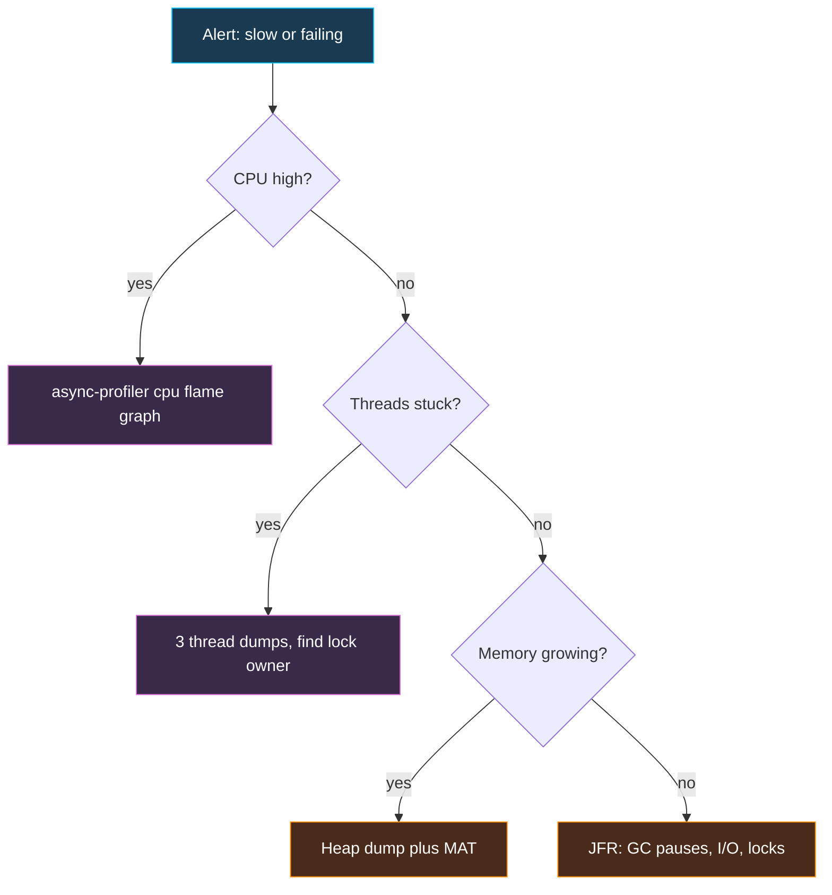

# Profiling and Diagnostics: JFR, async-profiler, Thread and Heap Dumps

A practical walkthrough for diagnosing a slow, hung or leaking JVM in production. Summary of tools lives in [Profiling Tools](logging-performance.md#profiling-tools) and [GC monitoring](advanced.md#gc-monitoring); this page is the how-to. Commands target JDK 17/21/25 (`$PID` is the Java process id from `jcmd -l` or `jps`).

## Which Tool for Which Symptom

| Symptom | First tool | What you look for |
| :-- | :-- | :-- |
| High CPU | async-profiler (cpu) or JFR | Hot methods, flame graph |
| Latency spikes | JFR (GC, locks, I/O events) | Long GC pauses, lock contention, slow sockets |
| App hung / unresponsive | Thread dump (3 dumps, 5s apart) | `BLOCKED`, deadlocks, all workers parked on the same call |
| Growing memory / `OutOfMemoryError` | Heap dump plus MAT | Dominator tree, leak suspects |
| Excess allocation / GC churn | JFR allocation events, async-profiler `alloc` | Top allocating stack traces |
| Thread-pool exhaustion | Thread dump | Many threads waiting on a pool, DB or HTTP client |

## Java Flight Recorder (JFR)

Built into the JDK, event-based, typically about 1 percent overhead. Free to use since JDK 11 (the `UnlockCommercialFeatures` flag is obsolete and removed).

```bash
# Start with the app (default profile ~ low overhead; "profile" setting = more detail)
java -XX:StartFlightRecording=filename=app.jfr,duration=120s,settings=profile -jar app.jar

# Or attach to a running process
jcmd $PID JFR.start name=rec settings=profile duration=60s filename=/tmp/rec.jfr
jcmd $PID JFR.dump name=rec filename=/tmp/now.jfr     # snapshot without stopping
jcmd $PID JFR.stop name=rec

# Always-on ring buffer, dump on demand or on crash/OOM
java -XX:StartFlightRecording=maxage=1h,maxsize=500M,dumponexit=true,filename=/var/log/app.jfr -jar app.jar

# Inspect without a GUI
jfr summary app.jfr
jfr print --events jdk.GCPhasePause,jdk.JavaMonitorEnter app.jfr
```

Open the file in **JDK Mission Control (JMC)**: Method Profiling (hot methods), Memory (allocation and GC), Lock Instances, I/O, Threads. Useful events: `jdk.ExecutionSample`, `jdk.GarbageCollection`, `jdk.ObjectAllocationSample`, `jdk.JavaMonitorEnter`, `jdk.SocketRead`. Custom events: extend `jdk.jfr.Event`. Since JDK 17+ JFR streaming (`RecordingStream`) gives live events, and virtual-thread events exist from 21.

## async-profiler

Low-overhead sampling profiler for Linux/macOS that avoids the **safepoint bias** of many JVM profilers (it uses `AsyncGetCallTrace`/perf events) and can show native frames, kernel frames and allocations.

```bash
# CPU profile for 30s, flame graph as HTML
./asprof -d 30 -e cpu -f /tmp/cpu.html $PID

# Wall-clock (finds waiting: I/O, locks), useful for latency of a blocked service
./asprof -d 30 -e wall -t -f /tmp/wall.html $PID

# Allocation and lock contention
./asprof -d 30 -e alloc -f /tmp/alloc.html $PID
./asprof -d 30 -e lock  -f /tmp/lock.html  $PID

# As a JVM agent from startup
java -agentpath:/path/libasyncProfiler.so=start,event=cpu,file=/tmp/cpu.html -jar app.jar
```

Reading a flame graph: **width = share of samples**, vertical = call stack depth. Look for wide plateaus at the top (the code actually consuming CPU), not for tall towers. Compare `cpu` vs `wall`: wide in `wall` but absent in `cpu` means waiting, not computing. Containers: need `perf_event_paranoid` relaxed or `--cap-add SYS_ADMIN`/`SYS_PTRACE`, or use `-e itimer`.

## Thread Dumps

A snapshot of every thread's state and stack. Take **several** (e.g. 3, 5 seconds apart): one dump is a still photo, a pattern is evidence.

```bash
jcmd $PID Thread.print            # preferred
jstack -l $PID > t1.txt           # -l adds lock info (ownable synchronizers)
kill -3 $PID                      # prints to the process stdout (Linux)
jcmd $PID Thread.dump_to_file -format=json /tmp/threads.json   # JDK 21+, includes virtual threads
```

```text
"http-nio-8080-exec-7" #42 prio=5 tid=0x... nid=0x2f1b waiting for monitor entry
   java.lang.Thread.State: BLOCKED (on object monitor)
	at com.example.Cache.get(Cache.java:31)
	- waiting to lock <0x000000076ab62208> (a java.util.HashMap)
	at com.example.Api.handle(Api.java:18)
```

| State | Meaning | Typical cause |
| :-- | :-- | :-- |
| `RUNNABLE` | Running or in native code (also sockets reading) | CPU hog, or blocked in a socket read (looks runnable) |
| `BLOCKED` | Waiting for a monitor (`synchronized`) | Lock contention; find the owner `- locked <0x...>` |
| `WAITING` / `TIMED_WAITING` | `wait`, `park`, `sleep` | Idle pool workers (normal), or waiting on a DB/HTTP response |

Checklist: look for the `Found one Java-level deadlock` section (jstack prints it); count threads per pool; find the thread holding the lock most others wait for; map `nid` (hex) to OS thread ids from `top -H -p $PID` (convert with `printf '%x'`) to find which thread burns CPU. Analysers: fastThread, or IDE thread-dump viewers.

## Heap Dumps

```bash
# On demand (live objects only, triggers a full GC; pauses the JVM)
jcmd $PID GC.heap_dump /tmp/heap.hprof
jmap -dump:live,format=b,file=/tmp/heap.hprof $PID

# Automatic on OutOfMemoryError (set this in every production service)
java -XX:+HeapDumpOnOutOfMemoryError -XX:HeapDumpPath=/var/dumps/ -jar app.jar

# Cheap trend view without a dump
jcmd $PID GC.class_histogram | head -20
```

Analyse with **Eclipse MAT** (or VisualVM / JProfiler):

1. Open the `.hprof` and run **Leak Suspects**.
2. Use the **Dominator Tree**: objects sorted by *retained size*, the memory freed if they were collected.
3. Use **Path to GC Roots (exclude weak/soft references)** on a suspect to see what holds it: a static map, `ThreadLocal`, listener list, unbounded cache, or a classloader.
4. Compare two dumps taken minutes apart; growing instance counts reveal the leak.

Practicalities: dump size is about the heap size, so keep disk space free and mind PII in dumps (they contain real data; restrict access). In Kubernetes mount a volume for `HeapDumpPath`, or the file is lost when the pod restarts. Set `-XX:MaxRAMPercentage` so the container limit is respected and you get an `OutOfMemoryError` (with dump) instead of an OOM-kill (without).

## A Realistic Triage Flow



## Common Interview Questions

- *App is slow, what do you do first?* Check metrics and logs, then CPU vs waiting: profile (JFR/async-profiler) for CPU, thread dumps for blocking, GC logs/heap for memory.
- *JFR vs async-profiler?* JFR: built in, many event types (GC, locks, I/O), JMC GUI. async-profiler: accurate flame graphs, native/kernel frames, wall-clock and allocation modes; no safepoint bias.
- *How do you find a deadlock?* `jstack`/`jcmd Thread.print` reports it; or `ThreadMXBean.findDeadlockedThreads()` programmatically.
- *`BLOCKED` vs `WAITING`?* BLOCKED waits for a monitor; WAITING waits for a notification, unpark or join.
- *How do you find a memory leak?* Heap dump on OOM, MAT dominator tree and path to GC roots; confirm growth by comparing dumps or class histograms.
- *Retained vs shallow size?* Shallow is the object itself; retained includes everything only it keeps alive.
- *Safe in production?* JFR and `Thread.print` yes; `heap_dump` pauses the JVM (and `live` forces a GC), so do it on one instance after removing it from the load balancer.

**See also:** [Logging & Performance](logging-performance.md), [Advanced Java: GC](advanced.md#garbage-collection-gc), [Spring Boot Actuator](../spring-web/spring-boot-actuator.md)

**Practice questions:** [Java Advanced](../interview-questions/verbal/verbal-java-advanced-questions.md)
