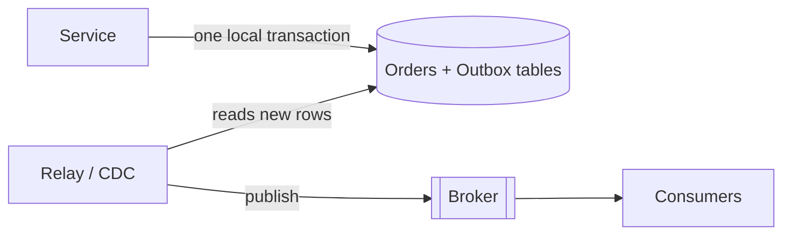
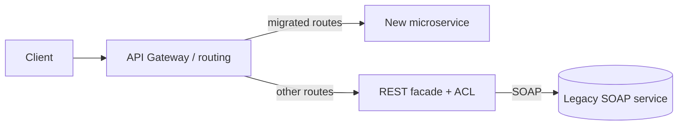

# Data Consistency Patterns: Outbox, Idempotency Keys, Legacy Wrapping

Practical patterns for keeping services consistent without distributed transactions (see [2PC and Saga](principles.md#communication-patterns) for why) and for modernising legacy systems safely.

## Transactional Outbox

**Problem (dual write):** a service must update its database *and* publish an event. Doing both separately can fail halfway: DB committed but the broker call fails (event lost), or the event is sent and the DB rolls back (phantom event).

**Solution:** write the event to an **outbox table in the same local transaction** as the business change. A separate process reads the outbox and publishes to the broker, then marks the rows sent.



```sql
CREATE TABLE outbox (
  id            UUID PRIMARY KEY,
  aggregate_id  VARCHAR(64)  NOT NULL,
  type          VARCHAR(64)  NOT NULL,
  payload       JSONB        NOT NULL,
  created_at    TIMESTAMP    NOT NULL DEFAULT now(),
  published_at  TIMESTAMP
);
```

```java
@Service
public class OrderService {
    private final OrderRepository orders;
    private final OutboxRepository outbox;
    private final ObjectMapper mapper;

    // constructor omitted

    @Transactional
    public void placeOrder(Order order) throws JsonProcessingException {
        orders.save(order);
        outbox.save(new OutboxEvent(UUID.randomUUID(), order.getId(), "OrderPlaced",
                                    mapper.writeValueAsString(order)));
    }   // both rows commit or roll back together
}

@Component
class OutboxPublisher {
    // simple polling relay
    @Scheduled(fixedDelay = 1000)
    @Transactional
    void publish() {
        for (OutboxEvent e : outbox.findTop100ByPublishedAtIsNullOrderByCreatedAt()) {
            kafka.send("orders", e.getAggregateId(), e.getPayload());
            e.markPublished();
        }
    }
}
```

### Relay options

| Approach | How | Notes |
|----------|-----|-------|
| Polling publisher | Scheduled query of unpublished rows | Simple; adds DB load and latency; use `SKIP LOCKED` with several instances |
| Log-based CDC | Debezium reads the DB transaction log | Low latency, no polling; needs Kafka Connect and Debezium's outbox event router |

### Gotchas

- Delivery is **at least once** (a crash after send but before marking sent republishes). Consumers must be idempotent: dedupe on event id (see below).
- Keep **ordering per aggregate** by using the aggregate id as the partition key.
- Clean up or archive published rows.
- It guarantees the event is *eventually published*, not that consumers process it.
- The **inbox pattern** is the consumer-side twin: store processed message ids in the same transaction as the side effect.

## Idempotency Keys for Write APIs

Networks retry. An **idempotent** operation gives the same result however many times it is applied. `GET`, `PUT`, `DELETE` are idempotent by definition; `POST` (create, pay) is not, so clients send an **idempotency key**, a unique id (UUID) per logical operation, in a header such as `Idempotency-Key`.

Server flow:

1. Look up the key. If a completed record exists, return the stored response (same status and body).
2. If not, insert the key in a *processing* state (a unique constraint makes concurrent duplicates fail or wait).
3. Do the work, store the response with the key, in the same transaction as the business change where possible.
4. Keys expire after a retention period (for example 24 hours).

```java
@RestController
class PaymentController {
    private final PaymentService service;
    PaymentController(PaymentService service) { this.service = service; }

    @PostMapping("/payments")
    ResponseEntity<PaymentResponse> pay(@RequestHeader("Idempotency-Key") String key,
                                        @RequestBody PaymentRequest req) {
        return ResponseEntity.status(HttpStatus.CREATED).body(service.payOnce(key, req));
    }
}

@Service
class PaymentService {
    private final IdempotencyRepository keys;
    private final PaymentRepository payments;
    // constructor omitted

    @Transactional
    PaymentResponse payOnce(String key, PaymentRequest req) {
        Optional<IdempotencyRecord> existing = keys.findById(key);
        if (existing.isPresent()) {
            if (!existing.get().requestHash().equals(hash(req)))
                throw new ResponseStatusException(HttpStatus.UNPROCESSABLE_ENTITY, "key reused with different payload");
            return existing.get().response();                 // replay stored result
        }
        PaymentResponse resp = PaymentResponse.of(payments.save(Payment.from(req)));
        keys.save(new IdempotencyRecord(key, hash(req), resp));   // PK on key rejects racing duplicates
        return resp;
    }
}
```

| Concern | Approach |
|---------|----------|
| Concurrent duplicates | Unique constraint on the key; loser retries or reads the stored result |
| Same key, different body | Reject (store a request hash) |
| Where to store | Same database as the business data (atomic); Redis only for short-lived dedupe |
| Message consumers | Dedupe on message or event id (inbox table) |
| Natural idempotency | Prefer `PUT /resource/{id}` or upserts when the client can choose the id |

## Resilience4j Bulkhead

A bulkhead limits concurrent use of a resource so one slow dependency cannot exhaust all threads. The concept and a pattern overview are in [Spring Boot Circuit Breaker](../spring-web/spring-boot-circuit-breaker.md); this is the configuration detail.

| Type | Mechanism | Use when |
|------|-----------|----------|
| `SEMAPHORE` (default) | Caps concurrent calls on the caller thread | Most blocking and reactive calls; low overhead |
| `THREADPOOL` | Dedicated thread pool with queue, runs call asynchronously (returns `CompletableFuture`) | Hard isolation, calls you want off the request thread |

```yaml
resilience4j:
  bulkhead:
    instances:
      inventory:
        maxConcurrentCalls: 10        # semaphore permits
        maxWaitDuration: 100ms        # how long a caller waits for a permit (0 = fail fast)
  thread-pool-bulkhead:
    instances:
      reports:
        coreThreadPoolSize: 4
        maxThreadPoolSize: 8
        queueCapacity: 20
```

```java
@Bulkhead(name = "inventory", fallbackMethod = "stockFallback")
public Stock getStock(String sku) { return inventoryClient.get(sku); }

Stock stockFallback(String sku, BulkheadFullException ex) { return Stock.unknown(sku); }

@Bulkhead(name = "reports", type = Bulkhead.Type.THREADPOOL)
public CompletableFuture<Report> build(String id) {
    return CompletableFuture.supplyAsync(() -> reportClient.build(id));
}
```

- When full, calls throw `BulkheadFullException`; map it to a fallback or HTTP 503/429.
- Size `maxConcurrentCalls` from measured latency and throughput (concurrency ≈ rate × latency), with one bulkhead per downstream dependency.
- Aspect order in Resilience4j Spring Boot is Retry, CircuitBreaker, RateLimiter, TimeLimiter, Bulkhead (outermost first); a retry wraps the others.
- With virtual threads (Java 21+), the semaphore bulkhead still matters to protect downstream capacity, since threads are no longer the scarce resource.
- Related: a rate limiter limits calls per time window; a bulkhead limits concurrency.

## Wrapping a Legacy SOAP Service with a REST Facade

Goal: let modern clients use REST/JSON while a legacy SOAP system keeps running, then replace it gradually.



**Facade with anti-corruption layer:** a thin service exposes clean REST resources and translates to and from the legacy SOAP model, keeping WSDL-generated classes out of the new domain (see [ACL](ddd-bounded-contexts.md#anti-corruption-layer)).

```java
@RestController
@RequestMapping("/customers")
class CustomerFacade {
    private final CustomerSoapPort soap;       // generated from the WSDL (wsimport / JAX-WS)
    CustomerFacade(CustomerSoapPort soap) { this.soap = soap; }

    @GetMapping("/{id}")
    CustomerDto get(@PathVariable String id) {
        GetCustomerResponse r = soap.getCustomer(new GetCustomerRequest(id));   // legacy call
        return new CustomerDto(r.getCustNo(), r.getFullName());                 // map to clean model
    }
}
```

Spring Web Services (`WebServiceTemplate`) is the Spring-native way to call SOAP.

**Facade responsibilities:** protocol translation (SOAP/XML to REST/JSON), error mapping (SOAP faults to HTTP status codes and problem details), authentication bridging, timeouts and a [circuit breaker](../spring-web/spring-boot-circuit-breaker.md) around the slow legacy call, caching, and logging.

### Strangler Fig

Incrementally replace the legacy system: put a routing layer (gateway, proxy) in front, then move one capability at a time to new services and switch its route. The old system "withers" until nothing routes to it.

1. Introduce the facade or proxy in front of the legacy system.
2. Build one slice as a new service (new data store, own model).
3. Migrate data (sync or dual-run), compare results (shadow traffic), then flip the route.
4. Repeat; retire the legacy module and the facade parts that are no longer needed.

| Pitfall | Mitigation |
|---------|------------|
| Facade becomes permanent | Track retirement per route, set an end date |
| Shared legacy database | Sync with CDC or events, move ownership slice by slice |
| Leaky legacy model | Keep the ACL strict; never expose SOAP types |
| Big-bang rewrite temptation | Strangler gives value and rollback at each step |

## Common Interview Questions

- **What is the dual-write problem?** Updating a DB and a broker without a shared transaction can leave them inconsistent; the outbox fixes it.
- **Outbox with polling vs CDC?** Polling is simple but adds load and latency; CDC (Debezium) is near real time and non-intrusive.
- **Does outbox give exactly-once?** No, at-least-once publishing; exactly-once effect needs idempotent consumers.
- **How do idempotency keys work?** Client-generated unique key; server stores the key with the result and replays it on duplicates.
- **Semaphore vs thread-pool bulkhead?** Semaphore limits concurrency cheaply on the caller thread; the thread-pool variant isolates execution in its own pool with a queue.
- **Strangler fig vs big-bang rewrite?** Incremental, reversible migration behind a routing layer versus a risky all-at-once cutover.
