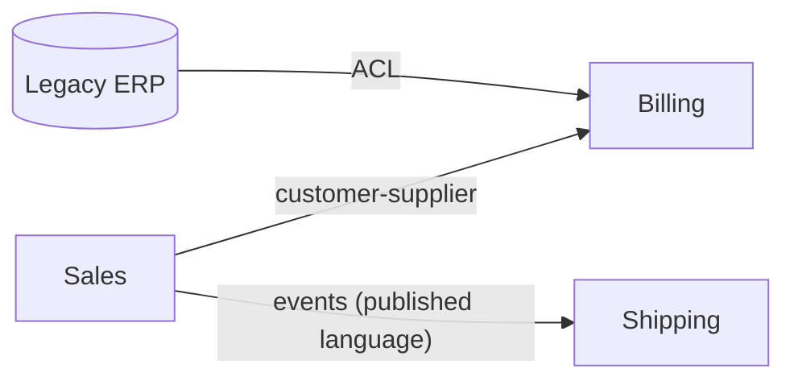

# Bounded Context and DDD Basics

Domain-Driven Design (DDD) models software around the business domain. Its strategic part, **bounded contexts**, is the main tool for deciding where microservice boundaries go.

## Ubiquitous Language and Bounded Context

- **Ubiquitous language:** one shared vocabulary between developers and domain experts, used in code, tests and conversation.
- **Bounded context:** an explicit boundary inside which a model and its language are consistent. The same word can mean different things in different contexts.

| Term | Sales context | Shipping context | Billing context |
|------|---------------|------------------|-----------------|
| Customer | Lead with preferences | Delivery address and contact | Payer with tax id |
| Product | Catalogue item, price | Parcel with weight | Invoice line |

Do not build one giant `Customer` class for everyone. Each context keeps its own small model and the contexts exchange only what they need.

**Rule of thumb:** one microservice per bounded context (or a few services within one), never one bounded context split across teams.

## Subdomains

| Type | Meaning | Strategy |
|------|---------|----------|
| Core | Competitive advantage | Build in-house, best people |
| Supporting | Needed but not differentiating | Build simply or outsource |
| Generic | Solved problem (auth, email) | Buy or use off-the-shelf |

## Tactical Building Blocks

| Block | Description |
|-------|-------------|
| Entity | Has identity that persists over time (`Order`) |
| Value object | Defined by attributes, immutable (`Money`, `Address`) |
| Aggregate | Cluster of entities and values with one **aggregate root**; the consistency and transaction boundary |
| Repository | Collection-like access to aggregates |
| Domain service | Domain logic that fits no entity |
| Domain event | Something that happened (`OrderPlaced`) |

```java
public record Money(BigDecimal amount, String currency) {          // value object
    public Money add(Money o) {
        if (!currency.equals(o.currency)) throw new IllegalArgumentException("currency mismatch");
        return new Money(amount.add(o.amount), currency);
    }
}

public class Order {                                                // aggregate root
    enum Status { NEW, PLACED }

    private final UUID id = UUID.randomUUID();
    private final List<OrderLine> lines = new ArrayList<>();
    private Status status = Status.NEW;

    public void addLine(String sku, int qty, Money price) {
        if (status != Status.NEW) throw new IllegalStateException("order is closed");
        lines.add(new OrderLine(sku, qty, price));                  // invariants enforced here
    }

    public void place() { status = Status.PLACED; /* register OrderPlaced event */ }
}

record OrderLine(String sku, int qty, Money price) {}
```

**Aggregate rules:** change state only through the root; keep aggregates small; reference other aggregates by id, not by object; one transaction per aggregate, and use events (eventual consistency) between aggregates.

## Context Map: Relationships Between Contexts

| Pattern | Meaning |
|---------|---------|
| Partnership | Two teams succeed or fail together, coordinate changes |
| Shared kernel | A small shared model owned jointly (use sparingly) |
| Customer-supplier | Upstream supplies, downstream needs influence the plan |
| Conformist | Downstream accepts the upstream model as is |
| Anti-corruption layer (ACL) | Downstream translates the upstream model to protect its own |
| Open host service / published language | Upstream exposes a stable, documented API or schema for many consumers |
| Separate ways | No integration; contexts are independent |



## Anti-Corruption Layer

A translation layer that stops a foreign or legacy model leaking into your domain.

```java
// Billing context: our own model and port
public record Payer(String id, String taxId) {}

public interface PayerGateway { Payer find(String id); }

// ACL: adapter plus translator isolates the legacy ERP's model
@Component
class ErpPayerAdapter implements PayerGateway {
    private final ErpClient erp;                       // legacy client
    ErpPayerAdapter(ErpClient erp) { this.erp = erp; }

    @Override
    public Payer find(String id) {
        ErpCustomerRec r = erp.getCust(id);             // ugly legacy shape
        return new Payer(r.getCustNo().trim(), r.getTaxField());   // translate
    }
}
```

The domain depends on the `PayerGateway` interface only. See also the [legacy wrapping example](data-consistency-patterns.md#wrapping-a-legacy-soap-service-with-a-rest-facade).

## Finding Service Boundaries

- Start with business capabilities and **Event Storming** (map domain events on a timeline, cluster them into contexts).
- Follow team ownership (Conway's law): a context should be owned by one team.
- Warning signs of wrong boundaries: chatty synchronous calls between two services, shared database tables, changes that always span services (a "distributed monolith").
- When unsure, begin as a modular monolith with context-aligned modules and split later.

## Common Interview Questions

- **What is a bounded context?** A boundary within which a domain model and its language are consistent; the natural microservice boundary.
- **Aggregate vs entity?** An aggregate is a consistency boundary around one or more entities, accessed via its root.
- **Why reference other aggregates by id?** Keeps transactions small and aggregates independently scalable and consistent.
- **What is an ACL for?** To keep a legacy or external model from polluting your domain model.
- **How do you pick service boundaries?** Subdomains, event storming, team ownership, data ownership.
