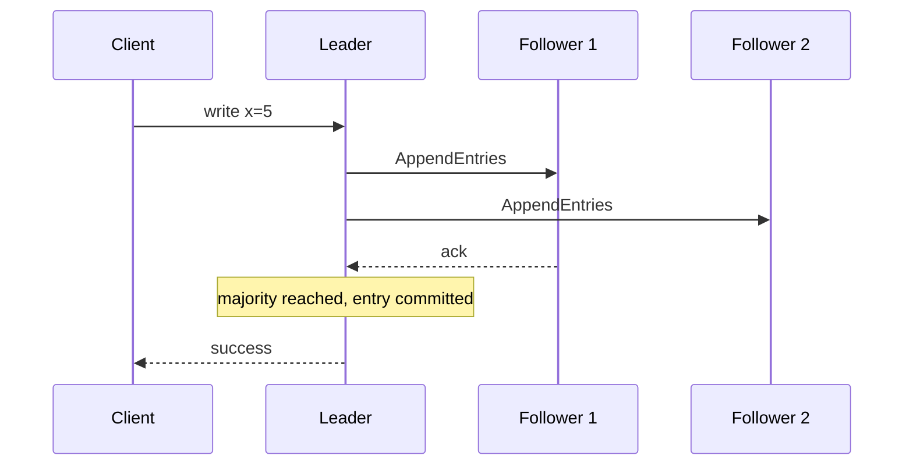

# Distributed Consensus and Eventual Consistency

Consensus lets a group of nodes agree on a single value (for example "who is the leader" or "the next log entry") even when some nodes crash or messages are delayed. It underpins coordination services, replicated databases and leader election.

## Why It Is Hard

- Networks drop, delay and reorder messages; clocks drift; nodes crash and restart.
- **FLP result:** in a fully asynchronous system, no deterministic algorithm can guarantee consensus if even one node may fail. Practical protocols use timeouts and randomisation to make progress in practice.
- **CAP:** during a network partition a system must choose between consistency and availability. Consensus-based systems choose **consistency** (the minority side stops accepting writes).

## Quorum

A decision needs a **majority** (`N/2 + 1`) of nodes. Any two majorities overlap, so two conflicting decisions cannot both be committed.

| Cluster size | Majority | Failures tolerated |
|--------------|----------|--------------------|
| 3 | 2 | 1 |
| 5 | 3 | 2 |
| 7 | 4 | 3 |

Use odd sizes: 4 nodes tolerate no more failures than 3.

## Raft

Raft was designed to be understandable. It splits consensus into three parts.

1. **Leader election:** nodes are followers, candidates or leader. A follower that hears no heartbeat within a randomised election timeout becomes a candidate, increments its **term**, and requests votes. A majority wins. Each node votes once per term.
2. **Log replication:** clients talk to the leader, which appends the command to its log and replicates it with `AppendEntries`. An entry is **committed** once stored on a majority, then applied to the state machine.
3. **Safety:** a candidate can win only if its log is at least as up to date as a majority's, so committed entries are never lost.

Used by etcd (the Kubernetes control plane store), Consul, and many replicated stores.

## Paxos

Paxos is the older, foundational protocol. Roles: **proposers**, **acceptors**, **learners**.

- **Phase 1 (prepare/promise):** a proposer sends a numbered proposal; acceptors promise not to accept lower numbers and report any value already accepted.
- **Phase 2 (accept/accepted):** the proposer asks acceptors to accept a value (the highest previously accepted one, if any); a majority accepting makes it chosen.
- Basic Paxos decides one value; **Multi-Paxos** elects a stable leader to decide a sequence of values. It is correct but notoriously hard to implement, which motivated Raft.

| | Raft | Paxos |
|---|------|-------|
| Goal | Replicated log, understandability | Agreement on a value |
| Leader | Strong, built in | Optional (Multi-Paxos) |
| Implementation | Easier, well specified | Many variants, harder |
| Examples | etcd, Consul | Chubby, Spanner (Paxos-based) |

ZooKeeper uses its own protocol, **ZAB**, similar in spirit.

## Leader Election in Practice

Applications rarely implement consensus; they use a coordination service.

- **Kubernetes:** controllers use a `Lease` object (backed by etcd) for leader election; one replica holds the lease and renews it.
- **ZooKeeper / etcd / Consul:** ephemeral nodes or sessions with a TTL; the holder is leader until the session expires.
- **Spring Integration** offers leader election built on lock registries (JDBC, Redis, ZooKeeper).
- **Fencing tokens:** a paused old leader may still believe it leads (for example after a GC pause). Attach a monotonically increasing token to each lease; downstream resources reject writes carrying an older token.

!!! warning "Split brain"
    Two nodes both acting as leader corrupt data. Majority quorums and fencing prevent it; a plain "ping and promote" script does not.

## Eventual Consistency

Replicas may differ temporarily but converge if updates stop. Typical in microservices (each service owns its data) and in AP stores such as Cassandra and DynamoDB.

| Model | Guarantee |
|-------|-----------|
| Strong / linearizable | Reads see the latest committed write |
| Read-your-writes | A client sees its own writes |
| Monotonic reads | A client never sees time go backwards |
| Eventual | Replicas converge given no new writes |

Techniques for converging: asynchronous replication, event-driven propagation (see [outbox](data-consistency-patterns.md#transactional-outbox) and [Saga](principles.md#communication-patterns)), **last-write-wins** (simple, can lose data), **vector clocks** and **CRDTs** (merge without conflict), read repair and anti-entropy, and tunable quorums (`R + W > N` guarantees read and write sets overlap).

## Common Interview Questions

- **Why an odd number of nodes?** Same fault tolerance as the next even size with less cost, and no split votes.
- **Raft vs Paxos?** Same guarantees; Raft is easier to understand and implement, with an explicit leader.
- **What happens during a partition?** The side with a majority continues; the minority cannot commit.
- **How do you live with eventual consistency?** Idempotent consumers, compensations, UI that shows pending state, and reading from the owner when freshness matters.
