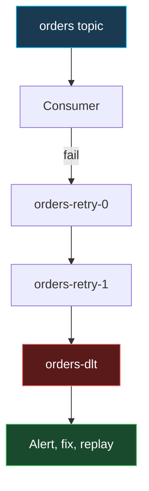

# Kafka Reliability: Retries, Dead Letter Topics & Reprocessing

How to keep a consumer healthy when messages fail, and how to replay data safely. Builds on [Messaging & Kafka](messaging.md) (offsets, consumer groups, rebalancing). Related: [Kafka & Messaging questions](../interview-questions/verbal/verbal-kafka-messaging-questions.md).

## The problem

A Kafka partition is an ordered log with one committed offset per group. If a record always fails (a poison pill) and you keep retrying, the partition is **blocked**; if you skip it silently, you lose data. The answer is bounded retries, then a **dead letter topic (DLT)**.



## Option 1: blocking retries with DefaultErrorHandler

Spring Kafka's default `DefaultErrorHandler` retries a failed record (10 attempts in total, no delay) and then logs and skips it. Configure a backoff and a recoverer that publishes to a DLT.

```java
@Bean
DefaultErrorHandler errorHandler(KafkaTemplate<Object, Object> template) {
    var recoverer = new DeadLetterPublishingRecoverer(template);   // default: <topic>.DLT
    var backOff = new ExponentialBackOffWithMaxRetries(4);
    backOff.setInitialInterval(1_000);
    backOff.setMultiplier(2.0);
    var handler = new DefaultErrorHandler(recoverer, backOff);
    handler.addNotRetryableExceptions(IllegalArgumentException.class);
    return handler;
}
```

- The default DLT is `<original-topic>.DLT` and uses the **same partition number** as the failed record, so the DLT needs at least as many partitions (or supply a custom destination resolver).
- Headers added: original topic, partition, offset, exception class and message, stack trace.
- Blocking retries pause that partition, preserving order but delaying every record behind the bad one.
- Never sleep for long in a listener: exceeding `max.poll.interval.ms` triggers a rebalance.
- Non-retryable errors (bad payload, validation) should go straight to the DLT. Deserialization exceptions are non-retryable by default.

## Option 2: non-blocking retry topics (`@RetryableTopic`)

Failed records are republished to delay topics so the main topic keeps flowing. Ordering is lost for the failed record.

```java
@Component
class OrderListener {

    @RetryableTopic(
        attempts = "4",
        backoff = @Backoff(delay = 1000, multiplier = 2.0, maxDelay = 30_000),
        include = TransientException.class)
    @KafkaListener(topics = "orders", groupId = "order-service")
    void handle(Order order) {
        process(order);                 // throw to trigger a retry
    }

    @DltHandler
    void dead(Order order,
              @Header(KafkaHeaders.ORIGINAL_TOPIC) String topic,
              @Header(KafkaHeaders.EXCEPTION_MESSAGE) String reason) {
        log.error("DLT order={} from={} reason={}", order.id(), topic, reason);
        // persist for triage and alert; do not throw
    }
}
```

Spring creates topics such as `orders-retry-0`, `orders-retry-1`, `orders-retry-2` and `orders-dlt` (names configurable; auto-created through `KafkaAdmin`).

| | Blocking (`DefaultErrorHandler`) | Non-blocking (`@RetryableTopic`) |
| :-- | :-- | :-- |
| Ordering per key | Preserved | Lost for retried records |
| Throughput impact | Partition stalls | Main topic unaffected |
| Extra topics | DLT only | Retry topics + DLT |
| Complexity | Low | Higher (idempotent consumers required) |
| Best for | Short transient errors, strict order | Long delays, many failures |

A common layering: a few quick in-memory retries for transient glitches, retry topics for longer outages, then the DLT.

## Dead letter topic operations

- **Alert** on DLT lag or size; a growing DLT means a systemic bug.
- **Triage** using headers (`kafka_dlt-exception-message`, `kafka_dlt-original-offset`).
- **Fix and replay**: deploy the fix, then republish DLT records to the original topic with a small admin tool. Replay must be idempotent.
- **Retention**: give DLTs long retention so people have time to react.
- **Deserialization errors**: wrap with `ErrorHandlingDeserializer`, otherwise the consumer fails repeatedly on a bad payload.

```yaml
spring:
  kafka:
    consumer:
      value-deserializer: org.springframework.kafka.support.serializer.ErrorHandlingDeserializer
      properties:
        spring.deserializer.value.delegate.class: org.springframework.kafka.support.serializer.JsonDeserializer
```

!!! warning "Idempotency"
    Retries and replays deliver the same record more than once. Consumers must be idempotent (dedupe by business key or event id). See exactly-once in [Messaging & Kafka](messaging.md).

## Resetting offsets for reprocessing (CLI)

Use `kafka-consumer-groups.sh` (`.bat` on Windows). **The group must be inactive** (stop consumers) or the reset is rejected.

```bash
# See current position and lag
kafka-consumer-groups.sh --bootstrap-server localhost:9092 --describe --group order-service

# Preview (without --execute nothing is applied; --dry-run is explicit)
kafka-consumer-groups.sh --bootstrap-server localhost:9092 --group order-service \
  --topic orders --reset-offsets --to-earliest --dry-run

# Apply
kafka-consumer-groups.sh --bootstrap-server localhost:9092 --group order-service \
  --topic orders --reset-offsets --to-earliest --execute
```

| Option | Effect |
| :-- | :-- |
| `--to-earliest` / `--to-latest` | Start of log / end of log |
| `--to-offset N` | Specific offset |
| `--shift-by -100` | Move relative to current (negative rewinds) |
| `--to-datetime 2026-01-15T10:00:00.000` | First offset at or after the timestamp |
| `--by-duration PT1H` | Rewind by an ISO-8601 duration |
| `--to-current` | Keep current offsets (useful to preview) |

Target one partition with `--topic orders:2`; use `--all-topics` for every topic the group consumes.

Alternatives:

- Use a **new `group.id`** with `auto.offset.reset=earliest` to reprocess without touching the old group.
- In code: Spring Kafka `ConsumerSeekAware`, or `consumer.seek(...)` and `offsetsForTimes(...)`.
- Reprocessing is bounded by **retention**; expired or compacted data is gone.
- To skip a poison record, stop the group and `--shift-by 1` on that partition, but prefer sending it to a DLT.

## Common interview questions

- **What is a poison pill and how do you handle it?** A record that always fails; use `ErrorHandlingDeserializer`, non-retryable exception types, bounded retries, then a DLT.
- **Blocking vs non-blocking retry?** Blocking keeps order but stalls the partition; retry topics keep throughput but break ordering.
- **Why not just sleep in the listener?** It exceeds `max.poll.interval.ms`, so the consumer is evicted and the group rebalances.
- **How do you reprocess last week's data?** Stop the group, `--reset-offsets --to-datetime ... --execute`, or use a new group id; consumers must be idempotent and data within retention.
- **Who owns DLT messages?** The team alerts on the DLT, triages, fixes, then replays.
- **Why use `--dry-run`?** It previews the new offsets before applying them.

## References

- [Spring Kafka: Non-Blocking Retries](https://docs.spring.io/spring-kafka/reference/retrytopic.html)
- [Spring Kafka: Handling Exceptions](https://docs.spring.io/spring-kafka/reference/kafka/annotation-error-handling.html)
