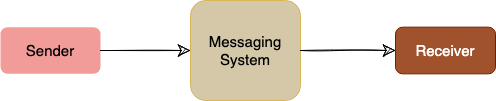
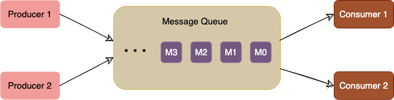
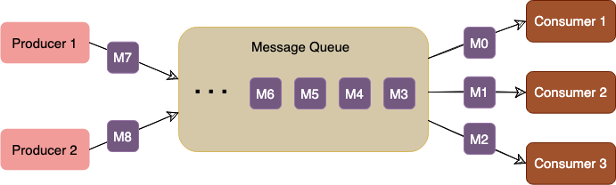
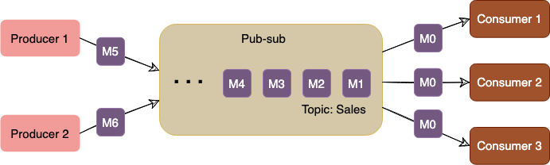
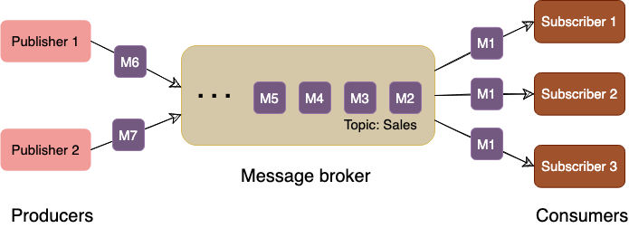
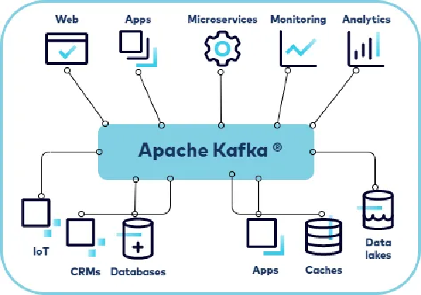
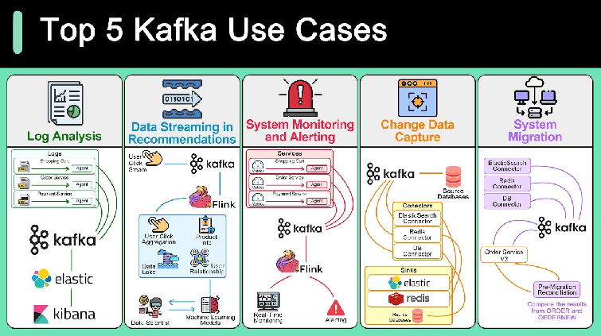
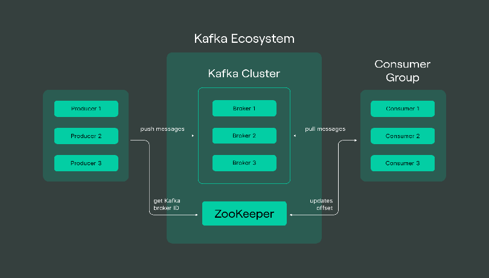

# Messaging & Kafka

## Messaging Systems

[Overview of a Messaging System. Messaging systems overview. Explanation… | by Gaurav Ingalkar | Medium](https://medium.com/@gauravingalkar/overview-of-messaging-systems-b67ddaa860d0)
[Overview on Messaging System in Microservice architecture | by Dwarak | Medium](https://medium.com/@dwarak1991/overview-on-messaging-system-in-microservice-architecture-f149b6c0d18f)

A **messaging system** is responsible for transferring data among services, applications, processes, or servers. Such a system helps **decouple** different parts of a distributed system by providing an **asynchronous** way of transferring messaging between the sender and the receiver. Hence, all senders (or producers) and receivers (or consumers) focus on the data/message without worrying about the mechanism used to share the data.



There are two common ways to handle messages: **Queuing** and **Publish-Subscribe**.

**Queue**

In the queuing model, messages are stored sequentially in a queue. Producers push messages to the rear of the queue, and consumers extract the messages from the front of the queue.



A particular message can be consumed by a maximum of one consumer only. Once a consumer grabs a message, it is removed from the queue such that the next consumer will get the next message. This is a great model for distributing message-processing among multiple consumers. But this also limits the system as multiple consumers cannot read the same message from the queue.



**Publish-subscribe messaging system**
In the pub-sub (short for publish-subscribe) model, messages are divided into topics. A publisher (or a producer) sends a message to a topic that gets stored in the messaging system under that topic. Subscribers (or the consumer) subscribe to a topic to receive every message published to that topic. Unlike the Queuing model, the pub-sub model allows multiple consumers to get the same message; if two consumers subscribe to the same topic, they will receive all messages published to that topic.



The messaging system that stores and maintains the messages is commonly known as the message **broker**. It provides a loose coupling between publishers and subscribers, or producers and consumers of data.



The message broker stores published messages in a queue, and subscribers read them from the queue. Hence, subscribers and publishers do not have to be synchronized. This **loose coupling** enables subscribers and publishers to read and write messages at different rates.

The messaging system's ability to store messages provides **fault-tolerance**, so messages do not get lost between the time they are produced and the time they are consumed.

To summarize, a message system is deployed in an application stack for the following reasons:

1. **Messaging buffering:** To provide a buffering mechanism in front of processing (i.e., to deal with temporary incoming message spikes that are greater than what the processing app can deal with). This enables the system to safely deal with spikes in workloads by temporarily storing data until it is ready for processing.
2. **Guarantee of message delivery:** Allows producers to publish messages with assurance that the message will eventually be delivered if the consuming application is unable to receive the message when it is published.
3. **Providing abstraction:** Distributed messaging systems enable decoupling of sender and receiver components in a system, allowing them to evolve independently. This architectural pattern promotes modularity, making it easier to maintain and update individual components without affecting the entire system.
4. **Scalability:** Distributed messaging systems can handle a large number of messages and can scale horizontally to accommodate increasing workloads. This allows applications to grow and manage higher loads without significant performance degradation.
5. **Fault Tolerance:** By distributing messages across multiple nodes or servers, these systems can continue to operate even if a single node fails. This redundancy provides increased reliability and ensures that messages are not lost during system failures.
6. **Asynchronous Communication:** These systems enable asynchronous communication between components, allowing them to process messages at their own pace without waiting for immediate responses. This can improve overall system performance and responsiveness, particularly in scenarios with high latency or variable processing times.
7. **Load Balancing:** Distributed messaging systems can automatically distribute messages across multiple nodes, ensuring that no single node becomes a bottleneck. This allows for better resource utilization and improved overall performance.
8. **Message Persistence:** Many distributed messaging systems provide message persistence, ensuring that messages are not lost if a receiver is temporarily unavailable or slow to process messages. This feature helps maintain data consistency and reliability across the system.
9. **Security:** Distributed messaging systems often support various security mechanisms, such as encryption and authentication, to protect sensitive data and prevent unauthorized access.
10. **Interoperability:** These systems often support multiple messaging protocols and can integrate with various platforms and technologies, making it easier to connect different components within a complex system.

## Kafka

[Introduction](https://kafka.apache.org/intro)
[Kafka | Confluent Documentation](https://docs.confluent.io/kafka/overview.html)
[Introduction to Apache Kafka?](https://medium.com/@erkndmrl/introduction-to-apache-kafka-574301baf96)







## Basics

**Kafka Cluster**: A Kafka cluster is a system that comprises of different brokers, topics, and their respective partitions. Data is written to the topic within the cluster and read by the cluster itself.

**Producers**: A producer sends or writes data/messages to the topic within the cluster. In order to store a huge amount of data, different producers within an application send data to the Kafka cluster.

**Consumers**: A consumer is the one that reads or consumes messages from the Kafka cluster. There can be several consumers consuming different types of data form the cluster. The beauty of Kafka is that each consumer knows from where it needs to consume the data.

**Brokers**: A Kafka server is known as a broker. A broker is a bridge between producers and consumers. If a producer wishes to write data to the cluster, it is sent to the Kafka server. All brokers lie within a Kafka cluster itself. Also, there can be multiple brokers.

**Topics**: It is a common name or a heading given to represent a similar type of data. In Apache Kafka, there can be multiple topics in a cluster. Each topic specifies different types of messages.

**Partitions**: The data or message is divided into small subparts, known as partitions. Each partition carries data within it having an offset value. The data is always written in a sequential manner. We can have an infinite number of partitions with infinite offset values. However, it is not guaranteed that to which partition the message will be written.

**ZooKeeper**: A ZooKeeper is used to store information about the Kafka cluster and details of the consumer clients. It manages brokers by maintaining a list of them. Also, a ZooKeeper is responsible for choosing a leader for the partitions. If any changes like a broker die, new topics, etc., occurs, the ZooKeeper sends notifications to Apache Kafka. A ZooKeeper is designed to operate with an odd number of Kafka servers. Zookeeper has a leader server that handles all the writes, and rest of the servers are the followers who handle all the reads. However, a user does not directly interact with the Zookeeper, but via brokers. No Kafka server can run without a zookeeper server. It is mandatory to run the zookeeper server.

## Use Cases

**Log Aggregation and Monitoring**
Use Case: Collecting and analyzing logs from distributed systems for monitoring, troubleshooting, and performance analysis.
Example: Companies like LinkedIn and Twitter use Kafka for log aggregation to consolidate logs from different services and systems, allowing real-time analysis and monitoring of application health and performance.

**Stream Processing and Analytics**
Use Case: Processing and analyzing continuous streams of data for real-time insights, anomaly detection, and predictive analytics.

Example: Financial institutions use Kafka to process market data feeds, detect trading anomalies, and make real-time trading decisions. Retailers analyze customer behavior and preferences in real-time to offer personalized recommendations and promotions.

**Microservices Communication**
Use Case: Facilitating communication and data exchange between microservices in a distributed system.

Example: Companies like Uber and Netflix use Kafka as a messaging backbone for inter-service communication, allowing microservices to exchange events and data in a scalable, decoupled manner.

**IoT Data Ingestion and Processing**
Use Case: Ingesting, processing, and analyzing large volumes of data generated by IoT devices and sensors.

Example: Smart cities leverage Kafka to ingest sensor data from traffic lights, environmental sensors, and public transportation systems. This data is used for traffic management, pollution monitoring, and optimizing city services.

**Real-time Fraud Detection**
Use Case: Detecting fraudulent activities and security threats in real-time by analyzing patterns and anomalies in streaming data.

Example: Financial institutions use Kafka to ingest transaction data from multiple channels and detect suspicious activities such as credit card fraud, identity theft, and money laundering in real-time.

**Event Sourcing and CQRS (Command Query Responsibility Segregation)**
Use Case: Implementing event-driven architectures for maintaining the state of distributed systems and supporting complex business workflows.

Example: E-commerce platforms use Kafka to capture events such as user interactions, order updates, and inventory changes. These events are stored in event logs and used to derive the current state of the system, enabling scalable and resilient systems.

**Machine Learning Model Serving**
Use Case: Deploying and serving machine learning models in real-time to make predictions and recommendations based on streaming data.

Example: Online retailers use Kafka to deploy machine learning models for product recommendations, pricing optimization, and personalized marketing campaigns. Kafka streams deliver real-time predictions to customer-facing applications and marketing platforms.

## Kafka vs RabbitMQ

| Characteristics | Apache Kafka | RabbitMQ |
| :---- | :---- | :---- |
| **Architecture** | Kafka uses a partitioned log model, which combines messaging queue and publish subscribe approaches. | RabbitMQ uses a messaging queue. |
| **Scalability** | Kafka provides scalability by allowing partitions to be distributed across different servers. | Increase the number of consumers to the queue to scale out processing across those competing consumers. |
| **Message retention** | Policy based, for example messages may be stored for one day. The user can configure this retention window. | Acknowledgement based, meaning messages are deleted as they are consumed. |
| **Multiple consumers** | Multiple consumers can subscribe to the same topic, because Kafka allows the same message to be replayed for a given window of time. | Multiple consumers cannot all receive the same message, because messages are removed as they are consumed. |
| **Replication** | Topics are automatically replicated, but the user can manually configure topics to not be replicated. | Messages are not automatically replicated, but the user can manually configure them to be replicated. |
| **Message ordering** | Each consumer receives information in order because of the partitioned log architecture. | Messages are delivered to consumers in the order of their arrival to the queue. If there are competing consumers, each consumer will process a subset of that message. |
| **Protocols** | Kafka uses a binary protocol over TCP. | Advanced messaging queue protocol (AMQP) with support via plugins: MQTT, STOMP. |

---

## Kafka Deep-Dive

### Offsets & Consumer Position

An **offset** is a unique identifier for each message within a partition. It tracks consumer progress.

```
Partition 0:
  Message offset=0: "Event A"
  Message offset=1: "Event B"
  Message offset=2: "Event C"
  Message offset=3: "Event D"
  ↑
  Consumer at offset=2 (already read A, B; next read is C)
```

**Consumer Groups:** Multiple consumers can form a group to parallelize processing.

```java
// Spring Kafka Consumer
@SpringBootApplication
@EnableKafka
public class KafkaConsumerApp {
    
    @KafkaListener(topics = "orders", groupId = "order-processing-group")
    public void listenOrders(Order order) {
        // Kafka automatically tracks offset
        System.out.println("Processing order: " + order.getId());
    }
}

// Behind the scenes:
// 1. Consumer joins "order-processing-group"
// 2. Broker assigns partitions to this consumer
// 3. Consumer reads from offset where it left off
// 4. After processing, offset is committed (committed offset stored in __consumer_offsets topic)
// 5. On restart, consumer resumes from last committed offset
```

**Offset Management:**
- **Auto-commit:** Automatically commit offset after processing (default)
- **Manual commit:** Commit after successful processing (more control)

```java
@KafkaListener(topics = "orders", groupId = "group1")
public void process(Order order, Acknowledgment ack) {
    try {
        processOrder(order);
        ack.acknowledge();  // Manual commit after success
    } catch (Exception e) {
        // Don't acknowledge, retry on restart
    }
}
```

---

### Consumer Groups & Partitions

**Consumer Group Assignment:**

```
Topic "orders" with 4 partitions:
  Partition 0: Consumer A reads
  Partition 1: Consumer B reads
  Partition 2: Consumer C reads
  Partition 3: Consumer D reads

If Consumer C dies:
  Partition 2 → Rebalanced to Consumer A
  (Automatic failover)

If new Consumer E joins:
  Rebalancing happens → Partitions redistributed
  (Each consumer gets subset of partitions)
```

**Key Points:**
- Each partition → One consumer in a group (no parallelism within partition)
- Multiple partitions → Multiple consumers can process in parallel
- More consumers than partitions = some idle
- Fewer partitions than consumers = uneven load

---

### Replication & Durability

**Replication Factor:** Number of copies of each partition.

```
Replication Factor = 3:

  Broker 1: [Partition 0 - Leader]
  Broker 2: [Partition 0 - Replica]
  Broker 3: [Partition 0 - Replica]

When Broker 1 fails:
  Broker 2 or 3 becomes new leader
  Data is NOT lost (replicas have the data)
```

**In-Sync Replicas (ISR):** Replicas that are caught up with leader.

```yaml
# Kafka configuration
min.insync.replicas: 2  # Require 2 replicas in-sync before ack

# Producer: acks=all means wait for min.insync.replicas
# Guarantees: durability (no data loss) but slower throughput
```

---

### Log Compaction & Retention

**Retention Policy:** How long to keep messages.

```yaml
# By time (default)
log.retention.hours: 168  # Keep 7 days

# By size
log.retention.bytes: 1073741824  # 1GB per partition

# Combination: Whichever comes first
```

**Log Compaction:** Keep latest value per key (for stateful data).

```
Without Compaction (all messages kept):
  Key=user-123: {name: "Alice"}
  Key=user-456: {name: "Bob"}
  Key=user-123: {name: "Alice Updated"}  ← Old duplicate kept
  Key=user-456: {name: "Bob Updated"}

With Compaction (cleanup.policy=compact):
  Key=user-123: {name: "Alice Updated"}  ← Only latest
  Key=user-456: {name: "Bob Updated"}

Use case: User profile updates, config changes (state log)
```

---

### Exactly-Once Semantics

Guarantee: Each message processed exactly once (no duplicates, no loss).

**Implementation:**

```java
@KafkaListener(topics = "payments", groupId = "payment-group")
public void processPayment(PaymentEvent payment) {
    // 1. Idempotent producer: same message → same ID
    // 2. Idempotent consumer: process only if not already done
    
    if (paymentDatabase.exists(payment.getTransactionId())) {
        return;  // Already processed
    }
    
    chargeCard(payment);
    paymentDatabase.save(payment.getTransactionId());
    // Offset auto-committed after successful processing
}
```

**Kafka Config for Exactly-Once:**
```yaml
# Producer
enable.idempotence: true  # Prevent duplicate sends
acks: all                 # Wait for all replicas

# Consumer
isolation.level: read_committed  # Only read confirmed messages
```

---

### Spring Kafka Integration

**Producer:**
```java
@Service
public class OrderProducer {
    
    @Autowired
    private KafkaTemplate<String, Order> kafkaTemplate;
    
    public void publishOrder(Order order) {
        // Send to topic
        kafkaTemplate.send("orders", order.getId(), order)
            .addCallback(
                success -> System.out.println("Sent: " + order.getId()),
                failure -> System.out.println("Failed: " + failure)
            );
    }
}

// Config
@Configuration
public class KafkaProducerConfig {
    
    @Bean
    public KafkaTemplate<String, Order> kafkaTemplate() {
        return new KafkaTemplate<>(producerFactory());
    }
    
    @Bean
    public ProducerFactory<String, Order> producerFactory() {
        Map<String, Object> config = new HashMap<>();
        config.put(ProducerConfig.BOOTSTRAP_SERVERS_CONFIG, "localhost:9092");
        config.put(ProducerConfig.KEY_SERIALIZER_CLASS_CONFIG, StringSerializer.class);
        config.put(ProducerConfig.VALUE_SERIALIZER_CLASS_CONFIG, JsonSerializer.class);
        config.put(ProducerConfig.ACKS_CONFIG, "all");  // Durability
        config.put(ProducerConfig.RETRIES_CONFIG, 3);
        return new DefaultProducerFactory<>(config);
    }
}
```

**Consumer:**
```java
@Service
public class OrderConsumer {
    
    @KafkaListener(topics = "orders", groupId = "order-service")
    public void consume(Order order) {
        System.out.println("Processing: " + order.getId());
        // Process order
    }
    
    // Batch processing
    @KafkaListener(topics = "orders", groupId = "batch-group")
    public void batchConsume(List<Order> orders) {
        System.out.println("Batch size: " + orders.size());
        orders.forEach(this::processOrder);
    }
}

// Config
@Configuration
public class KafkaConsumerConfig {
    
    @Bean
    public ConcurrentKafkaListenerContainerFactory<String, Order> kafkaListenerContainerFactory() {
        ConcurrentKafkaListenerContainerFactory<String, Order> factory = 
            new ConcurrentKafkaListenerContainerFactory<>();
        factory.setConcurrency(3);  // 3 threads per listener
        factory.getContainerProperties().setAckMode(AckMode.MANUAL);  // Manual offset commit
        return factory;
    }
}
```

---

### Common Kafka Issues & Solutions

| Issue | Cause | Solution |
|-------|-------|----------|
| **Messages not appearing** | Consumer group offset ahead of latest | Use `--from-beginning` or reset offset with `kafka-consumer-groups` |
| **Slow consumption** | Partition count < consumer count | Add partitions with `--alter --partitions` |
| **Data loss** | `acks=1` (only leader ack) | Use `acks=all` + `min.insync.replicas=2` |
| **Duplicates** | Producer retries + consumer restart | Enable idempotence + deduplication in consumer |
| **OutOfMemory** | Large batch size | Reduce `fetch.max.bytes`, process in batches |
| **Consumer lag** | Processing too slow | Add consumers to consumer group (rebalancing) |

---

### Interview Talking Points

- **Offset tracking?** Kafka stores consumer offset in `__consumer_offsets` topic; consumer resumes from last committed offset
- **Consumer groups?** Multiple consumers share partitions; each partition processed by one consumer (no duplicates within group)
- **Replication?** Each partition replicated across brokers; if leader fails, replica becomes new leader (no data loss)
- **Exactly-once?** Idempotent producer + idempotent consumer + manual commit = exactly-once semantics
- **Retention policies?** By time (days), size (bytes), or log compaction (keep latest per key)
- **When to use Kafka?** High-throughput event streaming, multiple consumers (replay), long retention
- **When NOT to use?** Complex routing, low latency requirements, RabbitMQ/NATS might be simpler
