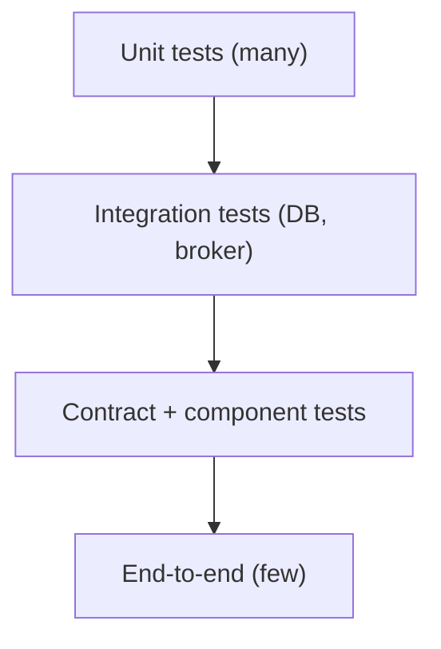

# Microservices Testing and Contract Testing

Testing many independently deployed services is a different problem from testing a monolith: end-to-end suites are slow and flaky, yet integration bugs (a changed field, a renamed endpoint) are the most common failures. Contract tests fill that gap.

## Test Strategy



| Level | Scope | Tools |
|-------|-------|-------|
| Unit | One class or domain object, no I/O | JUnit 5, Mockito |
| Integration | Service with real DB or broker | `@SpringBootTest`, `@DataJpaTest`, Testcontainers |
| Component | One service in isolation, dependencies stubbed | `@SpringBootTest` + WireMock |
| Contract | Consumer and provider agree on the interface | Pact, Spring Cloud Contract |
| End-to-end | Whole system via the public API | Few smoke tests only |

Keep the pyramid shape: many fast tests at the bottom, a handful of end-to-end journeys at the top. Also consider **resilience tests** (fault injection, timeouts) and **consumer-side stubs** to avoid starting every dependency.

## What Is a Contract Test

A contract is a machine-checkable description of the requests a **consumer** makes and the responses it relies on. The provider proves it can satisfy every consumer's contract, without both services running together.

- Catches breaking changes before deployment, in the provider's build.
- Replaces most cross-service end-to-end tests.
- Two directions: **consumer-driven** (consumers define needs; Pact) and **provider-driven** (provider publishes the contract; Spring Cloud Contract usually authored on the provider side).

## Pact (Consumer-Driven)

1. Consumer test describes expected interactions against a Pact mock; this generates a **pact file** (JSON).
2. The pact is shared via a **Pact Broker** (or PactFlow).
3. The provider build replays the pact against the real provider and verifies responses.
4. `can-i-deploy` checks whether a version is safe to release against its counterparts.

```java
// Consumer side (Pact JVM, JUnit 5)
@ExtendWith(PactConsumerTestExt.class)
@PactTestFor(providerName = "order-service")
class OrderClientPactTest {

    @Pact(consumer = "billing-service")
    V4Pact getOrder(PactDslWithProvider builder) {
        return builder
            .given("order 42 exists")
            .uponReceiving("get order 42")
                .path("/orders/42").method("GET")
            .willRespondWith()
                .status(200)
                .body(new PactDslJsonBody()
                    .stringType("id", "42")
                    .decimalType("total", 19.99))
            .toPact(V4Pact.class);
    }

    @Test
    @PactTestFor(pactMethod = "getOrder")
    void fetchesOrder(MockServer server) {
        Order o = new OrderClient(server.getUrl()).get("42");
        assertEquals("42", o.id());
    }
}
```

```java
// Provider side: verify the pacts
@Provider("order-service")
@PactBroker
@SpringBootTest(webEnvironment = SpringBootTest.WebEnvironment.DEFINED_PORT)
class OrderProviderPactTest {
    @TestTemplate
    @ExtendWith(PactVerificationInvocationContextProvider.class)
    void verify(PactVerificationContext ctx) { ctx.verifyInteraction(); }

    @State("order 42 exists")
    void order42() { /* insert test data */ }
}
```

## Spring Cloud Contract

The contract is written on the provider (Groovy, YAML or Kotlin DSL). The Maven/Gradle plugin **generates provider tests** and publishes a **stub jar**; consumers run against those stubs through the Stub Runner.

```yaml
# src/test/resources/contracts/get-order.yml
request:
  method: GET
  url: /orders/42
response:
  status: 200
  headers:
    Content-Type: application/json
  body:
    id: "42"
    total: 19.99
```

```java
// Consumer test using provider's stubs
@SpringBootTest
@AutoConfigureStubRunner(
    ids = "com.example:order-service:+:stubs:8090",
    stubsMode = StubRunnerProperties.StubsMode.LOCAL)
class OrderClientTest {
    @Test void fetchesOrder() { /* call http://localhost:8090/orders/42 */ }
}
```

Messaging contracts are also supported (verify Kafka or RabbitMQ message shapes).

| | Pact | Spring Cloud Contract |
|---|------|-----------------------|
| Driver | Consumer-driven | Provider-driven (consumer can contribute) |
| Languages | Many (JVM, JS, Go, .NET, ...) | JVM-centric, strong Spring support |
| Sharing | Pact Broker | Stub jars in a Maven repository |
| Release gate | `can-i-deploy` | Version-matched stubs |

## Other Useful Techniques

- **Testcontainers** for real PostgreSQL, Kafka, Redis in integration tests.
- **WireMock** for stubbing HTTP dependencies in component tests.
- **Schema compatibility checks** for events (schema registry compatibility modes) and OpenAPI diffing.
- **Testing in production:** canary releases, feature flags, synthetic monitoring (see [deployment patterns](principles.md#deployment-patterns)).

## Common Interview Questions

- **Why contract tests instead of end-to-end?** Faster, deterministic, pinpoint which service broke, no shared environment.
- **Pact vs Spring Cloud Contract?** Pact is consumer-driven and polyglot with a broker; SCC is provider-driven and JVM-centric.
- **What does a contract test not cover?** Business logic correctness and non-functional behaviour; only the interface shape and basic semantics.
- **How do you test async messaging?** Message contracts, consumer tests against sample payloads, schema compatibility, Testcontainers Kafka.
