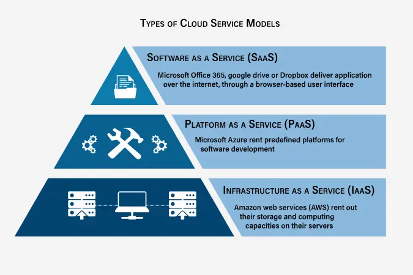

# Cloud & Microservices Principles

## Cloud Computing

## Service models



* **IaaS, or infrastructure as a service**, is on-demand access to cloud-hosted physical and virtual servers, storage and networking—the backend IT infrastructure for running applications and workloads in the cloud.
* **PaaS, or platform as a service**, is on-demand access to a complete, ready-to-use, cloud-hosted platform for developing, running, maintaining and managing applications.
* **SaaS, or software as a service**, is on-demand access to ready-to-use, cloud-hosted application software.

**BPaaS**, business process as a service as the delivery of business process outsourcing (BPO) services that are sourced from the cloud and constructed for multitenancy. Services are often automated, and where human process actors are required, there is no overtly dedicated labor pool per client.

**BPO,** Business process outsourcing is a method of subcontracting various business-related operations to third-party vendors.

### RDS vs S3

**RDS (Relational Database Service)**
- **What:** Managed SQL database (MySQL, PostgreSQL, Oracle, SQL Server)
- **Storage:** Structured data in tables with rows/columns
- **Use Cases:** Business apps, transactions, complex queries, consistency-critical data
- **Access:** Query language (SQL), structured access
- **Pricing:** Pay per DB instance size + storage
- **Scaling:** Vertical (bigger instance), limited horizontal scaling

**S3 (Simple Storage Service)**
- **What:** Object storage (files, blobs, unstructured data)
- **Storage:** Any file type (images, videos, backups, documents, logs)
- **Use Cases:** File storage, backups, archives, static assets, data lakes
- **Access:** HTTP GET/PUT/DELETE by key
- **Pricing:** Pay per GB stored + data transfer
- **Scaling:** Unlimited horizontal scaling, unlimited objects

**When to Use Which:**

| Scenario | Choice | Why |
|----------|--------|-----|
| User data, transactions | RDS | Needs ACID, complex queries, relationships |
| User-uploaded images | S3 | Object storage, cheap, scalable |
| Application logs | S3 | Unstructured, high volume, retention |
| Inventory management | RDS | Structured, transactions, consistency |
| Database backups | S3 | Durable, versioned, cheap long-term storage |
| Machine learning datasets | S3 | Large files, parallel access, integration with ML services |
| Real-time metrics | RDS | Needs complex queries, time-series queries |
| Static website assets | S3 | Fast distribution via CloudFront CDN |

**In Microservices:**
- **RDS:** Database per service (database-per-service pattern)
- **S3:** Shared data lake, audit logs, backups across services

## Principles

Cap theorem
Consistency
Availability
Partition tolerance
Fault tolerance
Load balancing

Event driven systems

## MicroService

**12-Factor App**

Methodology for building SaaS applications:
1. Codebase - One codebase tracked in version control
2. Dependencies - Explicitly declare and isolate dependencies
3. Config - Store config in environment variables
4. Backing services - Treat as attached resources (DB, cache)
5. Build/Run/Release - Strict separation of stages
6. Processes - Stateless and share-nothing
7. Port binding - Services export HTTP via port binding
8. Concurrency - Scale via process model
9. Disposability - Fast startup and graceful shutdown
10. Dev/Prod - Keep dev and prod identical
11. Logs - Treat as event streams to stdout
12. Admin processes - Run as one-off tasks

**Monolith vs Microservices**

| Aspect | Monolith | Microservices |
|--------|----------|--------------|
| **Structure** | Single codebase | Multiple independent services |
| **Deployment** | Deploy entire app | Deploy services independently |
| **Scaling** | Scale entire app | Scale specific services |
| **Technology** | Single tech stack | Polyglot (different techs per service) |
| **Complexity** | Simple initially | Complex distributed systems |
| **Communication** | Function calls | HTTP/gRPC/messaging |
| **Data** | Single database | Database per service |
| **Failure** | One failure = whole app down | Isolated failures |
| **Best For** | Small teams, MVPs | Large teams, complex systems |
Blue Green Deployment
Deployment strategies
Patterns
Micro service service discovery

The **12-Factor App** is a methodology for building **scalable, maintainable, and portable** cloud-native applications. It was created by developers at **Heroku** to define best practices for modern software-as-a-service (SaaS) applications.

### **The 12 Factors**

#### **1. Codebase – *One codebase, multiple deploys***

* A single **source code repository** should be used for all deployments (e.g., dev, staging, production).
* Different environments should not have separate codebases.

#### **2. Dependencies – *Explicitly declare and isolate dependencies***

* Dependencies should be **declared explicitly** in `pom.xml` (Maven) or `build.gradle` (Gradle) in Java projects.
* Use dependency managers (e.g., Maven, NPM, Pip) and avoid system-wide dependencies.

#### **3. Config – *Store config in the environment***

* **Configuration should be externalized** and stored in **environment variables**, not in the codebase.
* Avoid committing credentials (e.g., AWS keys, database passwords) in repositories.

#### **4. Backing Services – *Treat backing services as attached resources***

* External services (databases, message queues, caches) should be treated as **replaceable** and not hardcoded into the app.
* Example: Using AWS RDS instead of an in-memory database.

#### **5. Build, Release, Run – *Strictly separate build, release, and run stages***

* Build: Compile code and create artifacts.
* Release: Combine the build with the environment configuration.
* Run: Start the application instance.

#### **6. Processes – *Execute the app as one or more stateless processes***

* Apps should be **stateless** – session data should be stored in external services like Redis or databases.
* Avoid writing to local disk; instead, use object storage (e.g., AWS S3).

#### **7. Port Binding – *Export services via port binding***

* Apps should be self-contained and expose services via **ports** (e.g., Spring Boot runs on **port 8080**).
* Example: Instead of depending on Apache/Nginx, a Java microservice should expose APIs directly via Tomcat or Jetty.

#### **8. Concurrency – *Scale out via process model***

* Applications should **scale horizontally** by running multiple instances instead of relying on threads within a single instance.
* Example: Instead of increasing thread count, deploy multiple containers using Kubernetes.

#### **9. Disposability – *Fast startup and graceful shutdown***

* Apps should **start quickly** and **shutdown gracefully** to handle crashes and updates smoothly.
* Example: Use **graceful shutdown hooks** in Spring Boot to close DB connections properly.

#### **10. Dev/Prod Parity – *Keep development, staging, and production as similar as possible***

* Minimize differences between environments (e.g., run **Docker containers locally** that mimic production).
* Example: Use **Docker Compose** for local development if Kubernetes is used in production.

#### **11. Logs – *Treat logs as event streams***

* Logs should be **written to stdout/stderr**, not local files.
* Use **log aggregators** (e.g., ELK stack, CloudWatch) to manage logs.

#### **12. Admin Processes – *Run admin tasks as one-off processes***

* Tasks like **database migrations, cron jobs, and batch processing** should be separate from the main application.
* Example: Run **Flyway or Liquibase** migrations separately from the main app startup.

---

### **Why It’s Important?**

* Makes apps **scalable, portable, and cloud-ready**.
* Supports **DevOps, CI/CD, and microservices architectures**.
* Ensures **consistency between development and production environments**.

## Microservice Design Patterns

### Resilience Patterns

**Circuit Breaker**
- Prevents cascading failures by monitoring a downstream service
- States: **Closed** (working) → **Open** (failing, rejects calls) → **Half-Open** (tests if service recovered)
- Implementation: Hystrix, Resilience4J, Spring Cloud Circuit Breaker
```java
@CircuitBreaker(name = "userService", fallbackMethod = "fallback")
public User getUser(String id) {
    return restTemplate.getForObject("http://user-service/users/" + id, User.class);
}

public User fallback(String id, Exception ex) {
    return new User(id, "Unknown", false);  // Graceful degradation
}
```

**Retry Pattern**
- Retries failed requests with exponential backoff
- Useful for transient failures (network hiccup)
```java
@Retry(name = "userService", fallbackMethod = "fallback")
public User getUser(String id) { ... }
```

**Timeout Pattern**
- Prevents hanging on slow/dead services
- Configured per call: `timeout: 5s`
- Without timeout: thread starvation, cascading failure

**Bulkhead Pattern**
- Isolates resources (thread pools, connections) per service
- Failure in one service doesn't exhaust all resources
- Example: Separate pools for external APIs, internal DBs

### Communication Patterns

**Saga Pattern (Distributed Transactions)**
- Coordinates work across multiple services without distributed 2PC locks
- Two approaches:
  - **Choreography**: Services emit events; others react. Decoupled but complex to trace.
  - **Orchestration**: Central coordinator tells services what to do. Simpler logic, but coordinator is SPOF.

```java
// Choreography example
@Service
public class OrderService {
    @Transactional
    public void createOrder(Order order) {
        order.setStatus("PENDING");
        orderRepo.save(order);
        eventPublisher.publishEvent(new OrderCreatedEvent(order));  // Fire-and-forget
    }
}

@Service
@Transactional
public class PaymentService {
    @EventListener
    public void onOrderCreated(OrderCreatedEvent event) {
        try {
            processPayment(event.getOrder());
            eventPublisher.publishEvent(new PaymentCompletedEvent(...));
        } catch (PaymentException e) {
            eventPublisher.publishEvent(new PaymentFailedEvent(...));
        }
    }
}

@Service
public class OrderService {
    @EventListener
    public void onPaymentFailed(PaymentFailedEvent event) {
        order.setStatus("CANCELLED");
        orderRepo.save(order);  // Rollback via compensation action
    }
}
```

**API Gateway Pattern**
- Single entry point for all clients; routes to backend services
- Responsibilities: Authentication, rate limiting, logging, request transformation
- Tools: Kong, AWS API Gateway, Spring Cloud Gateway
```java
@Configuration
public class GatewayConfig {
    @Bean
    public RouteLocator routes(RouteLocatorBuilder builder) {
        return builder.routes()
            .route("userService", r -> r.path("/users/**").uri("http://user-service"))
            .route("orderService", r -> r.path("/orders/**").uri("http://order-service"))
            .build();
    }
}
```

**Service Discovery Pattern**
- Services register themselves; clients discover addresses dynamically
- Tools: Eureka, Consul, Kubernetes DNS
- Eliminates hardcoding of IP/ports; handles failures + auto-scaling
```yaml
# application.yml
eureka:
  client:
    service-url:
      defaultZone: http://localhost:8761/eureka/
  instance:
    hostname: ${HOSTNAME:localhost}

spring:
  application:
    name: user-service  # Registers as "USER-SERVICE"
```

**Load Balancer Pattern**
- Distributes traffic across multiple instances
- Strategies: Round-robin, least connections, weighted, consistent hash
- Client-side (Spring Cloud LoadBalancer) or server-side (Nginx, AWS ELB)

### Data Patterns

**Database-Per-Service**
- Each microservice has its own database (or schema)
- Avoids shared state; enables independent scaling + tech choices
- Trade-off: Distributed queries are hard (need event logs or sync APIs)

**Event Sourcing**
- Stores all state changes as immutable events
- Rebuild current state by replaying events
- Benefits: Audit trail, temporal queries, event-driven architecture
```java
@Entity
public class Account {
    private Long id;
    private BigDecimal balance;
    
    @OneToMany(mappedBy = "account", fetch = FetchType.LAZY)
    private List<AccountEvent> events;  // Immutable log
}

public class AccountEvent {
    private Long id;
    private Long accountId;
    private String eventType;  // CREATED, CREDITED, DEBITED
    private BigDecimal amount;
    private LocalDateTime timestamp;
}
```

**CQRS (Command Query Responsibility Segregation)**
- Separates read model from write model
- Write service normalizes data into write DB; read service denormalizes into read cache/DB
- Benefits: Optimize reads and writes independently; eventual consistency
```
Client → API Gateway
       ↓ (Command) ↓ (Query)
   Write Service  Read Service (Cache)
       ↓              ↓
   Master DB      Read Cache
       ↓
   Event Stream → Updates Read Cache
```

## Deployment Patterns

### Blue-Green Deployment
- Two identical production environments: Blue (current) and Green (new version)
- Deploy to Green, test, then switch traffic (instant cutover)
- Rollback: Switch back to Blue
- Downtime: Zero (assuming Blue still running)
- Cost: 2x infrastructure
```yaml
# Load balancer config (Nginx, HAProxy, AWS ALB)
upstream backend {
    server blue-instances;   # Switch to green-instances for deploy
}
server {
    location / {
        proxy_pass http://backend;
    }
}
```

### Canary Deployment
- Gradually shift traffic from old version (Canary, 5%) → new version (Stable, 95%)
- Monitor metrics; if error rate spikes, rollback
- Downtime: Zero; blast radius: Limited
- Risk: Lower than big bang, but still affects subset of users
```yaml
# Istio VirtualService (Kubernetes)
apiVersion: networking.istio.io/v1beta1
kind: VirtualService
metadata:
  name: my-service
spec:
  hosts:
  - my-service
  http:
  - match:
    - uri:
        prefix: /
    route:
    - destination:
        host: my-service
        subset: v1
      weight: 95  # Old version
    - destination:
        host: my-service
        subset: v2
      weight: 5   # New version (canary)
```

### Rolling Deployment
- Gradually replace old instances with new ones (e.g., 1 at a time, 25%, 50%, 75%, 100%)
- Downtime: Zero (if using load balancer + health checks)
- Blast radius: Gradual, detected early
- Most common in Kubernetes (default)
```yaml
# Kubernetes Deployment
spec:
  strategy:
    type: RollingUpdate
    rollingUpdate:
      maxSurge: 1           # Max 1 extra pod during deploy
      maxUnavailable: 0     # Min 0 unavailable (always available)
  template:
    spec:
      containers:
      - name: app
        image: my-app:v2
        readinessProbe:     # Health check before serving traffic
          httpGet:
            path: /actuator/health
            port: 8080
          initialDelaySeconds: 10
          periodSeconds: 5
```

### Shadow/Parallel Deployment
- New version runs alongside old, mirroring real traffic
- No impact on users (they see old version responses)
- Validates new version before switcher traffic
- Cost: 2x during test period
```yaml
# Istio: Mirror traffic for validation
apiVersion: networking.istio.io/v1beta1
kind: VirtualService
metadata:
  name: my-service
spec:
  hosts:
  - my-service
  http:
  - route:
    - destination:
        host: my-service
        subset: v1
      weight: 100
    mirror:
      host: my-service
      subset: v2        # Mirrors traffic, but ignores v2 response
    mirrorPercent: 100  # Mirror 100% of traffic
```

### Deployment Comparison

| Strategy | Downtime | Risk | Cost | Rollback | Best For |
|----------|----------|------|------|----------|----------|
| **Big Bang** | High | High | Low | Slow | Non-critical, off-hours |
| **Blue-Green** | Zero | Medium | High (2x) | Instant | Critical systems, small blast radius |
| **Canary** | Zero | Low | Normal | Quick | Production, high-traffic systems |
| **Rolling** | Zero | Low | Normal | Quick | Kubernetes, stateless apps |
| **Shadow** | Zero | Very Low | High (2x) | N/A | Validation before deploy |

[https://www.geeksforgeeks.org/microservices-interview-questions/](https://www.geeksforgeeks.org/microservices-interview-questions/)

[https://www.baeldung.com/cs/service-discovery-microservices](https://www.baeldung.com/cs/service-discovery-microservices)

[https://www.geeksforgeeks.org/challenges-and-solutions-of-microservices-architecture/](https://www.geeksforgeeks.org/challenges-and-solutions-of-microservices-architecture/)
[https://rathod-ajay.medium.com/top-20-java-spring-boot-microservice-developer-interview-questions-3-7-experience-afb67b2e0725](https://rathod-ajay.medium.com/top-20-java-spring-boot-microservice-developer-interview-questions-3-7-experience-afb67b2e0725)
