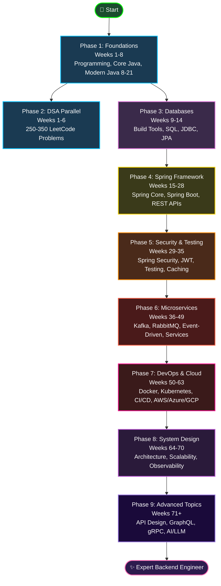
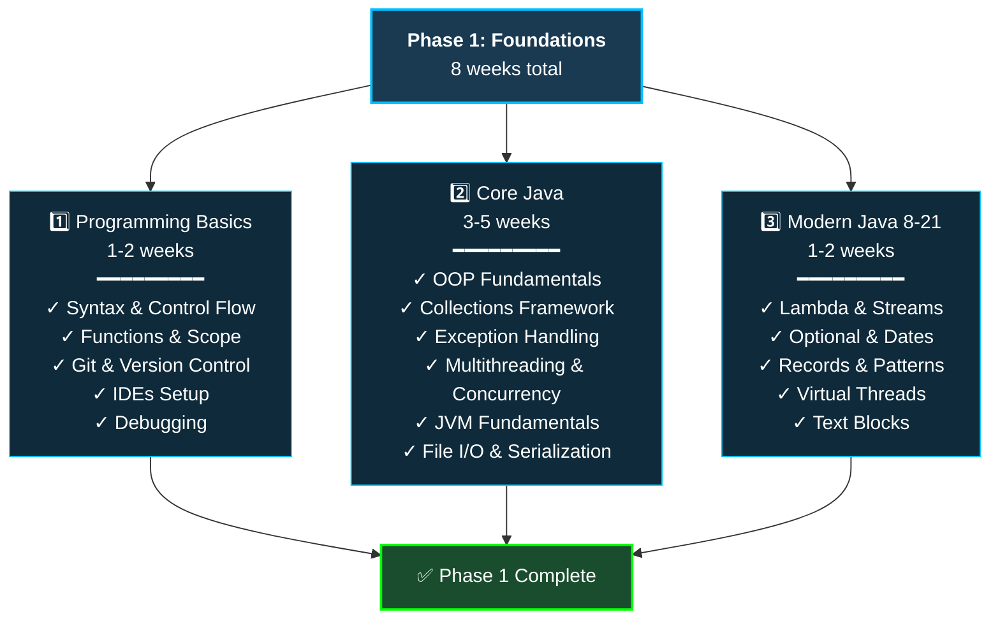
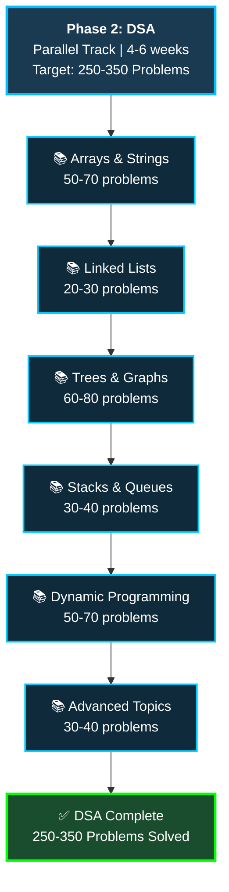
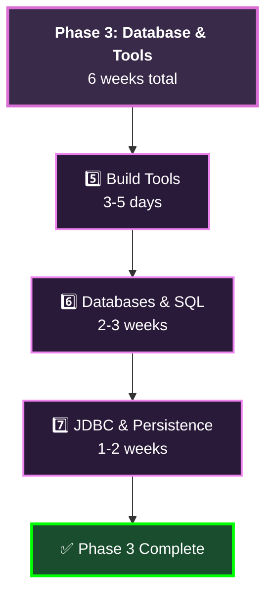
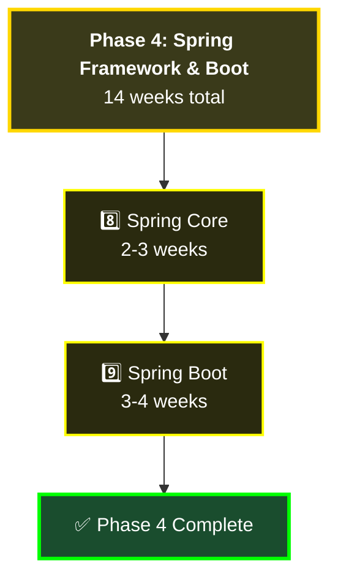
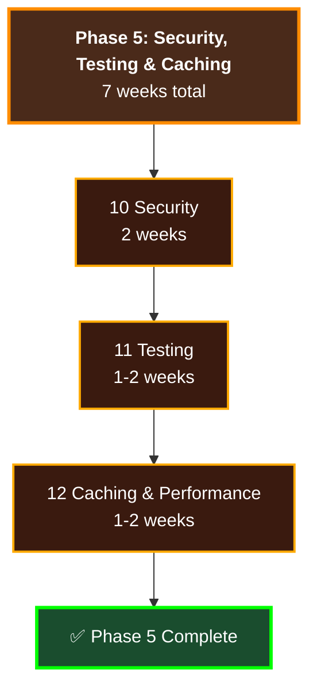
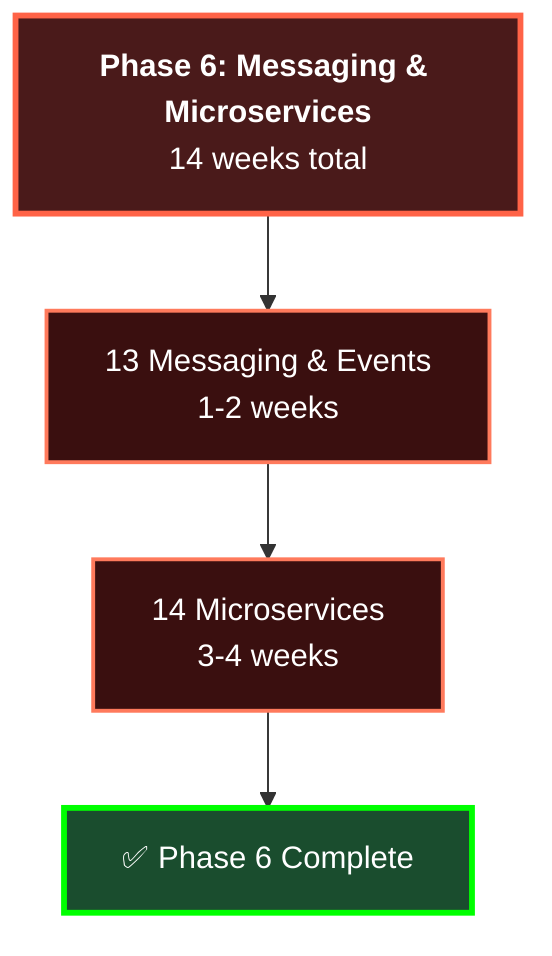
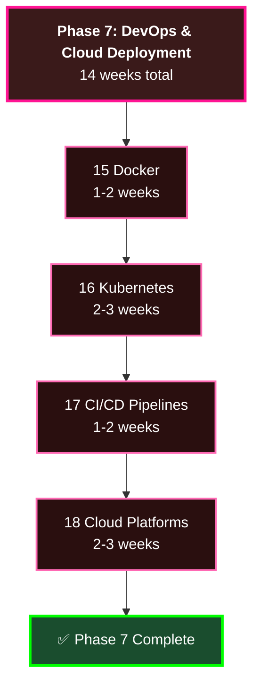
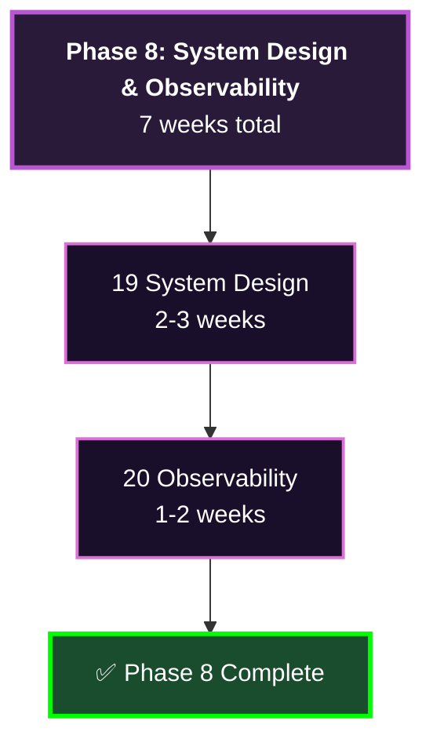
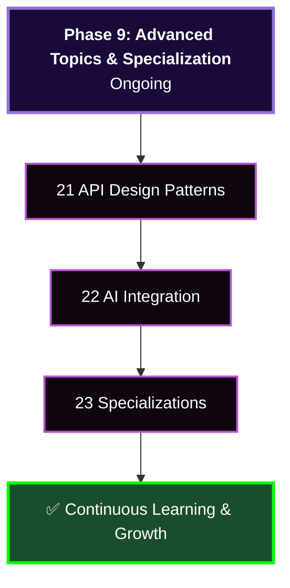

# Java Developer Roadmap: 6-8 Month Comprehensive Blueprint

Interactive learning path with 500+ concepts across backend engineering fundamentals, frameworks, microservices, and cloud deployment.

**Duration:** 6-8 months | **Intensity:** 3-4 hours/day, 5-6 days/week | **Total Topics:** 22 categories

---

## 📊 Complete Roadmap Overview

### Phase Flow (Vertical Learning Path)

### Learning Timeline

| Phase | Topic | Weeks | Key Skills | Topics Count |
|-------|-------|-------|-----------|-------------|
| **1** | Foundations & Core Java | 1-8 | OOP, Collections, Multithreading, Java 8-21 | 3 major |
| **2** | Data Structures & Algorithms | 4-6 | Arrays, Trees, Graphs, DP, DSA (parallel) | 250-350 problems |
| **3** | Build Tools & Databases | 9-14 | Maven, SQL, JDBC, JPA, Hibernate | 3 major |
| **4** | Spring Framework & Boot | 15-28 | IoC, DI, AOP, REST APIs, validation | 2 major |
| **5** | Security, Testing & Caching | 29-35 | Spring Security, JWT, OAuth, JUnit, Mockito, Redis | 3 major |
| **6** | Messaging & Microservices | 36-49 | Kafka, RabbitMQ, Event-driven, Service Discovery | 2 major |
| **7** | DevOps & Cloud | 50-63 | Docker, Kubernetes, CI/CD, AWS/Azure/GCP | 4 major |
| **8** | System Design & Observability | 64-70 | Scalability, Logging, Metrics, Tracing | 2 major |
| **9** | Advanced Topics | 71+ | API Design, GraphQL, gRPC, AI/LLM | 2+ major |

**Total Time:** 6-8 months | **Intensity:** 3-4 hours/day | **Total Topics:** 22 categories + 500+ concepts

---

## 🎯 Phase-by-Phase Breakdown

### **PHASE 1: FOUNDATIONS & CORE JAVA** (Weeks 1-8)

<h4>📖 Topic 1: Programming Basics (1-2 weeks)</h4>

<table>
<tr><th>Concept</th><th>Time</th><th>Resources</th></tr>
<tr><td><b>Logic & Syntax</b> Variables, data types, operators, casting</td><td>2-3 days</td><td>Official Java Docs, tutorials</td></tr>
<tr><td><b>Control Flow</b> if-else, switch, loops (for, while, do-while)</td><td>2-3 days</td><td>Practice problems</td></tr>
<tr><td><b>Functions/Methods</b> Parameters, return types, scope, recursion</td><td>2-3 days</td><td>Code examples, mini-projects</td></tr>
<tr><td><b>Git & Version Control</b> clone, commit, push, pull, branching, merges</td><td>2-3 days</td><td>GitHub Learning Lab, practice</td></tr>
<tr><td><b>IDEs & Debugging</b> IntelliJ IDEA, Eclipse, VS Code setup</td><td>1-2 days</td><td>IDE tutorials, debugging guides</td></tr>
<tr><td><b>Command Line</b> Navigation, compilation, running Java programs</td><td>1-2 days</td><td>Terminal practice</td></tr>
</table>

**Deliverables:** 5-10 small console programs (calculator, number games, basic algorithms)

<h4>📖 Topic 2: Core Java (3-5 weeks)</h4>

<table>
<tr><th>Concept</th><th>Duration</th><th>Key Skills</th></tr>
<tr><td><b>OOP Fundamentals</b></td><td>1 week</td><td>Classes, inheritance, polymorphism, encapsulation, SOLID principles</td></tr>
<tr><td><b>Collections Framework</b></td><td>1 week</td><td>List (ArrayList, LinkedList), Set (HashSet, TreeSet), Map (HashMap)</td></tr>
<tr><td><b>Exception Handling</b></td><td>3-4 days</td><td>Try-catch-finally, custom exceptions, exception propagation</td></tr>
<tr><td><b>Multithreading & Concurrency</b></td><td>1 week</td><td>Thread lifecycle, synchronization, atomic classes, ExecutorService</td></tr>
<tr><td><b>JVM Fundamentals</b></td><td>3-4 days</td><td>Memory model, heap vs stack, garbage collection, class loading</td></tr>
<tr><td><b>File I/O & Serialization</b></td><td>3-4 days</td><td>Streams, NIO, serialization, file operations</td></tr>
</table>

**Projects:** 
- Multi-threaded server | Thread-safe data structure
- File processor with error handling
- Library management system (OOP design)

<h4>📖 Topic 3: Modern Java 8-21 Features (1-2 weeks)</h4>

<table>
<tr><th>Version</th><th>Features</th><th>Use Cases</th></tr>
<tr><td><b>Java 8</b></td><td>Lambda expressions, Stream API, Optional, Date/Time API</td><td>Functional programming, data transformations</td></tr>
<tr><td><b>Java 9-10</b></td><td>Module system, local variable type inference (var)</td><td>Large codebases, improved readability</td></tr>
<tr><td><b>Java 11-14</b></td><td>HttpClient, Records, Pattern matching</td><td>Modern HTTP handling, immutable data</td></tr>
<tr><td><b>Java 15-17</b></td><td>Sealed classes, enhanced pattern matching</td><td>Type hierarchies, exhaustive pattern matching</td></tr>
<tr><td><b>Java 21</b></td><td>Virtual Threads, Record patterns, String templates</td><td>Massive concurrency, cleaner syntax</td></tr>
</table>

**Hands-On:** Stream API exercises (filter, map, reduce), records vs classes, virtual thread demo

---

### **PHASE 2: DATA STRUCTURES & ALGORITHMS** (Parallel Track, 4-6 weeks)

<h4>📖 DSA Topics Breakdown (Click to expand)</h4>

<table>
<tr><th>Topic</th><th>Problems</th><th>Key Skills</th></tr>
<tr><td><b>Arrays & Strings</b></td><td>50-70</td><td>Two pointers, sliding window, binary search, pattern matching (KMP)</td></tr>
<tr><td><b>Linked Lists</b></td><td>20-30</td><td>Cycle detection, merge, reverse, partition operations</td></tr>
<tr><td><b>Trees & Graphs</b></td><td>60-80</td><td>BFS/DFS, tree DP, LCA, shortest paths, MST, topological sort</td></tr>
<tr><td><b>Stacks & Queues</b></td><td>30-40</td><td>Monotonic stack/queue, priority queue, expression evaluation</td></tr>
<tr><td><b>Dynamic Programming</b></td><td>50-70</td><td>Memoization, tabulation, state compression, interval DP, tree DP</td></tr>
<tr><td><b>Advanced</b></td><td>30-40</td><td>Backtracking, greedy algorithms, bit manipulation, union-find</td></tr>
</table>

<h4>📊 DSA Learning Track Details</h4>

<table>
<tr><th>Category</th><th>Problems</th><th>Time</th><th>Platforms</th></tr>
<tr><td><b>Arrays & Strings</b></td><td>50-70</td><td>2-3 weeks</td><td>LeetCode, HackerRank</td></tr>
<tr><td><b>Linked Lists</b></td><td>20-30</td><td>1 week</td><td>LeetCode Easy-Medium</td></tr>
<tr><td><b>Trees & Graphs</b></td><td>60-80</td><td>2-3 weeks</td><td>Complex problems</td></tr>
<tr><td><b>Stacks & Queues</b></td><td>30-40</td><td>1-2 weeks</td><td>LeetCode</td></tr>
<tr><td><b>Dynamic Programming</b></td><td>50-70</td><td>2-3 weeks</td><td>Hard problems</td></tr>
<tr><td><b>Advanced (Backtracking, Greedy)</b></td><td>30-40</td><td>1-2 weeks</td><td>LeetCode Hard</td></tr>
</table>

<b>Timeline:</b> Run parallel with Phase 1-2. Complete 2-3 problems daily.

<b>Progression:</b>

<ol>
<li><b>Easy</b> (1-2 weeks) — Understand basics</li>
<li><b>Medium</b> (2-3 weeks) — Apply patterns</li>
<li><b>Hard</b> (1-2 weeks) — Optimize, multiple approaches</li>
</ol>

---

### **PHASE 3: BUILD TOOLS & DATABASE LAYER** (Weeks 9-14)

<h4>📖 Phase 3 Topics (Click to expand)</h4>

<table>
<tr><th>Topic</th><th>Duration</th><th>Key Skills</th></tr>
<tr><td><b>5️⃣ Build Tools</b></td><td>3-5 days</td><td>Maven (POM, lifecycle, plugins), Gradle (tasks, DSL), dependency management, repository management</td></tr>
<tr><td><b>6️⃣ SQL & Databases</b></td><td>2-3 weeks</td><td>SQL (DDL, DML, advanced), query optimization, MySQL, PostgreSQL, window functions, CTEs, Redis, NoSQL awareness</td></tr>
<tr><td><b>7️⃣ JDBC & Persistence</b></td><td>1-2 weeks</td><td>JDBC architecture, JPA/Hibernate, Spring Data JPA, connection pooling, database migrations (Flyway, Liquibase)</td></tr>
</table>

<h4>📖 Topic 5: Build Tools (3-5 days)</h4>

<b>Maven:</b>

<ul>
<li>POM structure: dependencies, plugins, properties</li>
<li>Build lifecycle: validate → compile → test → package → install → deploy</li>
<li>Profiles for different environments</li>
<li>Dependency management strategies</li>
</ul>

<b>Gradle:</b>

<ul>
<li>Build.gradle configuration, tasks, task dependencies</li>
<li>Gradle vs Maven comparison</li>
<li>Plugin ecosystem</li>
<li>Performance optimization</li>
</ul>

<b>Practice:</b> Set up multi-module Maven project + Gradle equivalent

<h4>📖 Topic 6: Databases & SQL (2-3 weeks)</h4>

<b>SQL Fundamentals (3-4 days):</b>

<ul>
<li>DDL: CREATE, ALTER, DROP</li>
<li>DML: SELECT, INSERT, UPDATE, DELETE</li>
<li>Constraints: PRIMARY KEY, FOREIGN KEY, UNIQUE</li>
</ul>

<b>Intermediate SQL (4-5 days):</b>

<ul>
<li>JOINs: INNER, LEFT, RIGHT, FULL OUTER</li>
<li>Aggregate functions: COUNT, SUM, AVG, GROUP BY, HAVING</li>
<li>Subqueries & CTEs</li>
</ul>

<b>Advanced SQL (3-4 days):</b>

<ul>
<li>Window functions: ROW_NUMBER, RANK, LAG, LEAD</li>
<li>Transactions & ACID properties</li>
<li>Query optimization & execution plans</li>
</ul>

<b>Database-Specific (3-4 days):</b>

<ul>
<li><b>MySQL:</b> InnoDB, replication, sharding</li>
<li><b>PostgreSQL:</b> JSONB, full-text search, extensions</li>
<li><b>Redis:</b> Data structures, Pub/Sub, caching patterns</li>
</ul>

<b>Practice:</b> 30-50 SQL problems on different databases

<h4>📖 Topic 7: JDBC & Java Persistence (1-2 weeks)</h4>

<b>JDBC (3-4 days):</b>

<ul>
<li>Connection pooling (HikariCP, Tomcat)</li>
<li>PreparedStatement, ResultSet</li>
<li>Batch operations, CallableStatement</li>
<li>Transaction management</li>
</ul>

<b>JPA & Hibernate (4-5 days):</b>

<ul>
<li>Entity annotations: @Entity, @Table, @Id, @GeneratedValue</li>
<li>Relationships: @OneToOne, @OneToMany, @ManyToMany</li>
<li>Fetch strategies: LAZY vs EAGER</li>
<li>Session management, lazy loading</li>
</ul>

<b>Spring Data JPA (2-3 days):</b>

<ul>
<li>Repository pattern</li>
<li>Query methods (findBy*, countBy*, deleteBy*)</li>
<li>Pagination, sorting, projections</li>
<li>Custom @Query methods</li>
</ul>

<b>Database Migrations (1-2 days):</b>

<ul>
<li>Flyway: versioned migrations</li>
<li>Liquibase: XML/YAML changelogs</li>
</ul>

<b>Project:</b> E-commerce database design + JDBC/Hibernate implementation

---

### **PHASE 4: SPRING FRAMEWORK & BOOT** (Weeks 15-28)

<h4>📖 Phase 4 Topics (Click to expand)</h4>

<table>
<tr><th>Topic</th><th>Duration</th><th>Key Skills</th></tr>
<tr><td><b>8 Spring Core</b></td><td>2-3 weeks</td><td>IoC container, dependency injection, bean lifecycle, AOP, cross-cutting concerns, Spring MVC, transactions, propagation levels</td></tr>
<tr><td><b>9 Spring Boot</b></td><td>3-4 weeks</td><td>Auto-configuration, REST APIs, validation (JSR-303/380), exception handling, Actuator, metrics, API documentation (Swagger/OpenAPI)</td></tr>
</table>

<h4>📖 Topic 8: Spring Core (2-3 weeks)</h4>

<b>Week 1: Inversion of Control & Dependency Injection</b>

<ul>
<li>ApplicationContext: ClassPathXmlApplicationContext, AnnotationConfigApplicationContext</li>
<li>Bean definition, scopes (singleton, prototype, request, session)</li>
<li>@Autowired, @Resource, @Inject</li>
<li>Circular dependency handling</li>
</ul>

<b>Week 2: Stereotype Annotations & AOP</b>

<ul>
<li>@Component, @Service, @Repository, @Controller</li>
<li>@Configuration, @Bean, component scanning</li>
<li>Aspect-Oriented Programming: @Aspect, @Pointcut, @Before, @After</li>
<li>Cross-cutting concerns: logging, security, transactions</li>
</ul>

<b>Week 3: Spring MVC & Transactions</b>

<ul>
<li>DispatcherServlet, handler mapping, view resolution</li>
<li>@Controller, @RequestMapping, interceptors, filters</li>
<li>@Transactional: propagation, isolation, rollback rules</li>
<li>TransactionTemplate, PlatformTransactionManager</li>
</ul>

<h4>📖 Topic 9: Spring Boot (3-4 weeks)</h4>

<b>Week 1: Spring Boot Basics</b>

<ul>
<li>@SpringBootApplication, auto-configuration</li>
<li>application.properties, application.yml</li>
<li>Profiles (dev, test, prod)</li>
<li>@ConfigurationProperties, @Value binding</li>
<li>Embedded Tomcat/Jetty, Fat JAR packaging</li>
</ul>

<b>Week 2: Building REST APIs</b>

<ul>
<li>@RestController, @RequestMapping, @GetMapping, @PostMapping, @PutMapping, @DeleteMapping, @PatchMapping</li>
<li>@RequestBody, @ResponseBody, @PathVariable, @RequestParam</li>
<li>HttpEntity, ResponseEntity, HTTP status codes</li>
<li>Content negotiation (JSON, XML)</li>
</ul>

<b>Week 3: Validation, Exception Handling, Actuator</b>

<ul>
<li>JSR-303/JSR-380: @NotNull, @Email, @Pattern, @Valid</li>
<li>@ExceptionHandler, @RestControllerAdvice</li>
<li>Spring Boot Actuator: /health, /metrics, custom indicators</li>
<li>Micrometer integration</li>
</ul>

<b>Week 4: API Documentation & Testing</b>

<ul>
<li>Swagger/OpenAPI integration (springdoc-openapi-ui)</li>
<li>@Operation, @ApiResponse, @Parameter annotations</li>
<li>@SpringBootTest, @DataJpaTest, @WebMvcTest</li>
<li>MockMvc, REST Assured, TestContainers</li>
</ul>

<b>Project:</b> Build complete e-commerce API with all layers

---

### **PHASE 5: SECURITY, TESTING & CACHING** (Weeks 29-35)

<h4>📖 Phase 5 Topics (Click to expand)</h4>

<table>
<tr><th>Topic</th><th>Duration</th><th>Key Skills</th></tr>
<tr><td><b>10 Security</b></td><td>2 weeks</td><td>Spring Security, JWT, OAuth 2.0, password hashing (Bcrypt/Argon2), CORS/CSRF, OWASP Top 10, secrets management</td></tr>
<tr><td><b>11 Testing</b></td><td>1-2 weeks</td><td>JUnit 5, Mockito, @SpringBootTest, MockMvc, REST Assured, JaCoCo coverage analysis</td></tr>
<tr><td><b>12 Caching</b></td><td>1-2 weeks</td><td>Spring Cache abstraction, Redis, performance profiling, JVM tuning, connection pooling</td></tr>
</table>

<h4>📖 Topic 10: Security (2 weeks)</h4>

<b>Week 1: Authentication & Authorization</b>

<ul>
<li>Spring Security fundamentals: SecurityContext, UserDetails</li>
<li>FilterChain, authentication providers</li>
<li>Role-based access control (RBAC)</li>
<li>@Secured, @PreAuthorize, @PostAuthorize annotations</li>
</ul>

<b>Week 1-2: Authentication Mechanisms</b>

<ul>
<li><b>JWT:</b> Structure, creation, validation, refresh tokens, stateless auth</li>
<li><b>OAuth 2.0:</b> Authorization Code Flow, access/refresh tokens</li>
<li><b>OpenID Connect:</b> ID tokens, user info</li>
<li>Multi-Factor Authentication (MFA)</li>
</ul>

<b>Week 2: Advanced Security</b>

<ul>
<li>Password security: Bcrypt, Argon2, salt & pepper</li>
<li>CORS & CSRF protection</li>
<li>HTTPS & TLS, SSL/TLS certificates</li>
<li>OWASP Top 10 prevention</li>
<li>Secrets management: environment variables, Vault</li>
</ul>

<b>Projects:</b>

<ul>
<li>Secure REST API with JWT</li>
<li>OAuth 2.0 integration with Google/GitHub</li>
<li>Multi-tenant application with RBAC</li>
</ul>

<h4>📖 Topic 11: Testing (1-2 weeks)</h4>

<b>Unit Testing:</b>

<ul>
<li>JUnit 5 (Jupiter): @Test, @BeforeEach, @AfterEach</li>
<li>Parameterized tests, assertions, matchers</li>
</ul>

<b>Mocking:</b>

<ul>
<li>Mockito: @Mock, @InjectMocks, @Spy</li>
<li>Stubbing, argument captors, verification</li>
</ul>

<b>Integration Testing:</b>

<ul>
<li>@SpringBootTest, test context framework</li>
<li>Testcontainers: Docker-based databases</li>
<li>@DirtiesContext, test listeners</li>
</ul>

<b>API Testing:</b>

<ul>
<li>MockMvc: perform(), andExpect(), andReturn()</li>
<li>REST Assured: given().when().then()</li>
<li>Contract testing (Spring Cloud Contract)</li>
</ul>

<b>Code Coverage:</b>

<ul>
<li>JaCoCo metrics</li>
<li>SonarQube integration</li>
</ul>

<h4>📖 Topic 12: Caching & Performance (1-2 weeks)</h4>

<b>Spring Cache Abstraction:</b>

<ul>
<li>@Cacheable, @CacheEvict, @CachePut, @Caching</li>
<li>Cache managers, key generation, conditional caching</li>
</ul>

<b>Redis Integration:</b>

<ul>
<li>Data structures: Strings, Lists, Sets, Hashes, Sorted Sets</li>
<li>Spring Data Redis, RedisTemplate</li>
<li>Session storage: Spring Session + Redis</li>
<li>Distributed locks, Pub/Sub</li>
</ul>

<b>Performance Optimization:</b>

<ul>
<li>Profiling: JVisualVM, JProfiler, Async Profiler</li>
<li>Database optimization (N+1 problem)</li>
<li>JVM tuning, connection pooling</li>
<li>Load testing: JMeter, Gatling</li>
</ul>

---

### **PHASE 6: MESSAGING & MICROSERVICES** (Weeks 36-49)

<h4>📖 Phase 6 Topics (Click to expand)</h4>

<table>
<tr><th>Topic</th><th>Duration</th><th>Key Skills</th></tr>
<tr><td><b>13 Messaging</b></td><td>1-2 weeks</td><td>Apache Kafka (producers, consumers, partitions), RabbitMQ (exchanges, queues), event-driven architecture, CQRS, Saga pattern (choreography/orchestration)</td></tr>
<tr><td><b>14 Microservices</b></td><td>3-4 weeks</td><td>Service decomposition, Spring Cloud, service discovery (Eureka), config management, API Gateway, resilience patterns (circuit breaker, retry, timeout)</td></tr>
</table>

<h4>📖 Topic 13: Messaging & Event-Driven (1-2 weeks)</h4>

<b>Apache Kafka (3-4 days):</b>

<ul>
<li>Architecture: Brokers, topics, partitions, replicas</li>
<li>Producers: serialization, partitioning, acknowledgments</li>
<li>Consumers: consumer groups, offsets, rebalancing</li>
<li>Delivery semantics: at-most-once, at-least-once, exactly-once</li>
<li>Spring Kafka integration, KafkaTemplate, @KafkaListener</li>
<li>Error handling, dead letter queues (DLQ)</li>
</ul>

<b>RabbitMQ (2-3 days):</b>

<ul>
<li>AMQP protocol, exchanges, queues, bindings</li>
<li>Exchange types: Direct, Topic, Fanout, Headers</li>
<li>Spring AMQP integration</li>
<li>Message TTL, acknowledgments</li>
</ul>

<b>Event-Driven Architecture (2-3 days):</b>

<ul>
<li>Event sourcing: event store, replaying</li>
<li>CQRS: command side vs query side</li>
<li>Saga pattern: choreography vs orchestration</li>
<li>Eventually consistent systems</li>
</ul>

<h4>📖 Topic 14: Microservices (3-4 weeks)</h4>

<b>Week 1: Microservices Fundamentals</b>

<ul>
<li>Service decomposition, bounded contexts (DDD)</li>
<li>Database per service pattern</li>
<li>Monolithic vs Microservices trade-offs</li>
</ul>

<b>Week 2: Spring Cloud</b>

<ul>
<li><b>Service Discovery:</b> Eureka, Consul, etcd</li>
<li><b>Load Balancing:</b> Spring Cloud LoadBalancer</li>
<li><b>Configuration Management:</b> Config Server, Git-backed</li>
<li><b>API Gateway:</b> Spring Cloud Gateway, routing, filtering</li>
<li><b>Distributed Tracing:</b> Sleuth, Zipkin, Jaeger</li>
</ul>

<b>Week 3: Resilience Patterns</b>

<ul>
<li><b>Circuit Breaker:</b> Hystrix, Resilience4j (Closed, Open, Half-open)</li>
<li><b>Retry Logic:</b> Exponential backoff, max retries</li>
<li><b>Timeout Management:</b> Request timeouts, deadline propagation</li>
<li><b>Bulkhead Isolation:</b> Thread pool, semaphore</li>
<li><b>Rate Limiting:</b> Token bucket, sliding window</li>
</ul>

<b>Week 4: Advanced Topics</b>

<ul>
<li><b>Inter-Service Communication:</b> REST, gRPC, GraphQL</li>
<li><b>Service-to-Service Auth:</b> mTLS, JWT propagation</li>
<li><b>Distributed Transactions:</b> Saga pattern, compensating transactions</li>
<li><b>Monitoring & Observability:</b> ELK Stack, Prometheus, Grafana</li>
</ul>

---

### **PHASE 7: DEVOPS & CLOUD DEPLOYMENT** (Weeks 50-63)

<h4>📖 Phase 7 Topics (Click to expand)</h4>

<table>
<tr><th>Topic</th><th>Duration</th><th>Key Skills</th></tr>
<tr><td><b>15 Docker</b></td><td>1-2 weeks</td><td>Container technology, Dockerfile, image layers, Docker Compose, Spring Boot containerization, multi-stage builds</td></tr>
<tr><td><b>16 Kubernetes</b></td><td>2-3 weeks</td><td>K8s architecture, pods, deployments, services, ingress, ConfigMaps, secrets, StatefulSets, RBAC, Helm</td></tr>
<tr><td><b>17 CI/CD</b></td><td>1-2 weeks</td><td>GitHub Actions, Jenkins pipelines, GitLab CI, code quality gates, deployment strategies (blue-green, canary, rolling)</td></tr>
<tr><td><b>18 Cloud</b></td><td>2-3 weeks</td><td>AWS (EC2, EKS, Lambda), Azure (AKS, App Service), GCP (GKE, Cloud Run), databases, CDN, networking</td></tr>
</table>

<h4>📖 Topic 15: Docker (1-2 weeks)</h4>

<b>Docker Fundamentals (3-4 days):</b>

<ul>
<li>Container technology, OS-level virtualization</li>
<li>Docker images: layers, base images, optimization</li>
<li>Dockerfile: FROM, RUN, COPY, EXPOSE, ENTRYPOINT, CMD</li>
<li>Multi-stage builds, image tagging, registries</li>
</ul>

<b>Container Operations (2-3 days):</b>

<ul>
<li>docker run: ports, volumes, environment, networks</li>
<li>Volume mounting, networking modes</li>
<li>Health checks, logs, exec</li>
</ul>

<b>Docker Compose (2-3 days):</b>

<ul>
<li>Multi-container orchestration</li>
<li>docker-compose.yml syntax</li>
<li>Service dependencies, health checks</li>
<li>Environment overrides</li>
</ul>

<b>Spring Boot & Docker (1-2 days):</b>

<ul>
<li>Layered JARs, Spring Boot Docker support</li>
<li>JVM optimization in containers</li>
<li>Resource constraints, security (non-root)</li>
</ul>

<h4>📖 Topic 16: Kubernetes (2-3 weeks)</h4>

<b>Week 1: Architecture & Core Concepts</b>

<ul>
<li>Master node: API server, scheduler, controller manager, etcd</li>
<li>Worker node: kubelet, kube-proxy, container runtime</li>
<li>Pods: atomic unit, containers, volumes, networking</li>
<li>Deployments, ReplicaSets, rollouts, rollbacks</li>
</ul>

<b>Week 2: Configuration & Workloads</b>

<ul>
<li>ConfigMaps, Secrets, PersistentVolumes, PersistentVolumeClaims</li>
<li>StatefulSets, DaemonSets, Jobs, CronJobs</li>
<li>Services: ClusterIP, NodePort, LoadBalancer</li>
<li>Ingress: external routing, ingress controllers</li>
</ul>

<b>Week 3: Advanced Topics</b>

<ul>
<li>Health probes: liveness, readiness, startup</li>
<li>Network policies, service mesh (Istio/Linkerd)</li>
<li>RBAC, resource quotas, namespaces</li>
<li>Helm: package manager, charts, templating</li>
<li>Operators, custom resource definitions (CRDs)</li>
</ul>

<h4>📖 Topic 17: CI/CD Pipelines (1-2 weeks)</h4>

<b>Git Workflows (2-3 days):</b>

<ul>
<li>Git Flow: master, develop, release, hotfix</li>
<li>GitHub Flow: main, feature branches, PRs</li>
<li>Trunk-Based Development</li>
<li>Commit message conventions</li>
</ul>

<b>Continuous Integration (3-4 days):</b>

<ul>
<li>GitHub Actions: workflows, events, jobs, steps</li>
<li>Jenkins: scripted & declarative pipelines</li>
<li>GitLab CI: .gitlab-ci.yml, runners</li>
<li>Build automation, unit testing</li>
<li>Code quality gates: SonarQube, Checkmarx</li>
</ul>

<b>Continuous Deployment (3-4 days):</b>

<ul>
<li>Deployment strategies: Blue-Green, Canary, Rolling, Shadow</li>
<li>Infrastructure as Code: Terraform, CloudFormation, Ansible</li>
<li>Secrets management in CI/CD</li>
<li>Post-deployment validation, automated rollback</li>
</ul>

<h4>📖 Topic 18: Cloud Platforms (2-3 weeks)</h4>

<b>AWS (1 week):</b>

<ul>
<li>Compute: EC2, Elastic Beanstalk, ECS, EKS, Lambda</li>
<li>Storage: S3, EBS, EFS</li>
<li>Database: RDS, DynamoDB, Aurora</li>
<li>Networking: VPC, ALB, NLB, Route 53</li>
<li>Identity & Access: IAM, KMS</li>
<li>Monitoring: CloudWatch, CloudTrail</li>
</ul>

<b>Azure (2-3 days):</b>

<ul>
<li>Compute: VMs, App Service, AKS</li>
<li>Data: SQL Database, Cosmos DB</li>
<li>Networking: Virtual Networks, Application Gateway</li>
<li>DevOps: Azure Pipelines, Azure DevOps</li>
</ul>

<b>GCP (2-3 days):</b>

<ul>
<li>Compute: Cloud Run, GKE, Cloud Functions</li>
<li>Data: BigQuery, Firestore, Cloud SQL</li>
<li>Networking: Cloud Load Balancing, Cloud CDN</li>
<li>DevOps: Cloud Build, Artifact Registry</li>
</ul>

---

### **PHASE 8: SYSTEM DESIGN & OBSERVABILITY** (Weeks 64-70)

<h4>📖 Phase 8 Topics (Click to expand)</h4>

<table>
<tr><th>Topic</th><th>Duration</th><th>Key Skills</th></tr>
<tr><td><b>19 System Design</b></td><td>2-3 weeks</td><td>Scalability, CAP theorem, load balancing, caching strategies, database sharding, design interview problems (URL shortener, chat, e-commerce, social feed, ride-sharing)</td></tr>
<tr><td><b>20 Observability</b></td><td>1-2 weeks</td><td>Structured logging (ELK stack), metrics (Prometheus, Grafana), distributed tracing (Zipkin, Jaeger), Spring Cloud Sleuth, alerting, health checks</td></tr>
</table>

<h4>📖 Topic 19: System Design (2-3 weeks)</h4>

<b>Week 1: Core Concepts</b>

<ul>
<li><b>Scalability:</b> Vertical vs horizontal</li>
<li><b>Availability:</b> Redundancy, failover, SLA/SLO/SLI</li>
<li><b>Consistency:</b> Strong, eventual, causal</li>
<li><b>CAP Theorem:</b> Trade-offs</li>
<li><b>Performance:</b> Latency, throughput, bandwidth</li>
</ul>

<b>Week 2: High-Level Design</b>

<ul>
<li><b>Load Balancing:</b> Algorithms, layer 4 vs 7</li>
<li><b>Caching:</b> Cache-aside, write-through, write-behind, TTL</li>
<li><b>Database Scaling:</b> Read replicas, sharding, replication</li>
<li><b>Message Queues:</b> Asynchronous processing</li>
<li><b>CDN:</b> Geographic distribution</li>
</ul>

<b>Week 3: Design Problems</b>

<ul>
<li>URL Shortener: Key generation, collisions, redirects</li>
<li>Chat System: Real-time messaging, presence, history</li>
<li>E-Commerce: Product catalog, inventory, orders, payments</li>
<li>Social Feed: Feed generation, caching, real-time updates</li>
<li>Ride-Sharing: Matching, location tracking, pricing</li>
<li>Hotel Booking: Availability, concurrency, reservations</li>
</ul>

<h4>📖 Topic 20: Observability & Monitoring (1-2 weeks)</h4>

<b>Logging (2-3 days):</b>

<ul>
<li>SLF4J abstraction, Logback, Log4j2</li>
<li>ELK Stack: Elasticsearch, Logstash, Kibana</li>
<li>Structured logging (JSON), correlation IDs</li>
<li>Log levels, sampling</li>
</ul>

<b>Metrics (2-3 days):</b>

<ul>
<li>Micrometer abstraction layer</li>
<li>Prometheus: time-series database, scraping</li>
<li>Grafana: dashboards, alerting</li>
<li>Key metrics: throughput, latency (p50, p95, p99), error rate, JVM metrics</li>
</ul>

<b>Distributed Tracing (2-3 days):</b>

<ul>
<li>Spring Cloud Sleuth: automatic trace/span injection</li>
<li>Zipkin: trace aggregation, latency analysis</li>
<li>Jaeger: distributed tracing, sampling</li>
<li>OpenTelemetry: unified instrumentation</li>
</ul>

<b>Alerting & Health:</b>

<ul>
<li>Alert thresholds, routing, escalation</li>
<li>Health checks, liveness/readiness probes</li>
<li>PagerDuty, Opsgenie integration</li>
</ul>

---

### **PHASE 9: ADVANCED TOPICS & SPECIALIZATION** (Weeks 71+)

<h4>📖 Phase 9 Topics (Click to expand)</h4>

<table>
<tr><th>Topic</th><th>Duration</th><th>Key Skills</th></tr>
<tr><td><b>21 API Design</b></td><td>Ongoing</td><td>REST principles, versioning, pagination, filtering, error handling (RFC 7807), GraphQL, gRPC, WebSockets, API versioning strategies</td></tr>
<tr><td><b>22 AI Integration</b></td><td>Ongoing</td><td>LLM APIs (OpenAI, Claude, Gemini), prompt engineering, RAG (retrieval-augmented generation), vector databases, Spring AI framework</td></tr>
<tr><td><b>23 Specializations</b></td><td>Ongoing</td><td>Full-text search (Elasticsearch), event sourcing at scale, stream processing (Kafka Streams), ML for backend engineers</td></tr>
</table>

<h4>📖 Topic 21: API Design & REST Best Practices</h4>

<b>REST Principles:</b>

<ul>
<li>Resource-oriented design, stateless architecture</li>
<li>HTTP methods: GET (safe, idempotent), POST, PUT/PATCH, DELETE</li>
<li>Status codes: 2xx, 3xx, 4xx, 5xx</li>
<li>Content negotiation</li>
</ul>

<b>Versioning Strategies:</b>

<ul>
<li>URL versioning (/v1/, /v2/)</li>
<li>Header versioning, query parameter</li>
<li>Backward compatibility, deprecation timelines</li>
</ul>

<b>Advanced Topics:</b>

<ul>
<li>Pagination: offset-based, cursor-based, seek method</li>
<li>Filtering, sorting, partial responses</li>
<li>Error handling: consistent format, error codes</li>
<li>Idempotency: idempotency keys, retry-safe design</li>
<li>Alternative protocols: GraphQL, gRPC, WebSockets</li>
</ul>

<h4>📖 Topic 22: AI Integration</h4>

<b>LLM Integration:</b>

<ul>
<li>LLM APIs: OpenAI GPT, Anthropic Claude, Google Gemini</li>
<li>Prompt engineering, context management</li>
<li>Token limits, temperature, sampling parameters</li>
</ul>

<b>RAG (Retrieval-Augmented Generation):</b>

<ul>
<li>Document ingestion, text chunking</li>
<li>Embedding generation, vector similarity search</li>
<li>Semantic search, context augmentation</li>
</ul>

<b>Vector Databases:</b>

<ul>
<li>Pinecone, Weaviate, Milvus, Chroma</li>
<li>Similarity metrics, approximate nearest neighbor search</li>
</ul>

<b>Spring AI:</b>

<ul>
<li>Chat models, embeddings</li>
<li>Agent patterns with tools</li>
<li>Structured output parsing</li>
</ul>

<h4>📖 Topic 23: Specializations (As Needed)</h4>

<b>Search & Analytics:</b>

<ul>
<li>Elasticsearch: full-text search, aggregations</li>
<li>Real-time analytics, data warehousing</li>
</ul>

<b>Advanced Patterns:</b>

<ul>
<li>Event sourcing at scale</li>
<li>CQRS with eventual consistency</li>
<li>Distributed saga orchestration</li>
<li>Stream processing: Kafka Streams, Flink</li>
</ul>

<b>Machine Learning:</b>

<ul>
<li>ML concepts for backend engineers</li>
<li>Model serving, prediction APIs</li>
</ul>

---

## 🎓 Learning Resources by Phase

| Phase | Topic | Resources | Time |
|-------|-------|-----------|------|
| **1** | Programming Basics | Official Java Docs, Codecademy | 1-2 weeks |
| **1** | Core Java | Baeldung, HowToDoInJava, textbooks | 3-5 weeks |
| **1** | Modern Java | Java 8+ guides, Oracle docs | 1-2 weeks |
| **2** | DSA | LeetCode, HackerRank, CodeSignal | 4-6 weeks |
| **3** | Build Tools | Maven/Gradle official docs | 3-5 days |
| **3** | SQL | PostgreSQL docs, Mode SQL tutorial | 2-3 weeks |
| **3** | JDBC/JPA | Baeldung, Spring docs | 1-2 weeks |
| **4** | Spring Core | Spring.io, Baeldung | 2-3 weeks |
| **4** | Spring Boot | Spring Boot docs, official guides | 3-4 weeks |
| **5** | Security | Spring Security docs, OWASP | 2 weeks |
| **5** | Testing | JUnit docs, Mockito docs | 1-2 weeks |
| **5** | Caching | Spring Cache, Redis docs | 1-2 weeks |
| **6** | Kafka | Kafka docs, Confluent | 1-2 weeks |
| **6** | Microservices | Spring Cloud docs, System Design Primer | 3-4 weeks |
| **7** | Docker | Docker docs, Docker for Java | 1-2 weeks |
| **7** | Kubernetes | Kubernetes.io, Mirantis training | 2-3 weeks |
| **7** | CI/CD | GitHub Actions, Jenkins, GitLab CI docs | 1-2 weeks |
| **7** | Cloud | AWS, Azure, GCP documentation | 2-3 weeks |
| **8** | System Design | ByteByteGo, System Design Primer | 2-3 weeks |
| **8** | Observability | ELK docs, Prometheus docs | 1-2 weeks |
| **9+** | Advanced | Framework-specific docs | Ongoing |

---

## 🚀 Acceleration Tips

1. **Parallel Tracks:** DSA while learning Java (weeks 1-6)
2. **Project-Based Learning:** Build small projects each phase
3. **Code Reviews:** Leverage [Java Code Review Guidelines](../code-review-guidelines/java-code-review-guidelines.md) for quality
4. **Practice Coding:** Daily DSA + Spring Boot mini-projects
5. **Read Documentation:** Official docs beat blog posts
6. **Open Source:** Contribute to Spring/Kafka/Kubernetes projects
7. **System Design:** Mock interviews every 2 weeks (weeks 50+)
8. **Pair Programming:** Learn from senior engineers

---

## 📚 Additional Resources

- **Learning Platforms:** LeetCode, HackerRank, CodeSignal, InterviewBit, Educative
- **Documentation:** Official Java, Spring, Kubernetes docs
- **Practice:** GitHub projects, open-source contributions
- **Communities:** Tech Discord servers, Reddit communities, Stack Overflow
- **Mock Interviews:** Pramp, Interviewing.io, LeetCode contests

---

## 📖 See Also

- [Java Code Review Guidelines](../code-review-guidelines/java-code-review-guidelines.md) — Code quality standards
- [Interview Questions](../../interview-questions/index.md) — Practice interview Q&As
- [System Design Problems](../../system-design/index.md) — Deep dives on complex systems

---

**Last Updated:** October 2026 | **Total Duration:** 6-8 months | **Expected Outcome:** Expert Backend Engineer 🎯

