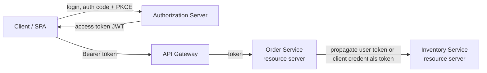

# Spring Security Across Microservices

In a microservice system, authentication happens **once** at an authorization server (identity provider); each service validates the resulting token and enforces its own authorization. Basics of JWT and OAuth2 are in [JWT and OAuth2](jwt-oauth.md); filter chain and method security are in [Security](security.md).

## Architecture



| Role | Responsibility |
| :-- | :-- |
| Authorization server (Keycloak, Okta, Entra ID, Spring Authorization Server) | Authenticates users, issues tokens, publishes keys (JWKS) |
| Gateway | Optional first check (token present, rate limit, coarse routes), may relay token |
| Resource server (each service) | Validates token **itself** and applies authorization rules |
| Client | Obtains and sends the token |

Zero trust rule: do not rely only on the gateway; each service validates the token, because internal calls can bypass the gateway.

## Resource Server (Spring Boot 3 / Security 6)

```yaml
spring:
  security:
    oauth2:
      resourceserver:
        jwt:
          issuer-uri: https://idp.example.com/realms/shop   # discovers JWKS, validates iss
```

```java
@Configuration
@EnableMethodSecurity
class SecurityConfig {

    @Bean
    SecurityFilterChain api(HttpSecurity http) throws Exception {
        http
            .csrf(csrf -> csrf.disable())                                  // stateless bearer API
            .sessionManagement(s -> s.sessionCreationPolicy(SessionCreationPolicy.STATELESS))
            .authorizeHttpRequests(a -> a
                .requestMatchers("/actuator/health/**").permitAll()
                .requestMatchers(HttpMethod.GET, "/orders/**").hasAuthority("SCOPE_orders.read")
                .anyRequest().authenticated())
            .oauth2ResourceServer(o -> o.jwt(j -> j.jwtAuthenticationConverter(converter())));
        return http.build();
    }

    // Map IdP-specific claims to roles
    JwtAuthenticationConverter converter() {
        JwtGrantedAuthoritiesConverter scopes = new JwtGrantedAuthoritiesConverter();   // SCOPE_ prefix
        JwtAuthenticationConverter c = new JwtAuthenticationConverter();
        c.setJwtGrantedAuthoritiesConverter(jwt -> {
            Collection<GrantedAuthority> out = new ArrayList<>(scopes.convert(jwt));
            List<String> roles = jwt.getClaimAsStringList("roles");
            if (roles != null) roles.forEach(r -> out.add(new SimpleGrantedAuthority("ROLE_" + r)));
            return out;
        });
        return c;
    }
}
```

Validation done by the starter: signature (via JWKS, cached), `exp`/`nbf`, `iss`. Add an **audience** validator so a token meant for another service is rejected:

```java
@Bean
JwtDecoder jwtDecoder(OAuth2ResourceServerProperties p) {
    NimbusJwtDecoder d = JwtDecoders.fromIssuerLocation(p.getJwt().getIssuerUri());
    OAuth2TokenValidator<Jwt> aud = new JwtClaimValidator<List<String>>("aud",
            a -> a != null && a.contains("order-service"));
    d.setJwtValidator(new DelegatingOAuth2TokenValidator<>(
            JwtValidators.createDefaultWithIssuer(p.getJwt().getIssuerUri()), aud));
    return d;
}
```

Use `@PreAuthorize("hasAuthority('SCOPE_orders.write')")` or `@AuthenticationPrincipal Jwt jwt` for user id (`jwt.getSubject()`).

## Calling Another Service: Token Propagation vs Own Identity

| Pattern | How | Use when |
| :-- | :-- | :-- |
| **Token relay / propagation** | Forward the caller's access token downstream | Downstream must act as the end user (user-scoped data, audit by user) |
| **Client credentials** | Service gets its own token for itself | Background jobs, system-to-system, no user context |
| **Token exchange (RFC 8693)** | Swap the user token for a new one with narrower audience/scope | Best practice for user-on-behalf-of with least privilege |
| Internal JWT / headers from gateway | Gateway adds `X-User-Id` | Only if the network is trusted and mTLS enforced; easily spoofed otherwise |

Relay the incoming token with `RestClient`/`WebClient`:

```java
@Bean
RestClient inventoryClient(RestClient.Builder b) {
    return b.baseUrl("http://inventory").requestInterceptor((req, body, exec) -> {
        Authentication auth = SecurityContextHolder.getContext().getAuthentication();
        if (auth instanceof JwtAuthenticationToken t) {
            req.getHeaders().setBearerAuth(t.getToken().getTokenValue());   // propagate
        }
        return exec.execute(req, body);
    }).build();
}
```

Own identity (client credentials) with Spring Security's OAuth2 client:

```yaml
spring.security.oauth2.client:
  registration:
    inventory:
      provider: idp
      client-id: order-service
      client-secret: ${ORDER_CLIENT_SECRET}
      authorization-grant-type: client_credentials
      scope: inventory.read
  provider:
    idp.issuer-uri: https://idp.example.com/realms/shop
```

```java
@Bean
WebClient inventoryWebClient(OAuth2AuthorizedClientManager manager) {
    var oauth = new ServletOAuth2AuthorizedClientExchangeFilterFunction(manager);
    oauth.setDefaultClientRegistrationId("inventory");   // fetches and caches the token, renews on expiry
    return WebClient.builder().baseUrl("http://inventory").apply(oauth.oauth2Configuration()).build();
}
```

Spring Cloud Gateway offers `TokenRelay` as a filter (`filters: - TokenRelay=`) with an OAuth2 client login at the gateway.

!!! warning "Async and propagation"
    `SecurityContextHolder` is thread-local. On `@Async`, executors or virtual-thread hand-offs the context is lost unless you use `DelegatingSecurityContextExecutor` / `DelegatingSecurityContextAsyncTaskExecutor`, or pass the token explicitly. In WebFlux use `ReactiveSecurityContextHolder`. See [Spring Threading](spring-threading.md).

## Other Concerns

- **Opaque tokens**: use `opaquetoken.introspection-uri` when you need instant revocation; costs a call per request (cache it). JWTs are self-contained but valid until `exp`, so keep access tokens short (5 to 15 min).
- **Service-to-service transport**: mTLS (service mesh) authenticates workloads; JWT carries user and scope. They complement each other.
- **Coarse vs fine authorization**: scopes in the token for coarse access, data-level checks (`order.ownerId == jwt.sub`) in the service.
- **Secrets**: client secrets from a vault; never in the repo. Rotate signing keys through JWKS.
- **CORS and CSRF**: browsers calling cookie-less bearer APIs need CORS config, not CSRF protection; if the gateway uses sessions (BFF pattern), keep CSRF on there.
- **Logging**: log `sub` and a request/trace id, never the token. Propagate trace ids with the token.

## Common Interview Questions

- **Where is the token validated?** In every resource server, using the issuer's public keys (JWKS), not just at the gateway.
- **Token relay vs client credentials?** Relay keeps user identity; client credentials gives the service its own least-privilege identity.
- **Why audience validation?** Stops a token issued for service A being replayed against service B.
- **How do you revoke a JWT?** Short expiry plus refresh tokens, a deny list, or opaque tokens with introspection.
- **Why does the security context vanish in `@Async`?** It is thread-local; use the delegating executors.
- **What is the BFF pattern?** A backend-for-frontend holds tokens server side and gives the browser only a session cookie, avoiding tokens in JavaScript.

Reference: [Spring Security OAuth2 Resource Server](https://docs.spring.io/spring-security/reference/servlet/oauth2/resource-server/index.html), [Spring Security OAuth2 Client](https://docs.spring.io/spring-security/reference/servlet/oauth2/client/index.html), [Spring Cloud Gateway TokenRelay](https://docs.spring.io/spring-cloud-gateway/reference/spring-cloud-gateway/gatewayfilter-factories/tokenrelay-factory.html).
